### MSci Dissertation


## **Determining Chess Game State From an Image Using Machine Learning**

_Author:_ Georg Wölflein

_Supervisor:_ Dr Ognjen Arandjelović

January 2021

## **Abstract**

Identifying the configuration of chess pieces from an image of a chessboard is a problem in computer vision that has not yet been solved accurately. However, it is important for helping amateur chess players improve their games by facilitating automatic computer analysis without the overhead of manually entering the pieces. Current approaches are limited by the lack of large datasets and are not designed to adapt to unseen chess sets. This project puts forth a new dataset synthesised from a 3D model that is two orders of magnitude larger than existing ones. Trained on this dataset, a novel end-to-end chess recognition system is presented that combines traditional computer vision techniques with deep learning. It localises the chessboard using a RANSAC-based algorithm that computes a projective transformation of the board onto a regular grid. Using two convolutional neural networks, it then predicts an occupancy mask for the squares in the warped image and finally classifies the pieces. The described system achieves an error rate of 0.23% per square on the test set, 28 times better than the current state of the art. Further, a one-shot transfer learning approach is developed that is able to adapt the inference system to a previously unseen chess set using just two photos of the starting position, obtaining a per-square accuracy of 99.83% on images of that new chess set. Inference takes less than half a second on a GPU and about two seconds on a CPU. The feasibility of the system is demonstrated in an interactive web app available at `https://www.chesscog.com` .

## **Declaration**

I declare that the material submitted for assessment is my own work except where credit is explicitly given to others by citation or acknowledgement. This work was performed during the current academic year except where otherwise stated.

The main text of this project report is 20694 words long.

In submitting this project report to the University of St Andrews, I give permission for it to be made available for use in accordance with the regulations of the University Library. I also give permission for the title and abstract to be published and for copies of the report to be made and supplied at cost to any bona fide library or research worker, and to be made available on the World Wide Web. I retain the copyright in this work.

_Georg Wölflein_

## **Acknowledgements**

First and foremost, I would like to express my sincere gratitude to Dr Ognjen Arandjelović who accepted the responsibility to supervise this project and offered valuable suggestions and advice guiding it to a successful completion. This project would not have been possible without his constant support and willingness to devote time in analysing problems, discussing solutions, and providing feedback.

I would also like to acknowledge Dr Stuart Norcross for his swift and competent support in setting up a remote GPU lab client for this project. Further, I am very grateful to the University of St Andrews and in particular the School of Computer Science for an exceptional education and a truly memorable time. Finally, I wish to thank my parents for providing me with the opportunities and encouragement to pursue higher education.

## **Contents**

|**1**|**Intr**|**oduction**<br>**1**|
|---|---|---|
||1.1|Context survey . . . . . . . . . . . . . . . . . . . . . . . . . . . .<br>2|
||1.2|Objectives . . . . . . . . . . . . . . . . . . . . . . . . . . . . . . .<br>6|
||1.3|Software engineering process . . . . . . . . . . . . . . . . . . . . .<br>7|
||1.4|Ethics . . . . . . . . . . . . . . . . . . . . . . . . . . . . . . . . .<br>7|
|**2**|**Bac**|**kground**<br>**8**|
||2.1|Supervised learning . . . . . . . . . . . . . . . . . . . . . . . . . .<br>8|
||2.2|Artificial neural networks<br>. . . . . . . . . . . . . . . . . . . . . .<br>10|
||2.3|Convolutional neural networks<br>. . . . . . . . . . . . . . . . . . .<br>17|
||2.4|Transfer learning . . . . . . . . . . . . . . . . . . . . . . . . . . .<br>22|
|**3**|**Gen**|**erating synthetic training data**<br>**25**|
||3.1|Chess positions . . . . . . . . . . . . . . . . . . . . . . . . . . . .<br>25|
||3.2|Three-dimensional renders . . . . . . . . . . . . . . . . . . . . . .<br>26|
||3.3|Automated labelling . . . . . . . . . . . . . . . . . . . . . . . . .<br>28|
||3.4|Splitting the dataset . . . . . . . . . . . . . . . . . . . . . . . . .<br>30|
|**4**|**Rec**|**ognising chess positions**<br>**33**|
||4.1|Board localisation<br>. . . . . . . . . . . . . . . . . . . . . . . . . .<br>34|
||4.2|Occupancy classification . . . . . . . . . . . . . . . . . . . . . . .<br>47|
||4.3|Piece classification . . . . . . . . . . . . . . . . . . . . . . . . . .<br>53|
||4.4|Producing a prediction . . . . . . . . . . . . . . . . . . . . . . . .<br>56|
|**5**|**Ada**|**pting to unseen chess sets**<br>**58**|
||5.1|Dataset<br>. . . . . . . . . . . . . . . . . . . . . . . . . . . . . . . .<br>59|
||5.2|Training . . . . . . . . . . . . . . . . . . . . . . . . . . . . . . . .<br>60|
|**6**|**Imp**|**lementation**<br>**65**|
||6.1|Configuration management (`recap`) . . . . . . . . . . . . . . . . .<br>68|
||6.2|Chess recognition system (`chesscog`) . . . . . . . . . . . . . . . .<br>68|
||6.3|Web app (`chesscog-app`) . . . . . . . . . . . . . . . . . . . . . .<br>69|
|**7**|**Eva**|**luation**<br>**72**|
||7.1|Achievement of objectives . . . . . . . . . . . . . . . . . . . . . .<br>75|
||7.2|Critical appraisal . . . . . . . . . . . . . . . . . . . . . . . . . . .<br>76|
|**8**|**Con**|**clusion**<br>**80**|
||8.1|Future work . . . . . . . . . . . . . . . . . . . . . . . . . . . . . .<br>81|

|**Ac**|**rony**|**ms**|**83**|
|---|---|---|---|
|**Bi**|**bliog**|**raphy**|**84**|
|**A **|**Test**|**ing summary**|**90**|
||A.1|Automated tests<br>. . . . . . . . . . . . . . . . .|. . . . . . . . . .<br>90|
|**B **|**Use**|**r manual:** `recap` **library**|**94**|
||B.1|Installing<br>. . . . . . . . . . . . . . . . . . . . .|. . . . . . . . . .<br>94|
||B.2|Usage<br>. . . . . . . . . . . . . . . . . . . . . . .|. . . . . . . . . .<br>95|
||B.3|Automated tests<br>. . . . . . . . . . . . . . . . .|. . . . . . . . . .<br>97|
||B.4|Documentation . . . . . . . . . . . . . . . . . .|. . . . . . . . . .<br>97|
|**C **|**Use**|**r manual:** `chesscog` **package**|**98**|
||C.1|Installing<br>. . . . . . . . . . . . . . . . . . . . .|. . . . . . . . . .<br>98|
||C.2|Usage<br>. . . . . . . . . . . . . . . . . . . . . . .|. . . . . . . . . .<br>99|
||C.3|Automated tests<br>. . . . . . . . . . . . . . . . .|. . . . . . . . . . 105|
||C.4|Documentation . . . . . . . . . . . . . . . . . .|. . . . . . . . . . 105|
|**D **|**Use**|**r manual: web app**|**106**|
||D.1|Installing<br>. . . . . . . . . . . . . . . . . . . . .|. . . . . . . . . . 106|
||D.2|Usage<br>. . . . . . . . . . . . . . . . . . . . . . .|. . . . . . . . . . 106|
||D.3|Automated tests<br>. . . . . . . . . . . . . . . . .|. . . . . . . . . . 108|
||D.4|Documentation . . . . . . . . . . . . . . . . . .|. . . . . . . . . . 108|
|**E **|**Ethi**|**cs self-assessment form**|**110**|

## **List of figures**

|2.1|An artificial neural network with six neurons that could be used<br>to decide a classification problem. . . . . . . . . . . . . . . . . . .|10|
|---|---|---|
|2.2|i<br>Plots of the two most common activation functions.<br>. . . . . . .|11|
|2.3|A SLP with two inputs and three outputs. . . . . . . . . . . . . .|12|
|2.4|A MLP with three inputs, two hidden layers, and two outputs.<br>.|14|
|2.5|Illustration of gradient descent training on an error-weight surface.|15|
|2.6|Illustration of a convolution operation with a 2_×_2 kernel. . . . .|19|
|2.7|Illustration of a convolution operation acting on two input channels.|20|
|2.8|Illustration of maximum pooling for _k_ =_s_= 2. . . . . . . . . . .|22|
|2.9|Illustration of the transfer learning process for domain adaption<br>in deep neural networks. . . . . . . . . . . . . . . . . . . . . . . .|24|
|3.1|The chessboard coordinate system. . . . . . . . . . . . . . . . . .|26|
|3.2|Side view of the camera setup for the scenario where it is white<br>to move.<br>. . . . . . . . . . . . . . . . . . . . . . . . . . . . . . .|27|
|3.3|Two samples from the synthesised dataset showing both types of<br>lighting. . . . . . . . . . . . . . . . . . . . . . . . . . . . . . . . .|28|
|3.4|Overhead view of the chessboard with two spotlights. . . . . . . .|29|
|3.5|Visualisation of the automatically generated labels. . . . . . . . .|31|
|3.6|Visual representation of the dataset split.<br>. . . . . . . . . . . . .|32|
|4.1|Overview of the chess recognition pipeline. . . . . . . . . . . . . .|33|
|4.2|The process of determining the intersection points on the chess-<br>board. . . . . . . . . . . . . . . . . . . . . . . . . . . . . . . . . .|35|
|4.3|A line in Hesse normal form.<br>. . . . . . . . . . . . . . . . . . . .|35|
|4.4|An example of how lines in image space are represented in (_ρ, θ_)<br>space.<br>. . . . . . . . . . . . . . . . . . . . . . . . . . . . . . . . .|36|
|4.5|Projection of four intersection points from the original to the<br>warped image.<br>. . . . . . . . . . . . . . . . . . . . . . . . . . . .|38|
|4.6|A sample from the training set with an incorrectly identified line.|39|
|4.7|i<br>The original image is warped using the computed homography<br>matrix **_H_**. . . . . . . . . . . . . . . . . . . . . . . . . . . . . . . .|42|
|4.8|Horizontal gradient intensities calculated on the warped image in<br>order to detect vertical lines.<br>. . . . . . . . . . . . . . . . . . . .|45|
|4.9|The identified corner points are projected back from the warped<br>image onto the original image using the inverse homography matrix.|46|
|4.10|An example illustrating why an immediate piece classification<br>approach is prone to reporting false positives. . . . . . . . . . . .|47|

|4.11|The process of obtaining samples for occupancy classification<br>from a chessboard image.<br>. . . . . . . . . . . . . . . . . . . . . .|48|
|---|---|---|
|4.12|Architecture of the CNN (100_,_3_,_3_,_3) network for occupancy clas-<br>sification.<br>. . . . . . . . . . . . . . . . . . . . . . . . . . . . . . .|49|
|4.13|Loss and accuracy during training on both the training and val-<br>idation sets for the CNN (100_,_3_,_3_,_3) model. . . . . . . . . . . . .|50|
|4.14|Loss and accuracy during training on both the training and val-<br>idation sets for the ResNet model.<br>. . . . . . . . . . . . . . . . .|51|
|4.15|The four samples that the ResNet model misclassified in the val-<br>idation set.<br>. . . . . . . . . . . . . . . . . . . . . . . . . . . . . .|51|
|4.16|The normals of the chessboard surface converge to a single van-<br>ishing point which is below the image. . . . . . . . . . . . . . . .|54|
|4.17|A random selection of six samples of white queens in the training<br>set. . . . . . . . . . . . . . . . . . . . . . . . . . . . . . . . . . . .|55|
|4.18|Loss and accuracy during training on both the training and val-<br>idation sets for the InceptionV3 model. . . . . . . . . . . . . . . .|56|
|5.1|The starting position on the board. . . . . . . . . . . . . . . . . .|59|
|5.2|The training dataset used for the transfer learning approach, con-<br>sisting of only two samples. . . . . . . . . . . . . . . . . . . . . .|59|
|5.3|Illustration of the shear transform with _λ_= <sup>1</sup>_/_2. . . . . . . . . . .|61|
|5.4|The augmentation pipeline applied to an input image. . . . . . .|62|
|5.5|Loss and accuracy in fine-tuning the occupancy and piece classi-<br>fiers on the new dataset. . . . . . . . . . . . . . . . . . . . . . . .|63|
|6.1|Overview of CI/CD pipelines. . . . . . . . . . . . . . . . . . . . .|67|
|6.2|Schematic overview of the infrastructure pertaining to the web<br>app. . . . . . . . . . . . . . . . . . . . . . . . . . . . . . . . . . .|70|
|7.1|Frequency of the number of mistakes per board on the training<br>and test sets. . . . . . . . . . . . . . . . . . . . . . . . . . . . . .|73|
|7.2|Inference time benchmarks of the chess recognition pipeline on<br>the test set. . . . . . . . . . . . . . . . . . . . . . . . . . . . . . .|75|
|A.1|Screenshot of the chess position inference using the web app.<br>. .|91|
|C.1|Screenshot of the corner detection output. . . . . . . . . . . . . .|102|
|D.1|Screenshots of the web app. . . . . . . . . . . . . . . . . . . . . .|107|
|D.2|Screenshot of the frequently asked questions page.<br>. . . . . . . .|109|

## **List of tables**

|4.1|Performance of all occupancy classification models on the valid-<br>ation set.<br>. . . . . . . . . . . . . . . . . . . . . . . . . . . . . . .|52|
|---|---|---|
|4.2|Performance of all piece classifiers on the validation set. . . . . .|55|
|4.3|Performance of the chess recognition pipeline on the training and<br>validation sets. . . . . . . . . . . . . . . . . . . . . . . . . . . . .|57|
|5.1|Performance of the chess recognition pipeline from Chapter 4 on<br>the transfer learning dataset without fine-tuning. . . . . . . . . .|60|
|5.2|Performance of the fine-tuned chess recognition pipeline on the<br>transfer learning dataset.<br>. . . . . . . . . . . . . . . . . . . . . .|64|
|7.1|Performance of the chess recognition system on the test dataset.|72|
|7.2|Confusion matrix of the per-square predictions on the test set.<br>.|74|

## **List of listings**

|1|Automated tests for the `recap` package. . . . . . . . . . . . . . .|91|
|---|---|---|
|2|Automated tests for the `chesscog` package. . . . . . . . . . . . .|92|
|3|Automated tests for the web app. . . . . . . . . . . . . . . . . . .|93|
|4|Structure of the JSON annotations generated for the running||
||example image from Chapter 3. . . . . . . . . . . . . . . . . . . .|100|
|5|Output of the chess recognition script. . . . . . . . . . . . . . . .|103|
|6|JSON labels of the two training images for the transfer learning||
||task. . . . . . . . . . . . . . . . . . . . . . . . . . . . . . . . . . .|104|

## **Notation**

This report follows typical notation conventions established in the deep learning community, particularly those in line with Goodfellow _et al._ [1].

|_a_|a scalar (integer or real)|
|---|---|
|**_a_**|a vector|
|**_A_**|a matrix|
|_A_|a set<br>|
|a|a scalar random variable<br>|
|**a**<br>|a vector random variable|
|**_A_**<sup>_⊤_</sup>|transpose of matrix **_A_**|
|**_I_**_n_|_n × n_ identity matrix|
|**_I_**|identity matrix (dimensionality implied by context)|
|**_A_**_⊙_**_B_**|pointwise (Hadamard) product<br>|
|**_A_**_∗_**_B_**<br>|convolution<sup>1</sup>|
|_N_(_µ, σ_<sup>2</sup>)|normal distribution|
|a_∼P_|random variable a follows distribution _P_|
|_f_(_·_)|scalar-valued function|
|**_f_**(_·_)|vector-valued function|
|_f ◦g_|composition of the functions _f_ and _g_|
|_⌊·⌋_|floor function|
|_|·|_|absolute value|
|_|A|_|cardinality of set _A_|
|_∥·∥_1|_ℓ_1 norm (Manhatten distance)|
|_∥·∥_2|_ℓ_2 norm (Euclidean distance)|
|R|the set of real numbers|
|Z<br>|the set of integers|
|_∂y_<br>_∂x_<br>_∂_|derivative of _y_ with respect to _x_|
|_f_<br>_∂_**_x_**<br>|Jacobian vector **_J_** _∈_R<sup>_n_ </sup>of _f_ :R<sup>_n _</sup>_→_R|
|_b_<sup>(</sup><sup>_l_)</sup><br>_j_<br>|the _j_<sup>th </sup>unit’s bias in layer _l_|
|_w_<sup>(</sup><sup>_l_)</sup><br>_i,j_<br>|the weight of the connection from unit _i_ in layer _l −_1 to unit _j_ in layer _l_|
|**_W_** <sup>(</sup><sup>_l_)</sup><br>|the weight matrix of layer _l_|
|**_b_**<sup>(</sup><sup>_l_)</sup>|the bias vector of layer _l_|

> 1Strictly speaking, _∗_ is used to denote cross-correlation, as explained in Section 2.3.1.

_Improving your weaknesses has the potential for the greatest gains._ Garry Kasparov

# **1 Introduction**

The epigraph above – remarked by former World Chess Champion Garry Kasparov in his most recent book [2] – is a profound observation that applies even outside of chess. With regard to chess in particular, Kasparov implies that one must identify one’s mistakes and weaknesses in order to improve as a player, and to do so, it is necessary to analyse one’s past games.

Amateur chess players can analyse games they played online without much effort because the moves are recorded automatically. However, to analyse overthe-board games<sup>2</sup> , players must tediously enter the position in the computer piece by piece. A casual over-the-board game between two friends will often reach an interesting position<sup>3</sup> . The players may want to analyse that position on a computer after the game, so they acquire a digital photograph of it before proceeding with the game. Afterwards, on the computer, they need to drag and drop pieces onto a virtual chessboard until the position matches the one they had on the photograph, and then they must double-check that they did not miss any pieces. The main goal of this project is to develop a system that is able to map a photo of a chess position to a structured format that can be understood by chess engines, such as the widely-used Forsyth–Edwards Notation (FEN) [3], in order to automate this laborious task.

> 2Usually, players invest more effort in over-the-board games, both in terms of time and deep thinking. These games also involve a greater psychological aspect as a result of being able to observe the opponent’s expressions. As such, analysing these games should be even more interesting and fruitful.

> 3For example, one of the players might have a few moves that look promising, but is also considering a line with a piece sacrifice. If he decides to play it safe, he will likely want to analyse the piece sacrifice on the computer after the game.

#### **1.1 Context survey**

This context survey examines not only past approaches to chess recognition, but also current implementation tools that are useful for designing such a system.

##### **1.1.1 Chess recognition**

Determining the game state of a chess board – described by the term _chess recognition_ in many papers – is a problem in computer vision whereby an algorithm is tasked with recovering the configuration of pieces from an image of a chessboard. Early work on chess recognition in the 1990s focused on extracting typeset games from printed material [4]. In recent years, the problem of parsing two-dimensional chess images has effectively been solved using conventional machine learning techniques [5] and deep learning [6], [7]. However, recognising chess positions from physical chessboards as opposed to artificial two-dimensional images poses a much more interesting and challenging problem that finds practical application in chess-playing robots, augmented reality, and aiding amateur chess players<sup>4</sup> .

**Chess robots** Initial research into chess recognition emerged from the development of chess robots that included a camera to detect the human opponent’s moves from a top-down overhead perspective. The difficulty of distinguishing between chess pieces from a bird’s-eye-view due to their similarity is noted in many papers; as a result, chess robots typically implement a three-way classification system that for every square attempts to determine whether it contains a piece, and, if so, that piece’s colour. Various approaches have been explored including employing manual thresholding [9]–[12] and clustering [13] in different colour spaces, as well as differential imaging (classifying based on the per-pixel difference between two images) [14], [15]. Although the _Gambit_ robot proposed by Matuszek _et al._ [16] does not require a bird’s-eye view over the chessboard and uses a depth camera to more reliably detect the occupancy of each square, it employs the three-way classification strategy using a linear support vector machine (SVM) to determine the piece colour.

**Chess move recording** Several techniques for recording chess moves from video footage have been proposed that follow a similar three-way occupancy and colour classification scheme, both from a top-down perspective [8], [17] as well as from a camera positioned at an acute angle to the board [18]. However, in any such three-way classification approach, the robot or move recorder requires knowledge of the previous board state in addition to its predictions for each square’s occupancy and piece colour to deduce the last move. While this information is readily available to a chess robot or move recording software, it is not for a chess recognition system that should deduce the position from a single still image. Furthermore, these approaches experience severe shortcomings in terms of their inability to recover once a single move was predicted incorrectly and failure to identify promoted pieces<sup>5</sup> [9].

> 4Electronic chess sets are impractical and very costly [8], thus solutions for chess recognition using just a photo of an unmodified chess board are more compelling for amateur chess players.

> 5Piece promotion occurs when a pawn reaches the last rank, in which case the player must choose to promote to a queen, rook, bishop or knight. Evidently, a vision system that can

**Single-image chess recognition** A number of techniques have been developed to address the issue of chess recognition from a single image. Unlike move recording software or chess robots, the squares’ occupancy and colour alone provide insufficient information to determine the position. These techniques must instead implement a classification algorithm for each piece type (pawn, knight, bishop, rook, queen, and king) of each colour which poses a significantly more difficult problem, attracting research mainly in the last five years. From a bird’s-eye view, the pieces are nearly indistinguishable, hence the photo is usually taken at an acute angle to the board. Ding [19] proposes a piece classifier that uses one-versus-rest SVMs trained on scale-invariant feature transform (SIFT) and histogram of oriented gradients (HOG) feature descriptors, achieving an accuracy of 85%. Conversely, Danner and Kafafy [20] as well as Xie _et al._ [21] claim that SIFT and HOG provide inadequate features for the problem of piece classification due to the similarity in texture between chess pieces, and instead focus on the pieces’ outlines. As such, Danner and Kafafy [20] use Fourier descriptors calculated based on the pieces’ contours, but this requires a manually-created database of piece silhouettes. Furthermore, they modify the board colours to red and green instead of black and white, in order distinguish the pieces from the board more easily<sup>6</sup> . On the other hand, Xie _et al._ [21] perform contour-based template matching with an interesting caveat: the camera angle is calculated based on the perspective transformation of the chessboard, and then depending on the angle, different templates are utilised for matching the chess pieces. As part of the same work, Xie _et al._ develop another approach that instead utilises convolutional neural networks (CNNs), but find that their original template-matching technique achieves superior results in terms of speed and accuracy in the specific setting of low-resolution images. However, the reader should note that their CNNs are trained on only 40 images per class, but deep learning methods tend to excel when trained on larger datasets [22].

**Board localisation** A prerequisite to any chess recognition system is the ability to detect the location of the chessboard and each of the 64 squares. Once the four corner points have been established, finding the squares is trivial for pictures captured in bird’s-eye view, and only a matter of a simple perspective transformation in the case of other camera positions. While finding the corner points of a chessboard is frequently used for automatic camera calibration due to the regular nature of the chessboard pattern [23], [24], techniques designed for this purpose tend to perform poorly when there are pieces on the chessboard that occlude lines or corners. Some of the aforementioned chess robots [13], [14], [17] as well as the single-image recognition system proposed by Danner and Kafafy [20] circumvent this problem entirely by prompting the user to interactively select the four corner points, but ideally a chess recognition system should be able to parse the position on the board without human intervention. Most approaches for automatic chess grid detection utilise either the Harris corner detector [11], [18] or a form of line detector based on the Hough transform [12], [15], [20], [25]–[28], although other techniques such as template matching [16] and flood

only detect the piece’s colour is unable to detect what it was promoted to.

6Similar board modifications have also been proposed as part of chess robots [11] and chess move trackers [8], but any such modification imposes an unreasonable constraint on normal chess games.

fill [8] have been explored. In general, corner-based algorithms are unable to accurately detect grid corners when they are occluded by pieces, thus line-based detection algorithms appear to be the favoured solution. Such algorithms often take advantage of the geometric nature of the chessboard which allows to compute a perspective transformation of the grid lines that best matches the detected lines [18], [21], [25]. However, lines found in the background of the photo can often cause failure modes. A recent chess grid detection algorithm that is highly successful even on populated boards is described by Xie _et al._ in [28]. They apply several clustering algorithms on the lines detected via a Hough transform in order to find the horizontal and vertical grid lines belonging to the chessboard, and use this algorithm as a preprocessing step in their template-matching piece classification technique [21] described above.

**Chess recognition using CNNs** Ever since Xie _et al._ pioneered the use of CNNs in the domain of chess recognition from monocular images in 2018<sup>7</sup> , a few more techniques have been developed that employ CNNs at various stages in the recognition pipeline. Czyzewski _et al._ [30] achieve an accuracy of 95% on chessboard detection from non-vertical camera angles by designing an iterative algorithm that generates heatmaps over the input image representing the likelihood of each pixel being part of the chessboard. They then employ a CNN to refine the corner points that were found using the heatmap, outperforming the results obtained by Gon¸calves _et al._ [13]. Furthermore, they compare a CNN-based piece classification algorithm to the SVM-based solution proposed by Ding [19] and find no notable amelioration, but manage to obtain major improvements by implementing a probabilistic reasoning system that uses the open source Stockfish chess engine [31] as well as chess statistics [32]. Although reasoning techniques were already employed for refining the predictions of chess recognition systems before [20], [26], Czyzewski _et al._ demonstrate the potential of combining information obtained from a chess engine with large-scale chess statistics. Very recently, Mehta and Mehta [33] implemented an augmented reality app using the popular _AlexNet_ CNN architecture introduced by Krizhevsky _et al._ [34], achieving promising results. Despite using an overhead camera perspective and not performing any techniques to ensure probable and legal chess positions, Mehta and Mehta achieve a per-square accuracy of 93.45% for the entire chessboard detection and piece classification pipeline, which – to the best of my knowledge – constitutes the current state of the art.

**Datasets** The lack of adequate datasets for chess recognition has been recognised by many [19], [30], [33]. Although Czyzewski _et al._ [30] published a dataset of chessboard lattice points that are difficult to predict [35], large datasets – especially at the scale required for deep learning – are not available as of now. Using synthesised data in the training set is an efficient means of creating sizable datasets while minimising the manual annotation efforts [29], [30], [36]. Czyzewski _et al._ distort some input images in order to simulate different camera perspectives on the chessboard corners. However, a more promising method

> 7Wei _et al._ [29] developed a chess recognition system using a volumetric CNN one year previously, but this approach requires three-dimensional chessboard data obtained from a depth camera. Their approach achieved a per-class accuracy over 90% except for the “king” class, was trained on CAD models, and evaluated on real three-dimensional images (point clouds) of a chessboard.

seems to be the use of three-dimensional models. Wei _et al._ [29] synthesise point cloud data for their volumetric CNN directly from three-dimensional chess models and Hou [36] use renderings of three-dimensional models as input. Yet Wei _et al._ [29]’s approach works only if the chessboard was captured with a depth camera and Hou [36] presents a chessboard recognition system using a simple artificial neural network (ANN) that is not convolutional and hence achieves an accuracy of only 72%.

##### **1.1.2 Implementation tools**

In both acedemia and industry, Python is the de facto standard programming language for machine learning. A 2019 analysis conducted on the world-leading software development platform GitHub found that Python is the most popular language for open source machine learning repositories [37]. Python is a simple yet versatile language that natively supports different programming paradigms (imperative, functional, object-oriented, and more). It is often called an interpreted language<sup>8</sup> because it is dynamically typed and performs automatic memory management (garbage collection) which generally facilitates shorter code than compiled languages such as C or Java, but also means that purePython implementations of data-intensive algorithms are usually not as efficient. One of the most fundamental packages, NumPy, implements very efficient array manipulation operations that, although specified in Python, are carried out at a lower level for performance.

NumPy is just one piece of Python’s rich ecosystem of packages that are maintained by open-source contributers in the scientific and engineering community. The two main frameworks for machine learning are TensorFlow by Google and PyTorch by Facebook. At their core, both frameworks facilitate the computation of mathematical operations on tensors<sup>9</sup> , offering support for hardware acceleration via graphics processing units (GPUs) and providing parallelisation strategies for distributed computing which is especially potent in the context of machine learning where many operations fit the single instruction, multiple data (SIMD) pattern. A TensorFlow program is specified as a directed _computational graph_ where nodes represent operations and edges represent their inputs and outputs (data tensors) [38]. In the new TensorFlow 2, this graph does not need to be explicitly constructed in the code anymore but is created on the fly which is known as _eager execution_ , thereby providing the user with a simpler interface similar to NumPy. The slightly younger PyTorch framework [39] provided dynamic computation graphs and a NumPy-like interface from the outset at its initial release in 2016, and more recently added support for static computational graphs. Hence the newest versions of both frameworks provide similar programming interfaces and computational capabilities. They also facilitate the automatic computation of gradients which is useful for training neural networks. In the research community, PyTorch recently overtook TensorFlow in terms of popularity; at every top machine learning conference since 2019, the majority of submissions with code were implemented in PyTorch [40].

> 8There is nuance associated with this statement, but Python certainly exhibits more traits of an interpreted than a compiled language.

> 9Tensors are essentially a generalisation of scalars, vectors, and matrices. They can be thought of as representing a multi-dimensional array.

#### **1.2 Objectives**

As mentioned in the introduction, the main aim of this project is developing an end-to-end chess recognition system that takes as input an image of a chessboard with pieces on it and outputs the game state (the chess position). To this end, the description, objectives, ethics, resources (DOER) document lists five primary objectives that should define the success of this project:

- A1. Perform a literature review of available methods for parsing chess positions from photos.

- A2. Develop an algorithm for detecting the corners of the chessboard as well as the squares.

- A3. Develop an algorithm for recognising the chess pieces.

- A4. Develop an algorithm that uses the outputs from A2 and A3 in order to compute a probability distribution over each piece in each square.

- A5. Evaluate the performance of the developed algorithms.

Next, there are three secondary objectives that provide meaningful extensions to the project:

- B1. Create a large labelled dataset of synthesised chessboard images using 3D models.

- B2. Implement an algorithm that takes as input the raw probability distribution of each piece in each square and outputs a likely FEN description.

- B3. Implement a simple web API that performs the inference pipeline for an input image, returning the FEN description.

Finally, the DOER lists one tertiary objective. During the course of this project, an additional tertiary objective (C2) was introduced as it became clear that employing a transfer learning approach to adapt to new chess sets would make the system significantly more useful:

- C1. Develop a web app that allows the user to upload an image of the chess board to obtain the FEN description.

- C2. Employ transfer learning to demonstrate how the system can adapt to new chess sets.

This project fully achieves all of the objectives listed above, as is evaluated in detail in Section 7.1. An interactive proof-of-concept demonstration of the developed system is available online at `https://www.chesscog.com` . However, this web app should just be regarded as a byproduct, since the main focus of this project lies in the development of the chess recognition algorithm itself.

Chapter 3 explains the process used to synthesise a large dataset of chess images using a 3D model of a chess set. The design of the chess inference system is explained in Chapter 4, and Chapter 5 extends this approach to facilitate adapting to new (previously unseen) chess sets. Chapter 6 discusses the implementation at a high level which is evaluated in Chapter 7 not only with regard to the aforementioned objectives, but also by comparing it to the existing approaches identified in the context survey. Finally, Chapter 8 concludes the report and provides suggestions for future work.

#### **1.3 Software engineering process**

The development of this project is characterised by a very agile approach due to its primarily research-oriented nature. Regular supervisor meetings were held where progress was discussed, and tasks were set for the next week. This ensured that changes could be made quickly depending on the outcomes of different approaches that were tested throughout the project.

Even though this project was primarily research-based, good software engineering practices were still followed. The code developed throughout this project was managed using Git repositories. The general approach to developing a new algorithm was to first implement it in an interactive Python notebook to allow rapid prototyping, and once development arrived at a working version, it was refactored into one or more Python files. Keeping the code as Python files instead of interactive notebooks avoids code duplication because many components of the chess recognition system are used both at training and inference time. Furthermore, this approach was necessary so that the algorithms could be tested using unit tests. The unit tests for a particular repository are run on every commit to that repository via a continuous integration (CI) pipeline. Moreover, since the web demo was developed in parallel to the core chess recognition algorithm, continuous delivery (CD) pipelines were set up for automatically deploying the web app, as well as integrating changes from the core recognition algorithm upon release. Specific details follow in Chapter 6.

An overarching theme that governed the development of the chess recognition system is that of reproducibility. Experimental results were persisted in data files<sup>10</sup> which can be reproduced using the scripts described in Appendix C to independently verify the benchmarks and results claimed throught this report.

#### **1.4 Ethics**

There are no ethical issues raised by this project, as indicated in the signed ethics form in Appendix E.

> 10The data files are available in the `chesscog/results` folder.

_To become good at anything, you have to know how to apply basic principles. To become great at it, you have to know when to violate those principles._

Garry Kasparov

# **2 Background**

This chapter will introduce some of the basic concepts involved in ANNs, CNNs, and transfer learning as they relate to this project. Readers familiar with this subject matter may skip this chapter and resume at Chapter 3.

#### **2.1 Supervised learning**

At its core, the purpose of an ANN is to infer a function that maps some input to some output, based on sample input-output pairs. In machine learning, this is known as a _supervised learning_ task, and there are a great number of machine learning models (not only ANNs) that have been developed for this task. I shall briefly examine the two main disciplines within supervised learning: _regression_ and _classification_ .

##### **2.1.1 Regression**

A regression model captures the relationship between multiple input variables and one output variable. As such, it can be defined by a mathematical function of the form _f_ : R<sup>_n_</sup> _→_ R given by

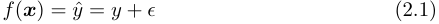

that models the relationship between an _n_ -dimensional feature vector **_x_** _∈_ R<sup>_n_</sup> of independent ( _input_ ) variables and the dependent ( _output_ ) variable _y ∈_ R. Given a particular **_x_** , the model produces a _prediction_ for _y_ which shall be denoted _y_ ˆ. Here, the additive error term _ϵ_ represents the discrepancy between _y_ and _y_ ˆ, i.e. the difference between the predicted and observed output.

A labelled dataset for a regression task consists of _m_ tuples of the form _⟨_ **_x_** _i, yi⟩_ for _i_ = 1 _, . . . , m_ . For each feature vector **_x_** _i_ (a row vector), the corres-

ponding _yi_ represents the observed output, or _label_ [41]. The vector

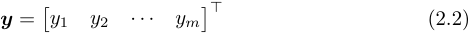

is used to denote all the labelled outputs in the dataset, and the _m × n_ matrix

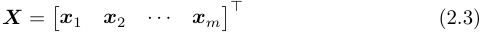

represents the corresponding feature vectors.

##### **2.1.2 Classification**

Classification is a task that finds greater applicability within this project. As the name implies, a classification model tries to determine to which category each input sample belongs from a predefined set of classes _C_ . To ease notation, let _C_ = _{_ 1 _,_ 2 _, . . . , C}_ where _C_ is the total number of classes. In practical terms, the elements in _C_ could represent any type of object, and in that case, all that is required is a one-to-one mapping (bijection) from those objects to _C_ . Furthermore, in the context of this report, each input sample can only belong to one class, and the output of the model is interpreted to represent the probabilities of the input sample belonging to each of the classes _C_ . Therefore, a classification model is represented by a vector-valued function **_f_** : R<sup>_n_</sup> _→_ [0 _,_ 1]<sup>_|C|_</sup> instead of a scalar function as in Equation (2.1), namely

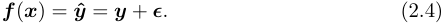

Here, **_f_** actually represents a probability mass function (PMF) where the _i_<sup>th</sup> component _y_ ˆ _i_ of the output vector **_y_ ˆ** represents the probability that the input sample **_x_** belongs to the class _i ∈C_ . It follows that

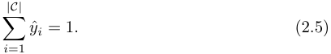

The observed output **_y_** is a row vector that uses a one-hot encoding (OHE) to represent the sample’s class. This means that for a given class _c ∈C_ , the components of **_y_** are given by

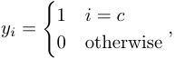

which retains the property described in Equation (2.5). Since **_f_** represents a PMF, the one-hot encoded vector essentially states that the probability of class _c_ is 100% and all other classes have a probability of 0%. Notice that the outputs are now the vectors **_y_** _i_ instead of the scalars _yi_ in the regression task. Hence a labelled classification dataset consists of _m_ tuples of the form _⟨_ **_x_** _i,_ **_y_** _i⟩_ , meaning that instead of the vector **_y_** from Section 2.1.2, it is necessary to use a matrix

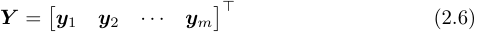

to denote the targets. Each row in **_Y_** represents the one-hot encoded class label for that sample. The input matrix **_X_** remains as defined in Equation (2.3).

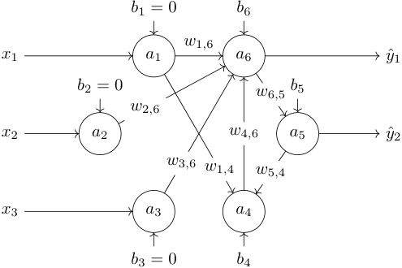

Figure 2.1: An artificial neural network with six neurons that could be used to decide a classification problem. The inputs _x_ 1 _, x_ 2 _, x_ 3 are set as the activations of the first three units (thus _b_ 1 _, b_ 2 _, b_ 3 have no effect) and the outputs _y_ ˆ1 _,_ ˆ _y_ 2 are the activations received from the final two units. Only some weights are shown in the diagram.

#### **2.2 Artificial neural networks**

ANNs take inspiration from the human brain and can be regarded as a set of interconnected neurons. More formally, an ANN is a directed graph of _n_ neurons (referred to as _nodes_ or _units_ ) with weighted edges ( _links_ ). Each link connecting two units _i_ and _j_ is directed and associated with a real-valued weight _wi,j_ .

A particular unit _i_ ’s _excitation_ , denoted _zi_ , is calculated as the weighted sum

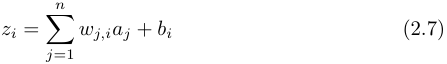

where _aj ∈_ R is another unit _j_ ’s _activation_ and _bi ∈_ R is the _i_<sup>th</sup> unit’s _bias_ . In this model, if there exists no link between unit _i_ and a particular _j_ then simply _wi,j_ = 0 and therefore _j_ does not contribute to _i_ ’s excitation. Figure 2.1 gives an example how such a network could look like.

The unit _i_ ’s activation is its excitation applied to a non-linear _activation function g_ : R _→_ R, giving

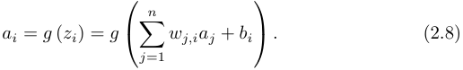

**Activation functions** In its original form in 1943, McCulloch and Pitts defined the neuron as having only binary activation [42]. This means that the model from Equation (2.8) would require _ai ∈{_ 0 _,_ 1 _}_ and hence an activation

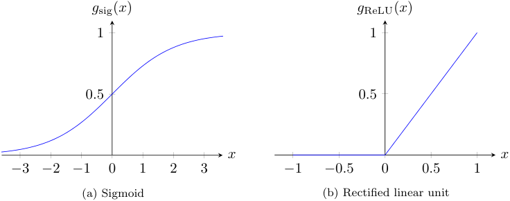

Figure 2.2: Plots of the two most common activation functions.

function of the form _g_ step : R _→{_ 0 _,_ 1 _}_ like the Heaviside step function<sup>11</sup>

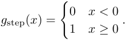

Commonly used activation functions in modern neural networks include the sigmoid

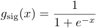

and the rectified linear unit (ReLU) [43]

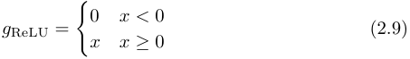

which are depicted in Figure 2.2. Unlike _g_ step, the range of these these activation functions is the real numbers, and the functions themselves are differentiable which is an advantage for being able to use gradient descent to optimise the weights [44, p. 729].

Rectified units do not suffer from the so-called _vanishing gradient effect_ [43]. This phenomenon occurs with sigmoid activation functions when they reach high saturation, i.e. when the input is significantly far from zero such that the gradient is almost horizontal (see Figure 2.2(a)), and is especially prevelant in deep neural networks<sup>12</sup> . As a result, the ReLU activation function (or variants thereof) is the most popular choice nowadays. Furthermore, the computational cost of the function itself as well as its gradient is cheap.

##### **2.2.1 Feedforward neural networks**

The definition of ANNs so far still is very general and makes virtually no restrictions on the graph of the network. It turns out that it is difficult to propagate

> 11In fact, McCulloch and Pitts defined the activation to be zero when _x < θ_ for a threshold parameter _θ ∈_ R and one otherwise, but in the model described here the bias term _bi_ acts as the threshold.

> 12Deep neural networks are ANNs with many layers.

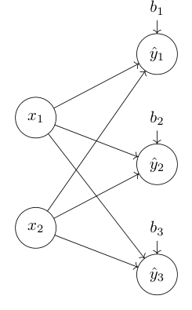

Figure 2.3: A SLP with two inputs and three outputs.

activations between neurons when they exhibit cycles, as is the case with the last three units in Figure 2.1. Let us thus impose a constraint that the nodes of the network are not allowed to form cycles, and as a result the network becomes a directed acyclic graph (DAG). This class of ANNs is referred to as _feedforward neural networks_ .

###### **2.2.1.1 Single-layer perceptron**

The most basic type of feedforward neural network is the single-layer perceptron (SLP). It consists of _n_ 0 input units that are directly connected to _n_ 1 output units, as illustrated in Figure 2.3. There are no connections between input units, and no connections between output units. Likewise, there are no connections from output units to input units. The only connections in the network originate from input units and feed to output units. In fact, that is where the term _feedforward_ arises: the network exhibits neither backwards nor intra-layer connections. The connections themselves are of course weighted as in any ANN. Due to the unidirectional nature of the links, I continue to use the notation _wi,j_ to denote weights, but now _i_ refers to the input unit and _j_ refers to the output unit.

From Equation (2.8), one can compute the values of the three output units in Figure 2.3 as

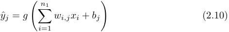

for _j_ = 1 _,_ 2 _,_ 3. Mathematically, a SLP is represented by a function **_f_** : R<sup>_n_0</sup> _→_ R<sup>_n_1</sup> that maps an input vector **_x_** _∈_ R<sup>_n_0</sup> to an output vector **_y_ ˆ** _∈_ R<sup>_n_1</sup> (staying consistent with the notation earlier in this chapter, both are row vectors). Let

us use the _n_ 0 _× n_ 1 matrix **_W_** to contain all weights such that

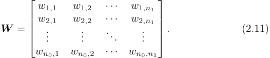

and the row vector

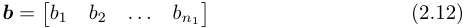

to represent the biases. Since the output vector **_y_ ˆ** is simply the concatenation of the output units, the summation in Equation (2.10) can be expressed using the dot product. Finally, the function of a SLP can be defined as

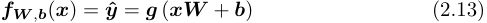

where **_g_** ( _·_ ) applies the activation function _g_ pointwise. The process of computing the activations of the output units given the input units is often called _forward propagation_ or _forward pass_ [41].

###### **2.2.1.2 Multi-layer perceptron**

As the name implies, a multi-layer perceptron (MLP) simply stacks multiple SLPs on top of each other, such that each layer’s outputs are connected to the next layer’s inputs (except for the final layer, where the outputs represent **_y_ ˆ** ). A MLP with _L_ layers can be expressed mathematically by composing _L_ SLPs **_f_** 1 _,_ **_f_** 2 _, . . . ,_ **_f_** _L_ :

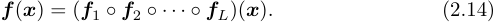

Each SLP inside the MLP constitutes a logical module which is called a _layer_ . Due to the fact that each layer has its own weights **_W_** and biases **_b_** , I shall henceforth use the parenthesised superscript notation **_W_**<sup>(</sup><sup>_l_)</sup> and **_b_**<sup>(</sup><sup>_l_)</sup> to denote the weights and biases in the _l_<sup>th</sup> layer. Further, the notation _b_<sup>(</sup> _j_<sup>_l_)</sup> refers to the _j_<sup>th</sup> unit’s bias in layer _l_ , and _wi,j_<sup>(</sup><sup>_l_)istheweightoftheconnectionfrom</sup> unit _i_ in layer _l −_ 1 to unit _j_ in layer _l_ . This notation follows Goodfellow _et al._ [1] and is customary in describing neural networks. I shall use _n_ 0 _, n_ 1 _, . . . , nL_ to denote the number of units in each layer. Layer zero is considered the _input layer_ , meaning that _n_ 0 must be equal to the dimensionality of **_x_** . The layers 1 _,_ 2 _, . . . , L −_ 1 are the _hidden layers_ because they are not directly connected to the input or output units. Finally, layer _L_ is the _output layer_ , since its units represent the prediction **_y_ ˆ** , and so _nL_ must be equal to the dimensionality of **_y_ ˆ** . Figure 2.4 gives an example of a MLP architecture. It can clearly be seen that because MLPs are simply nested SLPs, they still form DAGs and thus are feedforward networks. In fact, such networks are usually _fully-connected feedforward networks_ because all units from a particular layer connect to all units from the previous layer.

##### **2.2.2 Backpropagation**

_Training_ with regard to neural networks refers to the process of altering a network’s weights and biases with the goal of achieving an optimal configuration

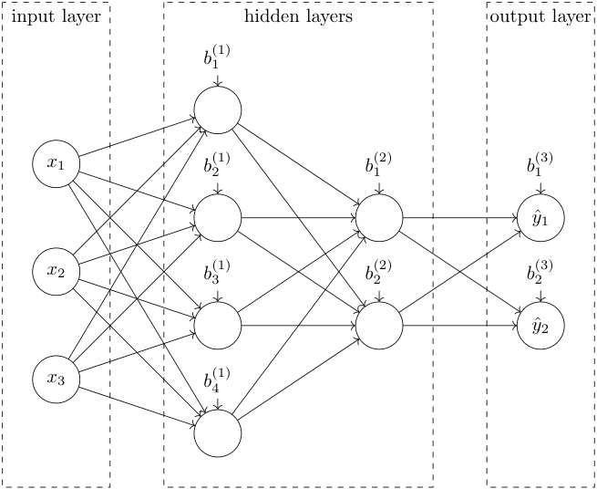

Figure 2.4: A MLP with three inputs, two hidden layers, and two outputs.

that reduces the error of the predictions, i.e. how far they are ‘off’. This is how the network facilitates _learning_ the input-output function from Equation (2.1) that I introduced at the very beginning of this chapter in the context of supervised learning.

Backpropagation with gradient descent is an iterative algorithm for training neural networks that, provided a suitable learning rate _α_ , is guaranteed to converge to a _local minimum_ . The main idea is as follows:

1. Calculate the derivative of the loss function with respect to the current trainable parameters **_p_** (weights and biases) as **∆** **_p_** =<sup>_<u>∂L</u>_</sup> _∂_ **_p_**<sup>(</sup><sup>**_p_**).</sup>

2. Take a step in the negative direction of this gradient, i.e. update the trainable parameters **_p_** _←_ **_p_** _− α_ **∆** **_p_** for some learning rate _α ∈_ R.

3. Repeat steps 1 and 2 until a predefined convergence criterion is met.

Figure 2.5 shows the steps that this algorithm would make on a simple errorweight surface with only one parameter.

To explain the backpropagation algorithm, I shall examine the case of a regression task, meaning that the network has only one output unit. The algorithm can, of course, be generalised to classification problems with multiple output units.

Let _{⟨_ **_x_** _i, yi⟩}_<sup>_m_</sup> _i_ =1<sup>bealabelledregressiondatasetasdefinedinSection2.1.1.</sup> First of all, it is necessary to introduce a measure indicating how good the predictions are. For simplicity, I use the mean squared error (MSE), although the reader should note that the cross-entropy loss is preferred for classification

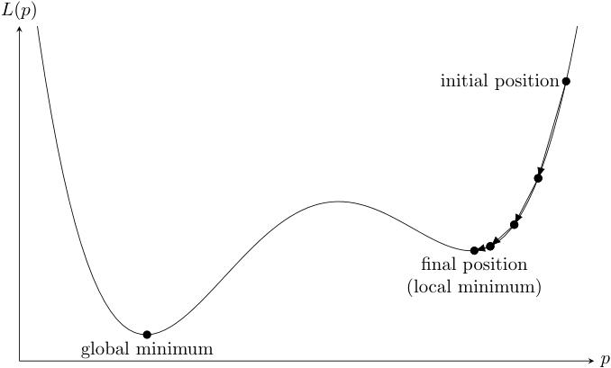

Figure 2.5: Illustration of gradient descent training on an error-weight surface with only one parameter (not drawn to scale). Gradient descent minimises the objective loss function and converges to a local minimum. In practice, deep neural networks have millions of parameters, resulting in a high-dimensional error surface, and local minima often turn out to be ‘good enough’ in that their error is only slightly higher than the global minimum [45].

problems. The MSE of a set of predictions **_y_ ˆ** is the average squared difference between the predictions and targets,

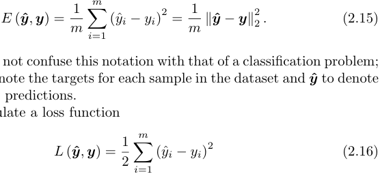

The reader should not confuse this notation with that of a classification problem; here, I use **_y_** to denote the targets for each sample in the dataset and **_y_ ˆ** to denote the corresponding predictions.

One can formulate a loss function

that behaves similarly to Equation (2.15) in that reducing the loss function also reduces the MSE, but it is be easier to work with.

###### **2.2.2.1 Single-layer perceptron**

Let us consider a SLP with one output unit for simplicity. The loss can be expressed in terms of the weights and biases by combining Equations (2.13) and (2.16) as

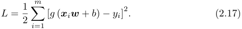

Here, the weight matrix **_W_** from Equation (2.11) has just one column (because there is just one output unit), so I denote it using the column vector **_w_** , and similarly the bias vector from Equation (2.12) is just a scalar _b_ .

Calculating the derivative of the loss function with respect to each of the trainable parameters is a core part of the gradient descent algorithm. In this network, the trainable parameters are **_w_** and _b_ , so _L_ is differentiated with respect to each of these. The partial derivative of the loss with respect to the bias is

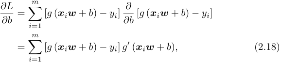

and similarly, differentiating with respect to the weights gives

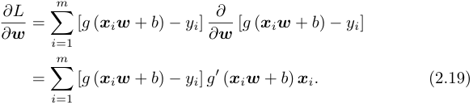

Here, the derivative _g_<sup>_′_</sup> ( _·_ ) depends on the choice of activation function _g_ ( _·_ ). At each iteration, the gradient descent algorithm updates the trainable parameters by taking a step in the direction opposite to the gradient. The size of this step is governed by the learning rate _α ∈_ R. Mathematically, this is expressed as

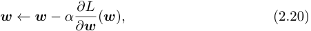

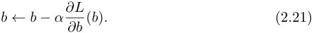

###### **2.2.2.2 Multi-layer perceptron**

To apply backpropagation in MLPs, the first step is to compute the gradient of the loss with resepect to each trainable parameter (i.e. each layer’s weights and biases). In other words, it is necessary to compute _∂∂L_ **_W_** _l_<sup>and</sup> _∂_<sup>_<u>∂L</u>_</sup> **_b_** _l_<sup>foreachlayer</sup> _l_ = 1 _,_ 2 _, . . . , L_ , but the exact derivation is left as an exercise to the reader. The main idea is realising that because MLPs are simply nested SLPs, the chain rule can be applied when calculating the derivative of Equation (2.14).

Similar to Equations (2.20) and (2.21), once the gradients are computed, the weights and biases are updated by applying the rule

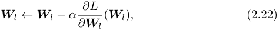

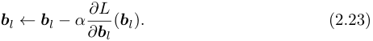

A major limitation of gradient descent, as it is described here, is the summation in Equations (2.18) and (2.19) that is applied over the whole dataset of

_m_ samples. This becomes impractical for large datasets due to memory consumption and computational complexity, so the dataset is commonly split into batches and the gradients are estimated for each batch in a process known as _stochastic gradient descent_ . Moreover, one would typically apply more sophisticated optimisation algorithms than the update rules outlined in Equations (2.22) and (2.23) to improve the speed and quality of convergence. A very popular choice that empirically demonstrates good results in many settings is the Adam optimiser **kingma2017** . However, such details are unfortunately outwith the scope of this report.

#### **2.3 Convolutional neural networks**

Let us examine how ANNs can be applied to a simple image classification problem. Consider an input image of 256 _×_ 256 pixels with three colour channels (RGB). If this image is flattened to a single vector, that vector contains 3 _·_ 2<sup>16</sup> values. One could construct a MLP that takes this vector as input and tries to classify the image as belonging to one of the predefined classes. If the first layer has half as many units as the input, the weight matrix **_W_** 1 would be be of size (3 _·_ 2<sup>16</sup> ) _×_ (3 _·_ 2<sup>15</sup> ), meaning that it would hold 9 _·_ 2<sup>31</sup> values. This means that the first layer alone would already have over two billion parameters. Networks with this many parameters are infeasible to train because the number of parameters exceeds the memory capacity and computational ability of modern hardware. Furthermore, networks with too many parameters are much more likely to overfit to training data.

CNNs are a special class of ANNs that require significantly fewer parameters in each layer. They are well-suited for image tasks and can be trained on modern hardware even when they have many layers (which are known as _deep neural networks_ ). Originally, the concept of CNNs evolved from the so-called _neocognitron_ that was introduced in 1980 and inspired studies of the visual cortex in humans and animals [46]. In 1998, LeCun _et al._ proposed the famous _LeNet-5_ architecture that is considered to be the first CNN [47]. The main concepts developed in the seminal work of LeCun _et al._ carry through to today.

By conducting experiments on animals, David Hubel and Torsten Wiesel<sup>13</sup> found that biological neurons in the visual cortex respond to patterns in specific areas of the visual field, known as _receptive fields_ [48]. Moreover, different neurons may respond to different patterns even if their receptive fields overlap. Hubel and Wiesel demonstrated this by showing that some neurons activate only for horizontal lines while others become active for vertical lines. They also showed that some neurons with larger receptive fields respond to more complex patterns that are combinations of such lower-level patterns.

CNNs follow the same intuition: neurons at the beginning of the network learn to recognise very simple, low-level patterns, while neurons deeper in the network compose these patterns to perceive more complex features. They are comprised of _convolutional_ and _pooling_ layers, which I shall describe below.

> 13Hubel and Wiesel received the Nobel Prize in Physiology or Medicine in 1981 for their work in understanding information processing in the visual system.

##### **2.3.1 Convolutional layers**

Convolutional layers are the most important component in a CNN. However, the term _convolution_ is actually used as a misnomer to mean _cross-correlation_ in the context of CNNs. Both terms refer to a mathematical operation where a matrix (known as _filter_ or _kernel_ ) is slid over the input image and the sum of products is computed at each location. A convolution operation is equivalent to cross-correlation if the filter matrix is pre-rotated by 180 degrees. For the remainder of this report, I shall follow the convention in machine learning and use the term convolution to refer to cross-correlation.

Each neuron in the first convolutional layer is connected to a square region of pixels (the receptive field) from the input image, as opposed to being connected to the entire input image which is the case in fully-connected MLPs. Similarly, subsequent layers’ neurons connect only to a square region of neurons in the respective previous layer, so that the network begins to form a hierarchy of filters.

Let us consider a neuron in the first convolutional layer. It is connected to a square patch of pixels from the input image (for now, let us consider only one colour channel), so let us represent this patch using the _k × k_ matrix **_P_** where _k_ indicates the side length of the square. The convolutional layer is associated with a filter matrix **_F_** of the same size as **_P_** . The convolution of the matrices **_P_** and **_F_** , denoted **_P_** _∗_ **_F_** , is obtained by performing a pointwise multiplication of the corresponding elements in **_P_** and **_F_** , and then computing the sum of these results. More formally, using the notation _pij_ and _fij_ to index into those two matrices, the convolution operation can be defined as

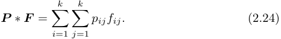

A patch **_P_** convolved with a particular filter **_F_** achieves a high value if the patch follows the pattern described by the filter. To see this, consider the filter

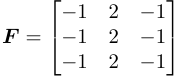

that tries to detect vertical lines. For a patch

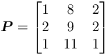

that clearly has high values in the middle column and thus describes a vertical line, one obtains **_P_** _∗_ **_F_** = 47. However, when considering a different patch

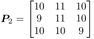

where the intensities are quite uniform (and thus not describing a vertical line), the convolution with **_F_** achieves a much lower result of 6.

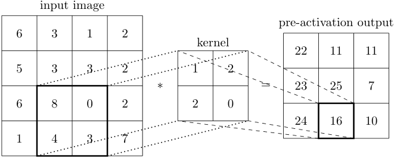

Figure 2.6: Illustration of a convolution operation with a 2 _×_ 2 kernel. The bias _b_ is added to the output on the right before pointwise applying the activation function _g_ in order to obtain the activations.

Coming back to examining the first layer of a CNN, notice that it is associated with a filter **_F_** . The output of the layer is obtained by sliding a _k × k_ window over the input image, and at each location of the window, the convolution **_P_** _∗_ **_F_** is computed where **_P_** are the pixels in the current window. This process is illustrated using an example in Figure 2.6. The result is a matrix, too, and so the output of the layer is obtained by applying the nonlinear activation function _g_ pointwise to that matrix plus a bias _b_ .

Now let us consider the case where the previous layer has multiple channels. The input image, for instance, has three colour channels. Thus, the first convolutional layer needs three filters: one for each input colour channel. The output is still only one matrix where the elements are summed across the channels, as explained in Figure 2.7 for a two-channel input. In practice, a convolutional layer stacks multiple such operations on top of each other (with different filters) so that the result is more than one output matrix. These matrices, after adding the bias and applying the activation function _g_ , constitute the input channels for the subsequent layer. Each output channel has its own bias _b_ , so a bias vector **_b_** is required to denote all of the biases.

The astute reader might wonder how the values for each of the filters are obtained so that they correspond to useful features in the image that ultimately allow a series of fully-connected feedforward layers following the convolutional layers to perform a classification prediction at the end of the network. As in MLPs, the answer is to use backpropagation and gradient descent. Each of the values in the filter matrices is a trainable parameter and the biases are of course trainable, too. It is possible to calculate the gradients of these trainable parameters with respect to the loss function, so an optimisation algorithm such as the popular _Adam_ optimizer **kingma2017** can be employed to update the parameters as discussed at the end of Section 2.2.2.2.

There are a number of hyperparameters associated with convolutional layers that impact the output dimensions as well as number of trainable parameters in the layer:

- the filter size _k_ ;

- the padding _p_ which indicates by how many rows/columns the input mat-

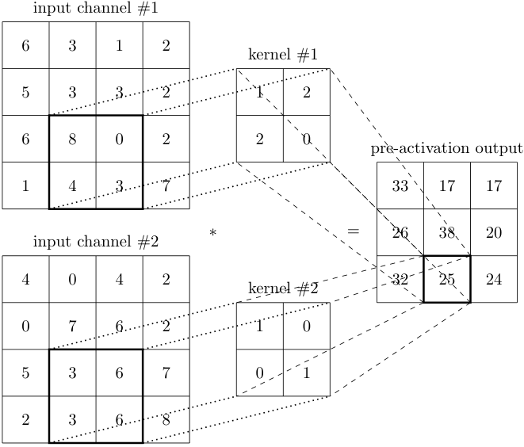

Figure 2.7: Illustration of a convolution operation with 2 _×_ 2 kernels acting on two input channels.

rix is extended in each direction, setting these new values to zero (Figures 2.6 and 2.7 use _p_ = 0);

- the strideby how many pixels the sliding window is moved each time (Figures 2.6 and 2.7 use _s_ = 1); and

- the desired number of output channels _c_ out.

Of course, the activation function _g_ may also be regarded as a hyperparameter, but it has no effect on the dimensions of the layer’s output. Let us consider a convolutional layer with an input of spatial size _h_ in _× w_ in and _c_ in channels. By examining how the spatial output dimensions correspond to the input size and hyperparameters in Figure 2.6, one can derive the equations

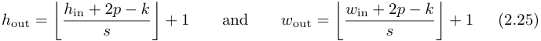

relating the input spatial dimensions to the output spatial dimensions of a convolutional layer. It is important to know this when designing a CNN architecture in order to monitor how the spatial size shrinks with each convolutional layer.

Having said that, I can now provide evidence for the claim at the beginning of Section 2.3 that CNNs require significantly fewer trainable parameters than MLPs. Notice that the number of trainable parameters is simply the number of elements in each filter **_F_** multiplied by the number of filters, plus the number of biases. One output channel requires _c_ in filters as shown in Figure 2.7. So, _c_ out output channels require _c_ in _· c_ out filters, and since each filter is a _k × k_ matrix, the number of kernel parameters is _c_ in _· c_ out _· k_<sup>2</sup> . Furthermore, each filter is associated with a bias that is trainable, so the total number of trainable parameters is _c_ in _· c_ out _·_ ( _k_<sup>2</sup> + 1). In contrast to MLPs, this is independent of the input’s spatial size ( _h_ in _× w_ in), and since the value of _k_ is typically quite small, the number of trainable parameters is orders of magnitude smaller than that of a layer in a MLP. As such, the weights in a CNN are considered to be _shared_ because the filters are slid over the entire input and can therefore identify similar features in different spatial locations.

##### **2.3.2 Pooling layers**

To understand the motivation of pooling layers, I shall first examine the general architecture of a CNN. Typically, a CNN consists of a number of convolutional and pooling layers followed by a small MLP that has one or two fully-connected layers. Since the output of the convolutional/pooling layers is a tensor of rank three (more specifically, there are _c_ out feature maps, each of size _h_ out _× w_ out), it must first be flattened so that all elements are concatenated into a vector. However, to ensure that this vector contains useful information for classification, it is preferrable to have a relatively small spatial size _h_ out _× w_ out, but a large number of channels. The reasoning for this is twofold: (i) a low spatial size reduces the size of the vector and thus the number of trainable parameters in the MLP; and (ii) a high number of channels allows the CNN to detect many different useful features. Pooling layers provide a means of reducing the spatial size while keeping the number of channels constant. They are used immediately after convolutional layers and typically occur less often than convolutional layers in a CNN architecture because their excessive use prevents the network

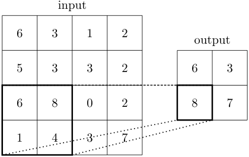

Figure 2.8: Illustration of maximum pooling for _k_ = _s_ = 2.

from learning any useful features. This is because pooling layers remove some information.

Pooling is applied on a per-channel basis, so the number of input channels is equal to the number of output channels. Furthermore, it does not apply an activation function because that is the job of the convolutional layers. The most common type of pooling is maximum pooling. Such max-pooling layers slide a window over the input and retain only the highest activation, as illustrated in Figure 2.8. It is easy to see that unlike convolutions, pooling layers have no trainable parameters. Nonetheless, they have three hyperparameters: the padding _p_ , stride _s_ and window size _k_ . In practice, it is common to set _s_ = _k_ = 2 and use no padding in order to halve the spatial dimensions (the calculation from Equation (2.25) holds for pooling layers as well).

#### **2.4 Transfer learning**

The underlying motivation behind transfer learning is to reuse knowledge gained in one task as a basis for learning a different task. It is an important tool that I employ in two different settings throught this project: (i) training CNNs for classifying chess squares and pieces in Sections 4.2 and 4.3; and (ii) fine-tuning these models in order to adapt to previously unseen chess sets in Chapter 5.

Training a deep CNN from scratch (starting from a randomly initialised weight state) can take several days even on modern GPUs. Furthermore, to achieve good performance, such netowrks require very large labelled datasets. Obtaining the required compute capability and quantity of data is often infeasible, and so it is very common to initialise the weights based on an already trained network. This makes sense because as discussed in Section 2.3, CNNs learn patterns at the beginning of the network that are of a similar level of abstraction for different datasets. Understanding these feature representations is still a very active area of research; in fact, a recent paper shows that when training the same deep neural network architecture on different datasets, the learned features are very similar at the beginning of the network until a depth of around two thirds [49]. In practice, this means that it is only in the last third of the network that it specialises on the task at hand, and before that, it learns only very general features.

For many popular deep CNN architectures, weight states are available online

that were trained for a long period of time on large datasets such as _ImageNet_ [50], a classification dataset with millions of samples that are annotated for thousands of categories. Naturally, the _classification head_ (the MLP after the convolutional and pooling layers that is responsible for classification) must be quite different for the target domain, especially if the target domain has a different number of classes. Thus, the classification head is simply replaced by a MLP that contains the desired number of output units, but the pretrained weights and architecture are used for the preceding layers. Then, the classification head can be trained in isolation by _freezing_<sup>14</sup> the weights in all the other layers. In essence, this means that the final MLP is trained based on the features learnt in the pretrained model. Finally, the whole network is trained by unfreezing all layers in a process called _fine-tuning_ . Typically, this is performed with a smaller learning rate because the feature extraction part of the network is significantly more sensitive. Figure 2.9 shows which layers are copied and trained using a simple example.

> 14Freezing a layer means that the weights and biases in that layer are not updated during backpropagation.

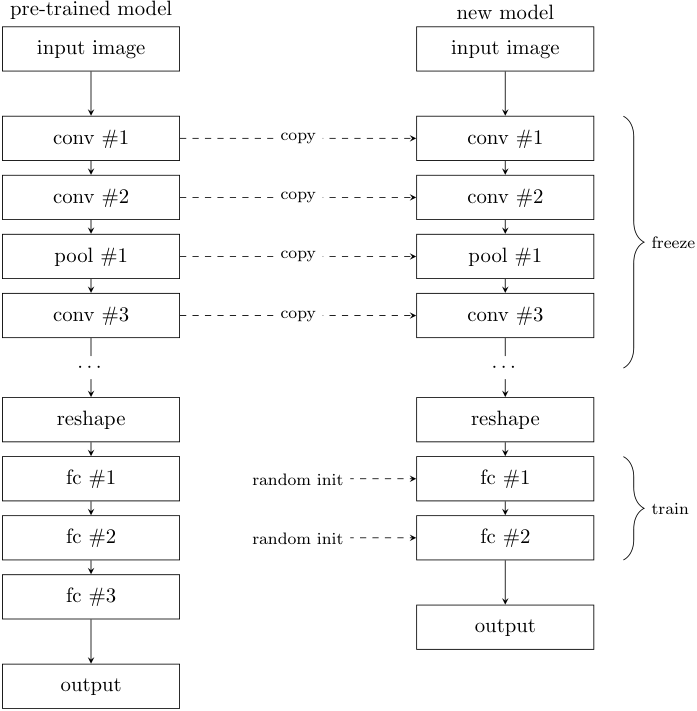

Figure 2.9: Illustration of the transfer learning process for domain adaption in deep neural networks. The boxes represent different types of layers: convolutional (conv), pooling (pool), and fully connected (fc). In the first instance, training proceeds only in the classification head, while the other layers are frozen. Then, the whole network is trained.

_I don’t look at computers as opponents. For me, it is much more interesting to beat humans._ Magnus Carlsen

# **3 Generating synthetic training data**

Studies in human cognition by Bilalić _et al._ [51] and Zhou [52] compared skilled chess players with novices in terms of their ability to remember a chess position for a short amount of time and confirmed that highly skilled players outperform novices at this task. Perhaps more interestingly, both studies find that skilled players remember _random_ positions (where pieces are positioned on random squares, not necessarily obeying the rules of chess) significantly less accurately than positions from actual chess games. Thus it stands to reason that in general, highly skilled chess players exhibit a more developed pattern recognition ability for chess positions than novices, but this ability is specific to positions that conform to the rules of chess and are likely to occur in actual games.

This project aims to develop a similar pattern recognition ability using machine learning, and therefore the dataset consists of positions from real chess games. In doing so, I automatically ensure that the chess positions are legal and sensible.

#### **3.1 Chess positions**

The positions are generated from a publicly available dataset of 2,851 games played by current World Chess Champion Magnus Carlsen [53]. I randomly select 2% of all positions (i.e. configurations of chess pieces) from all games to be included in the dataset, although duplicate positions are discarded. A total of 4,888 chess positions are obtained in this manner and saved in FEN format.

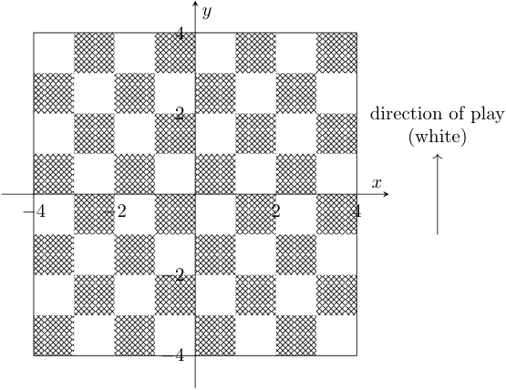

Figure 3.1: Overhead view of the coordinate system on the chessboard. The _z_ -axis (not shown) points upward, normal to the chessboard surface, and the board is oriented like a chess game would be set up, i.e. the bottom right square is white. White’s direction of play (the direction in which pawns are advanced) coincides with the _y_ -axis.

#### **3.2 Three-dimensional renders**

In order to obtain realistic images of these chess positions, I employ a threedimensional model of a chess set on a wooden table. Chess pieces are placed on the board’s squares according the given FEN description. Different camera angles and lighting setups are chosen in a random process in order to maximise diversity in the dataset.

For the following explanations, consider a three-dimensional Cartesian coordinate system whose origin lies at the centre point of the chessboard’s surface, as depicted in Figure 3.1. The chessboard lies on the plane formed by the _x_ and _y_ axes, and the chess squares are of unit length.

**Pieces** The pieces are positioned on the squares as dictated by the particular FEN description. However, instead of positioning them at the centre in their respective squares, they are randomly rotated and positioned with a random offset to emulate the conditions in real chess games. More specifically, the _x_ and _y_ position of a piece in file _i_ and rank _j_ is sampled from a bivariate normal distribution given by

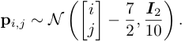

Here, it is assumed that _i_ and _j_ are zero-indexed, i.e. the square _a1_ corresponds to _i_ = _j_ = 0. The reason for shifting the mean by<sup><u>7</u></sup> 2<sup>aboveisthatsincethe</sup> origin lies at the midpoint of the board, the mean must be shifted four units to the left (or downwards for the _y_ -axis), but since the normal distribution should be centred on the midpoint of the square, a half must be added. Due to the fact that the _x_ and _y_ axes are perpendicular, the two components of **p**

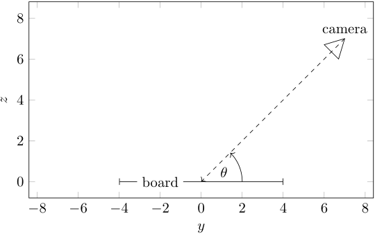

Figure 3.2: Side view of the camera setup for the scenario where it is white to move.

are independent and thus can be modelled with a covariance matrix that is a multiple of the identity matrix **_I_** 2. Experiments showed that a variance of 101 achieved realistic results. Finally, the piece’s rotation about its _z_ -axis is sampled from a uniform distribution over the half-open interval [0 _,_ 2 _π_ ).

**Camera** The camera is aligned to point directly at the origin (i.e. the centre of the board). It is positioned with only a small offset from the _yz_ -plane to ensure that the view over the chessboard is similar to the current player’s perspective. A slight perturbation to the _x_ -component of the camera position is introduced according to a normal distribution with _µ_ = 0 and _σ_ = 0 _._ 8 since the player is usually not positioned exactly in the middle in front of the board. An angle _θ_ is chosen uniformly in the range � _<u>π</u>_ 4<sup>_,_</sup><sup>_<u>π</u>_</sup> 3 � to represent the angle that the camera makes with the board’s surface (see Figure 3.2) if it is white to play<sup>15</sup> . This range is chosen because human players would typically choose a camera angle between 45 and 60 degrees to ensure maximum visibility of the pieces. The two remaining components ( _y_ and _z_ ) of the camera’s location are then obtained using a simple trigonometric calculation such that the distance from the camera to the origin is 11 units, a length that allows the camera to capture the entire board.

**Lighting** For each chess position, a random choice is made between two different lighting scenarios, each having equal probability of being employed.

1. The first lighting mode tries to emulate a _camera flash_ . To do so, a spotlight is set up with the same location and orientation as the camera. As a result, the scene is lit up quite well with no large shadows, as it can be seen in Figure 3.3(a).

> 2. In the other lighting mode, two spotlights are set up in the scene. Their _x_ and _y_ coordinates are constrained such that they lie on a circle centred

> 15On the other hand, if it is black to play, the perspective must be from the other side of the board, so _θ_ is chosen in the range � <u>23</u> _<u>π</u>_<sup>_,_</sup><sup><u>3</u></sup> 4<sup>_<u>π</u>_</sup> � which is equivalent to reflecting the camera position about the _xz_ -plane.

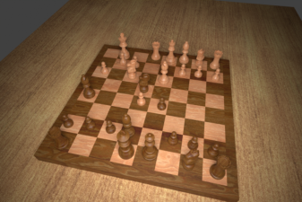

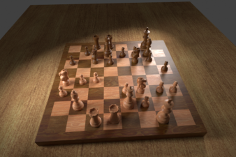

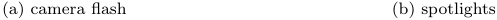

Figure 3.3: Two samples from the synthesised dataset showing both types of lighting.

at the origin of the coordinate system with radius 10 on the _xy_ -plane, as depicted in Figure 3.4, but each spotlight’s location along the circumference is sampled uniformly. Furthermore, each spotlight’s _z_ -component is sampled uniformly in the range [5 _,_ 10). Finally, for each spotlight, a focus point on the chessboard surface (i.e. the _xy_ plane) is sampled from _N ,_<sup>5</sup> and the corresponding spotlight is rotated such that it ��00� 2<sup>**_I_**2</sup> � points in that point’s direction. Consequently, there is greater variabililty in the lighting because the spotlights might point at different areas on the board, thus producing different types of shadows. Figure 3.3(b) shows an example rendering where the lighting produced by the spotlights is poorer than the camera flash mode.

#### **3.3 Automated labelling**

Apart from eliminating the need to manually set up a large number of positions on the chessboard and photographing them, the use of a 3D model for synthetic data generation exhibits another major advantage: the required labels can be computed for the data without human intervention. In fact, manually labelling the data is usually the most time-consuming part of the entire process.

With each render, a file in JavaScript object notation (JSON) format is exported alongside the image file containing the following information:

- the pixel coordinates of the chessboard’s four corner points on the rendered image;

- the FEN description of the pieces on the board;

- the colour of the current player (white/black);

- pixel coordinates of each piece’s bounding box on the rendered image;

- the position and angle of the camera (in the 3D world coordinate system); and

- the lighting mode as well as position, angle, and focus point of each light.

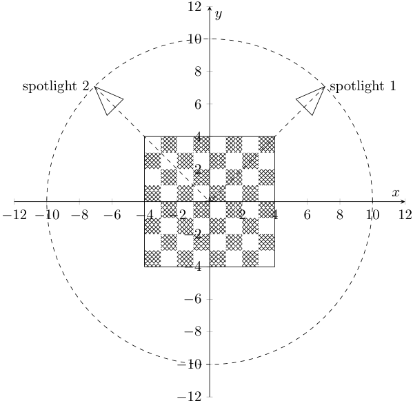

Figure 3.4: Overhead view of the chessboard with two spotlights. The spotlights are constrained to the dashed circle such that their distance to the origin amounts to 10 units when disregarding the _z_ -component.

The coordinates of the chessboard’s corners can be computed because the coordinates of the relevant meshes are known in the 3D world coordinate system, as is the world-to-camera-view matrix used to render the image. It is just a matter of performing some linear algebra to compute the corresponding 2D image coordinates. For computing the bounding boxes of the pieces, I simply project all vertices of the corresponding meshes onto the view plane and find the minimum and maximum points in the _x_ and _y_ directions. Figure 3.5 provides a visualisation of the automatically generated labels for one sample. Note that although the bounding boxes are not used in this project, they are useful for future research if someone should use the dataset to train an object recognition model for inferring chess positions instead of the classification-based approach. On the other hand, this project mainly relies on the board’s corner coordinates as well as the FEN description for training. Furthermore, the data about the cameras and lighting is useful in iteratively refining the models by analysing which conditions perform poorly and improving on them.

#### **3.4 Splitting the dataset**

In order to facilitate a fair evaluation of the chess recognition algorithm once it is completed, 7% of the dataset is immediately set aside as the so-called _test_ set. This data remains untouched until the very end when it is time to assess the performance of the chess recognition pipeline, in order to prevent _data leakage_ : to facilitate a fair evaluation of how the system performs on unseen data, any use of the the test set should be prohibited during training. A much smaller portion of the data (3%) is used for _validation_ purposes. This subset is not directly used for training, but for hyperparameter tuning or assessing whether a model overfits to the training data. Finally, the remaining 90% constitutes the training set. Figure 3.6 shows the proportions of the splits, including the actual number of samples in each subset. Note that the aforementioned splits are performed only once on the shuffled dataset and the associated JSON and image files are moved into three separate folders to ensure that the same split is used each time.

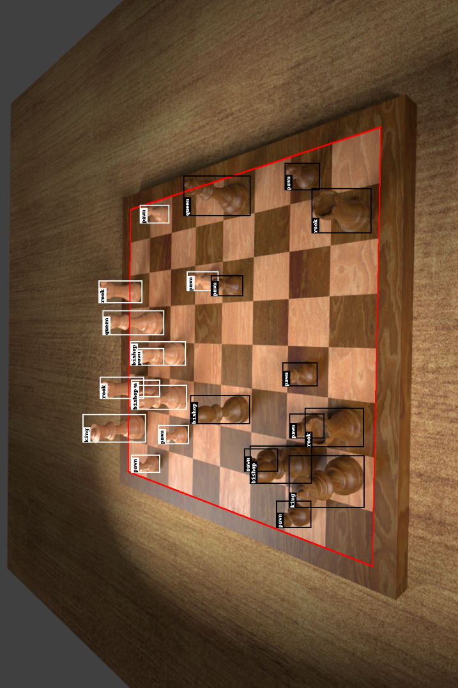

Figure 3.5: Visualisation of the automatically generated labels. The image is rotated 90° to fit on the page. The bounding box is computed for each piece and annotated with the piece type. The four corners of the chessboard are joined with red lines in the visualisation.

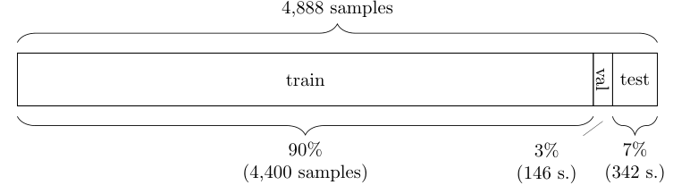

Figure 3.6: Visual representation of the dataset split.

_Of chess, it has been said that life is not long enough for it, but that is the fault of life, not chess._ William Napier

# **4 Recognising chess positions**

The chess recognition system is responsible for taking an RGB image of a chessboard with pieces on it and ultimately producing a FEN string representing the predicted chess position. The pipeline, depicted in Figure 4.1, consists of four main stages which shall be described in detail in the subsequent sections.

The first step is locating the chessboard in the image. More specifically, it is necessary to find the pixel coordinates of the four chessboard corners. Using these corner points, I warp the image such that the chessboard forms a regular square grid, to eliminate perspective distortion in the sizes of the chess squares. Next, I train a binary CNN classifier to determine individual squares’ occupancies. Each of the occupied squares are then input to another CNN that is responsible for determining the type of piece. Finally, I use the output probabilities of the piece classifier to produce a FEN string representing the position.

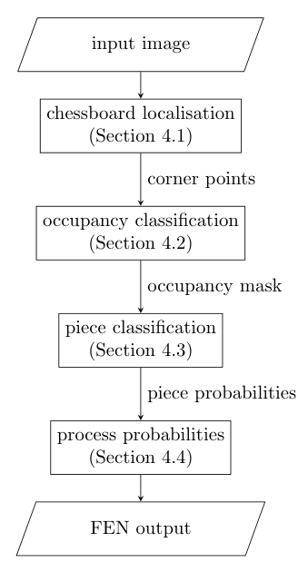

Figure 4.1: Overview of the chess recognition pipeline.


#### **4.1 Board localisation**

To determine the location of the chessboard’s corners, I rely on its regular geometric nature. Each square on the physical chessboard has the same width and height, even though their observed dimensions in the input image vary due to 3D perspective distortion. Before conducting any futher computation, the image is resized to a width of 1,200 pixels, keeping the aspect ratio.

##### **4.1.1 Finding intersection points**

A chessboard consists of 64 squares that are arranged in an 8 _×_ 8 grid. Thus, there are nine horizontal and nine vertical lines. The first step of the algorithm should detect the majority of these lines and find their intersection points.

###### **4.1.1.1 Edge detection**

To detect edges in the input image, I convert the RGB image to grayscale and apply the Canny edge detector [54], the result of which is shown in Figure 4.2(c). Canny edge detection is a multi-stage algorithm that first reduces noise in the image (by applying a Gaussian blur), then computes pixel intensity gradients, performs non-maximum supression, and finally refines the results using hysteresis thresholding [54], although the precise details of this algorithm are beyond the scope of this report.

###### **4.1.1.2 Line detection**

Next, I perform the Hough transform [55], [56] in order to detect lines that are formed by the edges. To this end, I represent lines in Hesse normal form, meaning that they are parameterised by the angle _θ_ that their normal vector forms with the _x_ -axis, and the distance _ρ_ to the origin. Figure 4.3 explains this geometrically and gives rise to the equation of a line in Hesse normal form,

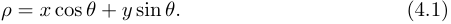

In fact, for a particular point ( _x, y_ ), Equation (4.1) represents the family of lines passing through it. Here, each pair of ( _ρ, θ_ ) values represents one particular line, and it suffices to only consider pairs where _ρ ≥_ 0 and 0 _≤ θ <_ 2 _π_ to parameterise all lines.

Plotting the pairs of ( _ρ, θ_ ) values for a particular point in image space gives a sinusoidal curve that represents all lines passing through that point. One can take multiple points in image space and plot their sinusoids. Then, each intersection in ( _ρ, θ_ ) space represents a line passing through the corresponding points, as illustrated in Figure 4.4.

For a given threshold _t_ , the Hough transform essentially plots the sinusoids for all edge points in the input image (which were obtained using the Canny edge detection algorithm) and outputs intersection points in ( _ρ, θ_ ) space that are on at least _t_ different sinusoids. Consequently, the lines identified by the Hough transform are supported by at least _t_ edge points in the image.


(d) detected lines, clustered into horizontal (green) and vertical (blue) lines (f) intersection points (red)

Figure 4.2: The process of determining the intersection points on the chessboard.


Figure 4.3: A line in Hesse normal form is parameterised by the angle _θ_ to the _x_ -axis and distance _ρ_ from the origin. The line is defined by the equation _ρ_ = _x_ cos _θ_ + _y_ sin _θ_ . Equivalently, in slope-intercept form, the equation is _y_ = _−x_ cot _θ_ + sin _<u>ρ θ</u>_<sup>provided that</sup> cos _θ̸_ = 0, i.e. _θ_ is not a multiple of _π_ . Notice that the _y_ -axis is pointing down because the origin of the coordinate system is the top left of the image.


Figure 4.4: An example of how lines in image space are represented in ( _ρ, θ_ ) space. The family of lines passing through a particular point in image space (a) is represented by a sinusoid in ( _ρ, θ_ ) space (b). The intersection point of the three curves represents the line passing through all three points.

###### **4.1.1.3 Filtering and clustering the lines**

On the chessboard images, the Hough transform typically yields around 200 lines, most of which are very similar. Therefore, I split them into horizontal and vertical lines and then eliminate similar ones. Experiments showed that simply setting thresholds for the angle _θ_ is insufficient for robustly classifying lines as horizontal or vertical. This is because the camera is often tilted quite severely in the synthetic dataset as a result of the procedure outlined in Section 3.1 (and may be the case in real chessboard photos taken by humans, too). Instead, I employ agglomerative clustering which is a bottom-up hierarchical clustering algorithm. In this algorithm, each line starts off in its own cluster, and as the algorithm progresses, pairs of clusters are merged in a manner that aims to minimise the variance within the clusters. I cluster the lines based only on their direction, i.e. their angle _θ_ , and use the smallest angle between two given lines as the distance metric. Finally, I use the mean angle of both top-level clusters to determine which cluster represents the vertical lines and which the horizontal lines. The clustered lines are depicted in Figure 4.2(d).

Next, it is necessary to eliminate similar lines by finding clusters of such similar lines. To eliminate similar horizontal lines, I first find the mean vertical line by considering the _ρ_ and _θ_ values associated to the lines in the vertical cluster. Then, I find the intersection points of all the horizontal lines with the mean vertical line and perform a DBSCAN clustering [57] to group similar lines based on these intersection points. I use the mean _ρ_ and _θ_ values of the lines in each group to represent the final set of discovered horizontal lines. The same procedure is applied vice-versa for the vertical lines, the result of which is shown


in Figure 4.2(e).

###### **4.1.1.4 Intersection points**

It remains to find the intersection points of the horizontal and vertical lines. Given two lines parameterised by ( _ρ_ 1 _, θ_ 1) and ( _ρ_ 2 _, θ_ 2) respectively, their point of intersection can be found by observing that their equations in Hesse normal form (see Equation (4.1)) constitute a system of two linear equations that can be solved for _x_ and _y_ :


Rearranging for _x_ and _y_ , and performing some algebraic manipulation yields


Finally, the intersection points can be found as depicted in Figure 4.2(f) using Equations (4.2) and (4.3) on each pair of horizontal and vertical lines.

##### **4.1.2 Finding the homography**

Once the intersection points are known, the next step is to project them onto a regular grid. Using this projection, known as a _homography_ , it is then possible to warp the original image to eliminate the perspective distortion.

###### **4.1.2.1 Computing the homography matrix**

The projection is described by a _homography matrix_ **_H_** _∈_ R<sup>3</sup><sup>_×_3</sup> [58] mapping any point **_p_** from the original image to the corresponding point **_p_**<sup>_′_</sup> in the warped image using the relation


up to a scalar factor _q ∈_ R. Here, **_p_** and **_p_**<sup>_′_</sup> are considered to be 2D _homogenous coordinate vectors_ , which are three-component vectors that extend the Euclidean plane with points at infinity. More precisely, a point ( _x, y_ ) in Euclidean space corresponds to the set of homogenous coordinates � _qx qy q_ � _⊤_ for any _q ∈_ R _, q̸_ = 0. In practical terms, a homogenous coordinate can thus be converted to the corresponding Euclidean coordinate by taking its first two components and dividing by the third.

Computing a homography requires four source points in the original image and four corresponding destination points in the warped image. It makes sense to choose the source points as four instersection points lying on two distinct horizontal and two distinct vertical lines (according to the lines found in Figure 4.2(e)) because they represent a rectangle on the chessboard. Let the 3 _×_ 4 matrix **_P_** contain these points’ homogenous coordinates as column vectors in clockwise order. Further, let **_P_**<sup>_′_</sup> be a matrix of the same size as **_P_** containing this rectangle’s coordinates in clockwise order. In the warped space, the squares of


Figure 4.5: Projection of four intersection points from the original to the warped image.

the chessboard will be of unit length. Therefore, the four points can be mapped from the original image to a rectangle whose top left vertex coincides with the origin and whose side lengths are _sx_ and _sy_ (see Figure 4.5), which means that


Since the homography matrix maps points from the original image to the output image, it follows from Equation (4.4) that


where the vector **_q_** _∈_ R<sup>4</sup> represents the scale factor for each point. Equation (4.5) describes a system of linear equations that can be solve computationally for **_H_** . Then, Equation (4.4) can be used to project all other intersection points to the warped image.

###### **4.1.2.2 Finding the optimal homography**

Although Figure 4.2(f) has no intersection points that are outliers (because all of the identified lines do, in fact, correspond to squares on the chessboard), the algorithm must be robust when facing lines identified in the image that do not correspond to squares on the chessboard. Figure 4.6 depicts one such example; however, in non-synthetic chessboard images, especially with other objects in the image that exhibit straight lines, there is often an even greater number of outliers.

Random sample consensus (RANSAC) [59] is a non-deterministic iterative model fitting algorithm that can robustly estimate a model’s parameters in such a manner that is not significantly influenced by outliers. It can be applied to a variety of situations where a model must be fit to a dataset containing outliers. For the purposes of this algorithm, the dataset consists of the intersection points (some of which are outliers due to detecting irrelevant lines) and the model is a homography that corresponds to the inlier intersection points. The RANSAC algorithm consists of two main steps:


Figure 4.6: A sample from the training set with an incorrectly identified line. The top horizontal line is at the border of the chessboard instead of the top chessboard squares.

1. Randomly sample a set of observations from the dataset that contains the minimum number of samples sufficient to fit the model. Four points are required to compute a homography, so this is the number of intersection points sampled in this step.

2. Fit the model to these samples, and then determine which observations are explained by the model within some threshold (the threshold should be just large enough to account for the expected noise in the dataset). This is the set of inliers, and if the size of this set is greater than the inliers discovered in the previous iteration, this model is retained instead of the previous. Repeat from step 1 until reaching a specified number of iterations.

Applied to the problem at hand, choosing any four intersection points in step 1 would be quite unwise because it is not known which points they represent on the chessboard, making it infeasible to map them to the warped image such that the chess squares are snapped to the grid of whole numbers. Instead, I randomly choose four points that based on the current model of horizontal and vertical lines are believed to form a rectangle on the chessboard. This means that I select two horizontal and two vertical lines at random, and choose the four intersection points of these lines as the random sample. These four points must form a rectangle in the warped image, so they are mapped to a rectangle as explained in Section 4.1.2.1 and illustrated in Figure 4.5.

The RANSAC-based method of finding the inlier intersection points is described in Algorithm 1. To simplify notation in the algorithm, the _h_ : R<sup>2</sup> _→_ R<sup>3</sup> is used to convert Euclidean coordinates to homogenous coordinates and


- **Algorithm 1** RANSAC-based algorithm for finding the optimal homography. **Input:** the set of intersection points _P ⊂_ R<sup>2</sup> **Parameters:** minimum number of iterations _i_ min, maximum number of iterations _i_ max, minimum number of inliers _c_ , inlier threshold _ϵ_ max

- **Output:** a bijective mapping _m_ : _I →W_ from a set of inlier points _I ⊆P_ to a set of warped points _W ⊂_ Z<sup>2</sup> that is given by its graph _M ⊂I × W_

- 1: _P ←{h_ ( **_p_** ) : **_p_** _∈P} ▷_ convert to homogenous coordinates 2: _I, W, M ←∅, ∅, ∅ ▷_ initialise outputs 3: _i ←_ 0 _▷_ number of iterations 4: **while** ( _i < i_ min) _∨_ ( _|I| < c_ ) **do** 5: _x_ 1 _, x_ 2 _←_ choose( _{_ 1 _,_ 2 _, . . . , x_ max _}_ ) _▷_ randomly choose such that _x_ 1 _< x_ 2 6: _y_ 1 _, y_ 2 _←_ choose( _{_ 1 _,_ 2 _, . . . , y_ max _}_ ) _▷_ randomly choose such that _y_ 1 _< y_ 2 7: **_p_** 1 _,_ **_p_** 2 _,_ **_p_** 3 _,_ **_p_** 4 _←_ intersection points in _P_ corresponding to the four points described by vertical lines _x_ 1 _, x_ 2 and horizontal lines _y_ 1 _, y_ 2 (clockwise order)

- 8: **_P_** _←_ � **_p_** 1 **_p_** 2 **_p_** 3 **_p_** 4� _⊤ ▷_ matrix of original points 9: **for all** _sx ∈{_ 1 _,_ 2 _, . . . ,_ 8 _}_ **do**

- 10: **for all** _sy ∈{_ 1 _,_ 2 _, . . . ,_ 8 _}_ **do** _⊤_

- _s_ 0 _x_ 00 11

- 11: **_P_**<sup>_′_</sup> _← ▷_ matrix of warped points _sx sy_ 1

-  0 _sy_ 1

- 12: **_H_** _←_ homography matrix calculated for **_P_** and **_P_**<sup>_′_</sup> using Equation (4.5)

- 13: _IC ←∅ ▷_ candidate set of inliers for this iteration 14: _WC ←∅ ▷_ candidate set of warped points 15: _MC ←∅ ▷_ candidate mapping 16: **for all** **_p_** _∈P_ **do** _▷_ iterate over all intersection points 17: **_p_**<sup>_′_</sup> _← h_<sup>_−_1</sup> ( **_Hp_** ) _▷_ warp the point according to the model 18: **_q_** _←_ round( **_p_**<sup>_′_</sup> ) _▷_ snap to grid (round element-wise to nearest whole number)

- 19: **if** **_q_** _∈WC_ **then** _▷_ ignore this point if is already mapped 20: **continue** 21: **end if** 22: _ϵ ←∥_ **_p_**<sup>_′_</sup> _−_ **_q_** _∥_ 1 _▷_ calculate the error 23: **if** _ϵ ≤ ϵ_ max **then** _▷_ determine whether it is an inlier 24: **_p_** _← h_<sup>_−_1</sup> ( **_p_** ) 25: _IC ←IC ∪{_ **_p_** _} ▷_ add the inlier to the candidate mapping 26: _WC ←WC ∪{_ **_q_** _}_ 27: _MC ←MC ∪{_ ( **_p_** _,_ **_q_** ) _}_ 28: **end if** 29: **end for** 30: **if** _|IC| > |I|_ **then** _▷_ update the set of inliers if the current iteration found more

- 31: _I, W, M ←IC, WC, MC_ 32: **end if** 33: **end for** 34: **end for**

35: **if** _i ≥ i_ max **then break end if** _▷_ guard against iterating indefinitely 36: _i ← i_ + 1 37: **end while**


_h_<sup>_−_1</sup> : R<sup>3</sup> _→_ R<sup>2</sup> denotes the reverse operation. Based on the characterisation of homogenous coordinates from Section 4.1.2.1, these functions may be defined as

and


provided that _z̸_ = 0.

The input to Algorithm 1 is the set of intersection points _P ⊂_ R<sup>2</sup> in the original image. Its output is a bijection _m_ : _I →W_ from a set of inlier points _I ⊆P_ to a set of warped points _W ⊂_ Z<sup>2</sup> . Notice that the warped points are represented by two-dimensional vectors whose components are whole numbers, meaning that they lie on a grid of whole numbers. Each square on the chessboard is represented by a square of unit length on the grid. The chessboard itself is represented by a 8 _×_ 8 square on that grid. However, since the set of inliers likely does not contain all vertices of the chessboard squares (for example because some lines were not recognised as seen in Figures 4.2(e) and 4.6), the precise location of that 8 _×_ 8 square is yet to be determined.

After computing the output of Algorithm 1 and obtaining the mapping _m_ of points from the original image to points on the grid of the warped image, I recompute the homography matrix **_H_** using Equation (4.5) with _all_ inliers to obtain a more accurate homography that is based on more than just four points. To do so, I take the matrix of original points **_P_** to be a 3 _× |I|_ matrix whose columns are populated with all the intersection points _I_ as homogenous coordinate vectors. The matrix of warped points **_P_**<sup>_′_</sup> of the same size is populated by the corresponding points in warped space _W_ according to the bijection _m_ . Using the new **_P_** and **_P_**<sup>_′_</sup> matrices, Equation (4.5) becomes an overdetermined linear system, so **_H_** is computed as the least squared error solution instead of the exact solution. Finally, I use the homography matrix to project the pixels of the original image to obtain a warped image as in Figure 4.7.

###### **4.1.2.3 Optimisations**

Algorithm 1 aims to outline the method of determining the inlier points in a manner that is logical and easy to follow. In practise, the employed algorithm is different in order to achieve improved performance. Implementing these differences in Algorithm 1 would have made it too convoluted to follow, so they shall instead briefly be summarised below:

- The for loop on line 16 can be vectorised and replaced by matrix operations.

- The computation of the homography matrix on line 12 occurs 64 times per iteration of the outer loop, due to the two for loops on lines 9 and 10. Instead, it should be moved before the two aforementioned for loops and computed for the scale _sx_ = _sy_ = 1. To ensure the points are mapped correctly, the instruction **_p_**<sup>_′_</sup> _←_ **_p_**<sup>_′_</sup> _⊙_ � _sx sy_ � _⊤_ must be added immediately after line 17 in order to scale the warped points.


_x x_

_y_

(a) original image with intersection points

_y_

(b) warped image

Figure 4.7: The original image is warped using the computed homography matrix **_H_** . Detected lines and intersection points are overlaid in the original image as per Figure 4.2(e). The corresponding intersection points are marked in red in the warped image and lie on a regular unit-length grid.

- The for loops on lines 9 and 10 do not need to be nested; instead, one could first consider only the _x_ -component of the vectors when calculating the errors for each scale _sx_ , and then do the same for the _y_ -components and _sy_ . Finally, one would choose the best _sx_ and _sy_ (with the least accumulated error), compute the total error, and use the information to update the mappings if necessary. This is the reason for using the _ℓ_ 1 norm for computing the error on line 22, since it can be easily decomposed into the two directional components.

##### **4.1.3 Inferring missing lines**

It was noted at the end of Section 4.1.2.2 that while the result of Algorithm 1 projects the inlier intersection points onto a regular grid of whole numbers, it does not explicitly indicate the location of the 8 _×_ 8 sub-grid that represents the chessboard. To understand the set of inliers, I first compute the minimum and maximum _x_ and _y_ values of the warped points. I shall use the notation


where


The _x_ min value describes the leftmost vertical line in the warped image given by the equation _x_ = _x_ min, and the value of _x_ max describes the rightmost vertical line. Similarly, the values of _y_ min and _y_ max represent the top and bottom lines. Examining the range of _x_ -values ( _x_ max _− x_ min) gives an indication of whether the identified vertical lines represent the whole chessboard, part of it, or even a range that is wider than the chessboard itself, horizontally. I thus distinguish between three cases based on the _x_ -values which I shall outline below.


_Case 1. x_ max _− x_ min = 8.

In this case, no action is required because the two outer vertical lines are detected. The leftmost vertical line of the chessboard is located at _x_ = _x_ min and the rightmost line is at _x_ = _x_ max on the warped image. _Case 2. x_ max _− x_ min _>_ 8.

This case arises when the vertical line _x_ = _x_ min is to the left of the left edge of the chessboard and/or the vertical line _x_ = _x_ max is right of the right edge of the chessboard. In other words, the range of _x_ -values covers more than just the chessboard. To remedy this, I iteratively update _Wx_ by applying


and recomputing _x_ min and _x_ max by Equation (4.6) until _x_ max _− x_ min _≤_ 8. Then, I update the set of warped points _W_ as


retaining only the warped points whose _x_ -component is in the interval [ _x_ min _, x_ max]. I also remove the corresponding points from _I_ and the mapping _m_ ’s graph _M_ . Then, the set of vertical lines falls either in case 1 or 3, depending on the values of _x_ min and _x_ max.

_Case 3. x_ max _− x_ min _<_ 8.

This most common scenario arises when the grid that should represent the chessboard in the warped image is smaller than eight units in width. Figure 4.7 illustrates this case and makes clear that it arises because either one or both of the outermost vertical lines were not detected on the chessboard. Determining whether the grid should be expanded towards the left or the right involves futher processing of the image which shall be outlined below.

I calculate the horizontal intensity gradients in the warped image for each pixel in order to determine whether an additional vertical line is more likely to occur one unit to the left or one unit to the right of the currently identified grid. To do so, I first convert the RGB image to grayscale and then apply the horizontal Sobel filter which is a discrete differentiation operator that provides an approximation for the gradient intensity in the horizontal direction. Large horizontal gradient intensities give rise to vertical lines in the warped image which can be used in order to determine whether the chessboard should be expanded to the left or right.

The Sobel filter is widely used in image processing and consists of two kernels that are convolved over the input image, a horizontal and a vertical one. Typically, the results of both convolution operations is calculated, and then some elementary trigonometry can be applied in order to determine the gradient directions for each pixel. However, since the objective is just to determine the gradients in the horizontal direction, it suffices to use the horizontal Sobel kernel


Given an intensity image (i.e. a grayscale image) of dimensions _h × w_ that is represented by the matrix **_A_** _∈_ R<sup>_h×w_</sup> , I compute the horizontal gradient intensity at each pixel by


where **_G_** _x_ is of the same dimensionality as **_A_** and contains the computed gradient intensities. Then, I can apply the Canny edge detector (as done in Section 4.1.1) to image represented by **_G_** _x_ in order to eliminate noise and obtain clear edges. Figure 4.8 shows the results of these operations on the running example.

On that image I sum the pixel intensities on the vertical lines at _x_ = _x_ min _−_ 1 and _x_ = _x_ max + 1 (with a small tolerance to the left and to the right). Then, if the sum of pixel intensities was greater at _x_ = _x_ min _−_ 1 than _x_ = _x_ max + 1, I update _x_ min _← x_ min _−_ 1, or otherwise _x_ max _← x_ max + 1. This process is repeated until _x_ max _− x_ min = 8.

Although the three cases above examine only the _x_ -values to locate the horizontal position of the chessboard, it is trivial to see how this method applies to determine the vertical position of the chessboard using the _y_ -values, too. The main caveat the reader should acknowledge is that the vertical sobel kernel


should be used instead of the horizontal one given in Equation (4.9), and as a consequence Equation (4.10) becomes


By following the instructions according to the three cases above for both the horizontal and vertical directions, I obtain the _x_ min, _x_ max, _y_ min, and _y_ max values that describe the location of the chessboard in the warped image. As such, the coordinates of the four corners of the chessboard on the warped image can be expressed as


The points are supplied in clockwise order, starting from the top left.

Finally, I can use the inverse of the homography matrix in order to project these points back onto the original image by inverting Equation (4.4). Notice that the points must be converted to homogenous coordinates and back again, so the equation becomes


for _i_ = 1 _,_ 2 _,_ 3 _,_ 4. The result is depicted in Figure 4.9.

##### **4.1.4 Determining optimal parameters**

The method of finding the four corner points of the chessboard described in the previous sections relies on numerous parameters whose optimal values must still be determined. The most important parameters are summarised below:


_x_


_x_

_y_

(a) warped image from Figure 4.7(b)

_y_

(b) conversion to grayscale


_x_


_x_

###### _y_

(c) horizontal gradient intensities as computed by the Sobel operator (the colour scale shows low values in black and high values in white)

###### _y_

(d) result of Canny edge detection on the horizontal gradient image

Figure 4.8: Horizontal gradient intensities calculated on the warped image in order to detect vertical lines. The red dots overlaid on each image correspond to the intersection points in _I_ . Here, _x_ max _− x_ min = 7 because there are eight columns of points instead of nine. This is because the rightmost vertical line was not detected. Note that the algorithm also failed to detect the topmost horizontal line, but the horizontal lines are handled later (using vertical gradients).


(a) warped image with detected corner points **_p_**<sup>_′_</sup> _i_


_y_ (b) original image with reprojected corner points **_p_** _i_

Figure 4.9: The identified corner points are projected back from the warped image onto the original image using the inverse homography matrix.

- low and high thresholds of the final stage of the Canny edge detector (hysteresis);

- threshold _t_ of the Hough transform as explained in Section 4.1.1;

- minimum number of iterations _i_ min, maximum number of iterations _i_ max, minimum number of inliers _c_ , and the inlier threshold _ϵ_ max from Algorithm 1;

- low and high Canny edge detection thresholds for the horizontal and vertical gradient images, as well as the relative width of the horizontal and vertical lines from Section 4.1.3.

The optimal parameter values are decided by performing a grid search using sensible presets. A corner is classified as being detected accurately if the prediction is within ten pixels of the ground truth label, which given the fact that the width of the image is 1,200 pixels<sup>16</sup> ensures that the predictions must be very close to the ground truth. If at least one corner is detected inaccurately, that particular sample is determined to be inaccurate. I perform the grid search only on a small subset of the training set because the number of different parameter sets to be tested is in the order of a thousand. The set of parameters achieving the best performance on this subset of the training set is retained as the final configuration.

Using this configuration, the corner detection algorithm yields inaccurate predictions in 13 cases out of 4,400 samples in the training set, so its accuracy is 99.71%. The validation set of size 146 sees no mistakes and thus achieves an accuracy of 100.00%. As such, I conclude that the corner detection algorithm is

> 16Recall that at the beginning of Section 4.1, the input image is resized to a width of 1,200 pixels.


(b) cropped sample

Figure 4.10: An example illustraing why an immediate piece classification approach is prone to reporting false positives. Consider the square marked in green in the original image (a). The bounding box for piece classification (marked in red) must be quite tall because the square might contain a tall piece such as a queen or king (the box must be at least as tall as the queen in the adjacent square on the left). The resulting sample, depicted in (b), contains almost the entire rook of the square behind. Thus, a piece classifier might classify this square as containing a rook instead of being empty.

very robust to unseen samples from the dataset and did not overfit as a result of the grid search.

#### **4.2 Occupancy classification**

Empirical experiments showed that performing piece classification directly after detecting the four corner points with no intermediate step yields a large number of false positives, i.e. empty squares being classified as containing a chess piece. One common scenario where the trained classifier failed is illustrated in Figure 4.10. Notice that squares further away from the camera must be cropped with increasingly taller bounding boxes. If a particular square is empty but its bounding box includes the piece from the adjacent square as in Figure 4.10(b), the trained classifier was prone to report a false positive.

To solve this problem, a binary classifier is trained on cropped squares to decide whether they are empty or not. Before cutting out the squares from the original image, the input image is warped to a two-dimensional overhead view by means of the projective transformation outlined in Section 4.1.2. This ensures that all squares are of equal size and that the corners form right angles (which is not the case in the original image due to perspective distortion), as depicted in Figures 4.11(a) and 4.11(b).

Cropping the squares from the warped image is trivial because the squares are of equal size. In training the occupancy classifiers, I hypothesise that it would be useful to include contextual information with each square; therefore, the squares are not cropped tightly around their boundaries but instead with a 50% increase in length on all four sides, as shown in Figures 4.11(c) and 4.11(d). This might aid the classifier’s decision in difficult situations where a chess piece


(a) original


(b) warped


(c) all 40 empty samples


(d) all 24 occupied samples

Figure 4.11: The process of obtaining samples for occupancy classification from a chessboard image. First, the original image (a) is warped to a two-dimensional overhead view, (b). Then, all squares are cropped (with a 50% increase in width and height to include contextual information). Finally, the cropped squares are annoted using the FEN ground truth as either empty (c) or occupied (d).


Figure 4.12: Architecture of the CNN (100 _,_ 3 _,_ 3 _,_ 3) network for occupancy classification. The input is a three-channel RGB image with 100 _×_ 100 pixels. There are two convolutional layers (yellow) with a kernal size of 5 _×_ 5 and stride 1, meaning that each convolutional layer reduces the width and height by 4. The final convolutional layer has a kernel size of 3 _×_ 3, thus only reducing the input size by two. Starting with 16 filters in the first convolutional layer, the number of channels is doubled in each subsequent layer, as is common practice in CNNs [60]. Each convolutional layer uses the ReLU activation function and is followed by a max pooling layer with a 2 _×_ 2 kernel that is moved with a stride of 2 such that the width and height are halved. Finally, the output of the last pooling layer is reshaped to a 640,000-dimensional vector that passes through two fully connected ReLU-activated layers before reaching the final fully connected layer with softmax activation. The decrease in spatial size in each convolutional and pooling layer is calculated according to Equation (2.25).

from another square reaches into the cropped one due to the camera perspective.

##### **4.2.1 Designing and training CNNs**

Six CNN architectures are devised for the occupancy classification task, of which two accept 100 _×_ 100 pixel input images and the remaining four require the images to be of size 50 _×_ 50 pixels. They differ in the number of convolution layers, pooling layers, and fully connected layers. When referring to these models, I shall use a 4-tuple consisting of the input side length and the three aforementioned criteria. Figure 4.12 depicts the architecture of CNN (100 _,_ 3 _,_ 3 _,_ 3) which achieves the greatest validation accuracy of these six models. The final fully connected layer in each model contains two output units that represent the two classes (occupied and empty). The models are trained using the cross-entropy loss function on the outputs. Training proceeds using the popular _Adam_ optimizer **kingma2017** with a learning rate of 0 _._ 001 for three whole passes over the training set using a batch size of 128. At every 100 steps, the model’s loss and accuracy is computed over the entire validation set, the results of which are reported in Figure 4.13. The model converges smoothly to a very low loss value, achieving a training accuracy of 99.70% and validation accuracy of 99.71%. Due to the fact that the difference between training and validation accuracy is very small (in fact, the validation accuracy even happens to be slightly above the training accuracy), I conclude that the model does not overfit the training set.


Figure 4.13: Loss and accuracy during training on both the training and validation sets for the CNN (100 _,_ 3 _,_ 3 _,_ 3) model. The best validation accuracy is 99.71%.

##### **4.2.2 Transfer learning on deeper models**

Apart from training custom CNN architectures as described in the previous section, I examine whether fine-tuning pre-trained models on the dataset can achieve even better performances. Section 2.4 explains the motivation for employing transfer learning and the general methodology of initialising the network with pre-trained weights, then training just the classification head and finally training the whole network. I replace the final layer of the pre-trained model’s classification head with a fully-connected layer that has two output units so the network can classify ‘empty’ and ‘occupied’ squares. Due to the abundance of data in the training set, it suffices to train the classification head for only one epoch<sup>17</sup> (one pass over the dataset) with a learning rate _α_ = 10<sup>_−_3</sup> , followed by training the whole network for two epochs with _α_ = 10<sup>_−_4</sup> . As underlying models, I compare the popular CNN architectures VGG [60], ResNet [61], and AlexNet [34]. The weights in each case were pretrained on the ImageNet [50] dataset.

The ResNet model achieves the highest validation accuracy (99.96%) of all evaluated architectures. Training progresses smoothly and there is no significant gap between the training and validation metrics which are depicted in Figure 4.14. The large decrease in loss and simultaneous increase in accuracy that occurs just after step 2,000 in that figure coincides with the transition from training exclusively the classification head to the whole network. After that, the model converges smoothly to a low loss and high accuracy. The final model misclassifies only four of the 146 samples in the validation set; these are shown in Figure 4.15.

> 17The number of steps is significantly greater than the number of epochs because each epoch is split into multiple batches.


Figure 4.14: Loss and accuracy during training on both the training and validation sets for the ResNet model. The best validation accuracy is 99.96%.


Figure 4.15: The four samples that the ResNet model misclassified in the validation set of size 146. The left sample depicts an empty square, and the remaining three are of occupied squares.


||model|# trainable<br>parameters|accuracy|precision|recall|errors|training<br>accuracy|
|---|---|---|---|---|---|---|---|
||ResNet [61]|1_._12_·_10<sup>7</sup><br>|99_._96%|1_._000|0_._999|4|99_._93%|
||VGG [60]|1_._29_·_10<sup>8</sup><br>|99_._95%|0_._999|0_._999|5|99_._96%|
||VGG [60]|1_._29_·_10<sup>8</sup><br>|99_._94%|0_._999|0_._999|6|99_._93%|
||ResNet [61]|1_._12_·_10<sup>7</sup><br>|99_._90%|0_._999|0_._998|9|99_._94%|
||AlexNet [34]|5_._7_·_10<sup>7</sup><br>|99_._80%|0_._998|0_._996|19|99_._74%|
||AlexNet [34]|5_._7_·_10<sup>7</sup>|99_._76%|0_._998|0_._995|22|99_._76%|
||CNN (100_,_3_,_3_,_3)|6_._69_·_10<sup>6</sup>|99_._71%|0_._997|0_._995|27|99_._70%|
||CNN (100_,_3_,_3_,_2)|6_._44_·_10<sup>6</sup>|99_._70%|0_._996|0_._995|28|99_._70%|
||CNN (100_,_3_,_3_,_2)|6_._44_·_10<sup>6</sup>|99_._64%|0_._996|0_._993|34|99_._61%|
||CNN (50_,_2_,_2_,_3)|4_._13_·_10<sup>6</sup>|99_._59%|0_._993|0_._995|38|99_._62%|
||CNN (50_,_3_,_1_,_2)|1_._86_·_10<sup>7</sup>|99_._56%|0_._997|0_._991|41|99_._67%|
||CNN (50_,_3_,_1_,_3)|1_._88_·_10<sup>7</sup>|99_._56%|0_._993|0_._994|41|99_._66%|
||CNN (50_,_2_,_2_,_2)|3_._88_·_10<sup>6</sup>|99_._54%|0_._993|0_._994|43|99_._64%|
||CNN (50_,_2_,_2_,_3)|4_._13_·_10<sup>6</sup>|99_._52%|0_._993|0_._993|45|99_._57%|
||CNN (100_,_3_,_3_,_3)|6_._69_·_10<sup>6</sup>|99_._50%|0_._988|0_._997|47|99_._55%|
||CNN (50_,_3_,_1_,_2)|1_._86_·_10<sup>7</sup>|99_._50%|0_._993|0_._992|47|99_._44%|
||CNN (50_,_2_,_2_,_2)|3_._88_·_10<sup>6</sup>|99_._44%|0_._995|0_._989|52|99_._54%|
||CNN (50_,_3_,_1_,_3)|1_._88_·_10<sup>7</sup>|99_._39%|0_._993|0_._989|57|99_._41%|

Table 4.1: Performance of all occupancy classification models on the validation set. For the CNN models, the 4-tuple denotes the length of the square input size in pixels, the number of convolution layers, the number of pooling layers, and the number of fully connected layers. The check mark in the left column indicates whether the input samples contained contextual information (cropped to include part of the adjacent squares). In the penultimate column, the total number of misclassifications in the validation set are reported (the validation set consists of 9,346 samples). The training accuracy is given in the rightmost column for comparison. Notice that there is no significant difference between the validation and training accuracies, indicating that none of the models suffer from overfitting.

##### **4.2.3 Analysis**

Each model is trained separately on the dataset of squares that are cropped to include contextual information (by increasing the bounding box by 50% in each direction), and again on the same samples except that the squares are cropped tightly. Key performance metrics for each model are summarised in Table 4.1. In each case, the model trained on the samples that contained contextual information outperforms its counterpart trained on tightly cropped samples, confirming the hypothesis voiced at the beginning of Section 4.2 that the information around the square itself is useful.

Furthermore, it can be seen that the pre-trained models from Section 4.2.2 perform better than the CNNs from Section 4.2.1, although the differences in accuracy are small and every model achieves accuracies above 99%. Likely reasons for the superiority of the pre-trained models are the increased number of trainable parameters (up to two orders of magnitude higher than the simple CNNs), the use of transfer learning, and the more complex architectural designs. Nonetheless, it is evident in Table 4.1 by comparing the training and validation


accuracies that none of the models suffer from overfitting which is not suprising given the size of the dataset. I select the ResNet model for use in the chess recognition pipeline because it attains the highest accuracy score.

#### **4.3 Piece classification**

Now that the occupancy of each square on the chessboard can be detected to a high degree of accuracy, the next step is to classify the piece type and colour in each of the occupied squares. To this end, a 12-way classifier is required that takes as input a cropped image of an occupied square and outputs the chess piece on that square. There are six types of chess pieces (pawn, knight, bishop, rook, queen, and king), and each piece can either be white or black in colour, thus there are a dozen classes.

Some special attention should be directed to how the pieces are cropped. Simply following the approach described in Section 4.2 would provide insufficient information to classify pieces. Especially tall pieces at the back of the board would be cropped in such a manner that only the bottom part of the piece remains in the region of interest (ROI). Consider for example the white king in Figure 4.11. Cropping only the square it is located on would not include its crown which is an important feature needed to distinguish between kings and queens. Instead, I choose a rectangular bounding box that is tall enough to account for the perspective distortion.

The camera perspective causes another phenomenon that must be accounted for: pieces on the left of the board tend to ‘slant’ to the left, and vice-versa on the right. This is due to the vanishing point of the normal vectors on the chessboard surface being roughly centred horizontally respective to the location of the chessboard itself<sup>18</sup> , as illustrated in Figure 4.16. Hence, I must extend the ROI horizontally in the appropriate direction (left or right).

To obtain the ROIs, I first warp the input image of the chessboard as described in Section 4.2 and exemplified in Figure 4.11(b). At first, each piece’s bounding box corresponds to the square it is located on, i.e. its width and height are that of the square<sup>19</sup> . Depending on the rank _r_ , the height is increased by


where the unit of measurement corresponds to the warped coordinate system described in Section 4.1.2.1 (each chess square is one square unit). This represents an arithmetic progression where the bounding box for pieces in the first rank (bottom row of the chessboard, i.e. _r_ = 1) is increased by one square, and pieces in the top row ( _r_ = 8) have their height increased by three units.

The increase in width is dependent on the file _f_ and given by the piecewise-

> 18Unfortunately, it is not possible to compute the vanishing point of the normals based solely on the information available in the input images because this would require knowledge of the intrinsic and extrinsic camera parameters [62]. The aim of this work is to recognise chess positions from just the input image without any further information; therefore, I devise a heuristic based on the observation that the vanishing point tends to be vertically below the chessboard and roughly horizontally centred.

> 19Note that due to the warped perspective, all squares have equal width and height.


Figure 4.16: The normals of the chessboard surface (corresponding to the direction the pieces are pointing, marked in red) converge to a single vanishing point which is below the image. It is assumed that the vanishing point is roughly horizontally centred with the chessboard, as this corresponds to how chessboards are usually photographed. As a result, pieces on left ‘lean’ left, and vice-versa on the right.

defined arithmetic progression


A negative increase in width means that the bounding box is extended to the left, whereas a positive increase means it is widened to the right. Thus, pieces on the left half of the board (1 _≤ f ≤_ 4) have their bounding boxes extended to the left, and vice-versa on the right (for 4 _< f ≤_ 8).

Experiments demonstrate that this heuristic generates bounding boxes that are large enough to contain even the tallest pieces in most cases, whilst not being needlessly large. As a further preprocessing step, the cropped ROIs for all pieces on the left side of the board (1 _≤ f ≤_ 4) are flipped horizontally, such that the square that the piece stands on is always in the bottom left of the image. This may help the classifier understand what piece is being referred to in samples where the larger bounding box includes adjacent pieces in the image. Figure 4.17 shows a random selection of the ROIs corresponding to white queens in order to demonstrate that the bounding boxes are large enough to contain even tall pieces.

##### **4.3.1 CNN models**

Similar to Section 4.2, I train several CNNs for the piece classification task. However, since the problem is not binary anymore, the final layer of the CNNs


Figure 4.17: A random selection of six samples of white queens in the training set. Notice that the square each queen is located on is always in the bottom left of the image and of uniform dimensions across all samples.

|model|# trainable<br>parameters|accuracy|errors|training<br>accuracy|
|---|---|---|---|---|
|InceptionV3 [63]|2_._44_·_10<sup>7</sup>|100_._00%|0|99_._98%|
|VGG [60]|1_._29_·_10<sup>8</sup>|99_._94%|2|99_._84%|
|ResNet [61]|1_._12_·_10<sup>7</sup>|99_._91%|3|99_._93%|
|AlexNet [34]|5_._71_·_10<sup>7</sup>|99_._02%|31|99_._51%|
|CNN (100_,_3_,_3_,_2)|1_._41_·_10<sup>7</sup>|96_._94%|97|99_._62%|
|CNN (100_,_3_,_3_,_3)|1_._44_·_10<sup>7</sup>|96_._90%|98|99_._49%|

Table 4.2: Performance of all piece classifiers on the validation set.

must have 12 instead of two output units. For the pre-trained models, I follow the same two-stage training regime, but double the number of epochs at each stage, so that the classification head is trained for two epochs followed by the whole network for four epochs. Furthermore, I introduce one more architecture, InceptionV3 [63], that is a bit more complicated to train due to its use of batch normalisation and multiple losses. The exact details are, however, beyond the scope of this report. All other configurations are as described in Section 4.2.

In total, I train six models, two of which are ‘vanilla’ CNNs (the best two from Section 4.2 are selected for this task), and the rest are deeper models trained by means of transfer learning. The results in Table 4.2 indicate a more significant difference between the hand-crafted CNNs and the deeper models (around three percentage points) than was the case for the occupancy classifier. The InceptionV3 model achieves the best performance with a validation accuracy of 100%, i.e. there were no misclassifications in the validation set. Therefore, I adopt that model in the chess recognition pipeline. Figure 4.18 shows the development of loss and accuracy during training. Similar to the ResNet occupancy classifier in Figure 4.14, there is an abrupt drop in loss and simultaneous increase in accuracy when all remaining layers are unfrozen. This occurs earlier in the training of the piece classifier because the size of the dataset is smaller<sup>20</sup> . Figure 4.18 also exhibits a higher degree of small fluctuations around the loss and accuracy curves which can be attributed to the increased difficulty of this task where a dozen different piece types must be classified.

> 20The dataset for piece classification consists of only occupied squares whereas the occupancy classification dataset comprises all squares.


Figure 4.18: Loss and accuracy during training on both the training and validation sets for the InceptionV3 model. The best validation accuracy is 100.00%.

#### **4.4 Producing a prediction**

Sections 4.1 to 4.3 describe the three components of the chess recognition pipeline. Assembling these parts facilitates an end-to-end chess recognition system that takes an input image and ultimately produces a FEN prediction. First, I localise the board (Section 4.1) and obtain the pixel coordinates of the four chessboard corners. Then, I warp the input image to fit the chessboard on a regular grid. I crop each of the squares and feed them to the occupancy classifier (Section 4.2). The output is a probability for the occupancy of each square. I retain only the squares with an occupancy probability over 50% and cut out the corresponding squares in the same manner as the piece classification dataset was created in Section 4.3. After that, each of the occupied samples is supplied to the piece classifier in order to obtain a probability distribution over the piece types. In each instance, I simply use the class with the highest probability. Finally, I create an internal representation of the chessboard based on the results of the two classifiers in order to produce a FEN description of the position on the board.

Table 4.3 summarises key performance metrics of the end-to-end chess recognition pipeline evaluated on both the training and validation sets (the test set is evaluated in Chapter 7). On average, the pipeline misclassifies only 0.03 squares per board. Overall, 97.95% of the chessboards in the validation set are predicted without mistakes, and 1.37% of the predictions have only one incorrect square. The accuracies of the two classifiers as well as the corner dectector is above 99%.


|metric|training set|validation set|
|---|---|---|
|mean number of incorrect squares per board|0.27|0.03|
|percentage of boards predicted with no mistakes|94.77%|97.95%|
|percentage of boards predicted with _≤_1 mistake|99.14%|99.32%|
|per-board corner detection accuracy|99.59%|100.00%|
|per-square occupancy classification accuracy|99.81%|99.97%|
|per-square piece classification accuracy|99.99%|99.99%|

Table 4.3: Performance of the chess recognition pipeline on the training and validation sets. The accuracies of the piece and occupancy classifiers are reported on a per-square basis. Note that the accuracy calculation of the piece classifier considers only squares marked as ‘occupied’ by the occupancy classifier. This is because the piece classifier is used only on the occupied squares.

_The beauty of a move lies not in its appearance but in the thought behind it._

Aron Nimzowitsch

# **5 Adapting to unseen chess sets**

Chess sets may vary significantly in appearance. As a result, CNNs trained on one type of chess set might perform poorly in the inference stage when supplied with images of another chess set. This is due to the violation of the assumption that the training and testing data are drawn from the same distribution. In light of the theory introduced in Section 2.4, the natural response is to employ transfer learning in order to fine-tune the CNNs to this new data distribution. Due to the inherent similarities in the data distribution (the fact that both are chess sets and that the source and target tasks are the same), it stands to reason that I could employ a form of _one-shot_ transfer learning; that is, using only a small amount of data in order to adapt the CNNs to the new distribution. Using the least amount of data necessary makes the system considerably more convenient for the user.

A significant advantage of the chess recognition system as it is developed in Chapter 4 is the fact that it employs conventional computer vision techniques such as edge and line detection in order to localise the board. This means that it is able to find the location of practically _any_ type of chess board with a high accuracy, not just the board used to generate the training data. On the other hand, had I employed a board localisation technique based on deep neural networks (for instance a semantic segmentation model), the system would suffer the same type of issues as the CNNs mentioned above when required to adapt to new chess sets. The fact that the system can reliably find the corner points of any chess board but may not be able to correctly identify the configuration of pieces on the board gives rise to the idea of employing transfer learning to obtain better predictions with only minimal extra effort on the part of the user: if the user wants to apply this new system to infer a position on their own chess board with their own chess set, they just need to take a picture of the starting position (Figure 5.1) from both players’ perspectives. The angle of the camera to the chessboard should be in the same interval as used in the data synthesis process depicted in Figure 3.2, i.e. between 45° and 60°. This chapter will demonstrate


Figure 5.1: The starting position on the board. It is the same at the beginning of each game, thus a photo captured in this position is well-suited for transfer learning as the user does not need to manually label the position.


Figure 5.2: The training dataset used for the transfer learning approach, consisting of only two samples.

how to effectively fine-tune the occupancy and piece classification CNNs based on only two input images.

#### **5.1 Dataset**

First, a dataset is required in order to evaluate the effectiveness of the approach. The training set, consisting of the two images obtained in the aforementioned manner is depicted in Figure 5.2. For this task, I do not employ a validation dataset because the availability of labelled data is limited (it would be unreasonable to ask the user for more photos and then even requiring them to manually annotate the positions). The test dataset consists of 27 images obtained by playing a game of chess and taking a photo of the board after each move. Each photo is taken from the current player’s perspective, so the images alternate between White’s and Black’s perspectives. All samples are associated with a

|metric|training set|test set|
|---|---|---|
|mean number of incorrect squares per board|9.50|9.33|
|percentage of boards predicted with no mistakes|0.00%|0.00%|
|percentage of boards predicted with _≤_1 mistake|0.00%|0.00%|
|per-board corner detection accuracy|100.00%|100.00%|
|per-square occupancy classification accuracy|100.00%|99.88%|
|per-square piece classification accuracy|85.16%|85.52%|

Table 5.1: Performance of the chess recognition pipeline from Chapter 4 on the transfer learning dataset without fine-tuning. In this case, the training set is not used for training because the model is not fine-tuned.

manually labelled FEN string describing the position.

At this point, it is a good idea to establish a baseline for the quality of predictions the chess recognition pipeline achieves without fine-tuning the CNNs on the test set. These results are summarised in Table 5.1. This regime is unable to completely identify any of the positions; on average, it misclassifies 9.33 out of 64 squares per board. The accuracy of the corner detection algorithm is 100%, meaning that it can generalise nicely to new chess sets as hypothesised at the beginning of this chapter. While the occupancy classification CNN is able to adapt quite well to this new dataset (achieving an accuracy of 99.88% on the test set), the underlying reason for the poor performance stems from the piece classifier that achieves only around 85% accuracy.

#### **5.2 Training**

The ability to fine-tune the models to this new dataset is mainly constrained by the limited availability of data. Since I only have two input images, the occupancy classifier must be fine-tuned using only 128 samples (each board has 64 squares). Moreover, the piece classifier has only 64 training samples because there are 32 pieces on the board at the starting position. While the CNN for occupancy detection is a binary classifier, the piece classifier must undertake the more challenging task of distinguishing between a dozen different piece types. Furthermore, the data is not balanced between the classes: for example, there are 16 training samples for black pawns, but only two for the black king, and some pieces are more difficult to detect than others (pawns usually look similar from all directions whereas knights do not). Given this premise, it is clear that I should employ data augmentations at training time in order to increase the variability of the data and reduce the risk of overfitting.

##### **5.2.1 Data augmentation**

The use of various types of data augmentation results in a net increase in the accuracy of the position inference by 45 percentage points (from 44% without data augmentation to 89% with augmentation). Furthermore, the mean number errors per position decreases from 2.3 squares to 0.11 squares. Of course, these augmentations are only applied while training the networks and not at test/inference time. The following sections lay out various data augmentations


Figure 5.3: Illustration of the shear transform with _λ_ =<sup>1</sup> _/_ 2. Notice that the _y_ -axis points in the opposite direction as is used to represent images, thus in practice, the input sample is flipped vertically before applying the shear transform and then flipped back afterwards.

employed to increase the performance of the piece classifier. While the occupancy classifier was fine-tuned as well, augmentations are not used as aggresively in that CNN’s training process because its accuracy is already very high from the outset. In fact, these augmentations have little to no effect on the performance, so in the interest of brevity I shall instead focus on the augmentations of the piece classifier.

###### **5.2.1.1 Shearing**

Of all augmentations, the shear transformation exhibits the most significant performance gains, likely due to its similarity to actual perspective distortion. In Section 4.3, I explain that the piece images are transformed (by performing a horizontal flip where appropriate) in a manner such that the bottom left part of the sample always depicts the square on which the piece stands, as can be seen in Figure 4.17. Consequently, the use of the shear transform must be carefully designed in order to retain this property in broad terms.

A shear transform is a linear map that displaces pixels from the original image. For the purposes of this project, the magnitude of displacement is proportional to the _y_ -axis, and each pixel remains on its row. Mathematically, a shear is a function **_s_** : R<sup>2</sup> _→_ R<sup>2</sup> that maps a 2D coordinate to another. It is defined as


for some _λ ∈_ R affecting severity of the distortion. For _λ_ = 0, there is no distortion. Figure 5.3 demonstrates the shear transform on a conceptual level and shows that the bottom left corner of the image is affected the least. At each iteration during training, I sample _λ_ from a uniform distribution in the interval [ _−_ 0 _._ 1 _,_ 0 _._ 25].


Figure 5.4: The augmentation pipeline applied to an input image (left). Each output looks different due to the random parameter selection.

###### **5.2.1.2 Affine transform**

Apart from shearing, I employ two more affine transformations: translation and scaling. The random _x_ and _y_ displacements are sampled uniformly in the interval [ _−_ 0 _._ 03 _,_ 0 _._ 1], meaning that the piece may shift up to 3% left or down (relative to the total width/height), but up to 10% up or right. Again, this is because the most important information is in the bottom left of the image.

Similar to the translation, scaling is performed separately on both axes, meaning that the _x_ and _y_ scales may be different. The scale factor for each axis is chosen uniformly in the interval [0 _._ 8 _,_ 1 _._ 2].

###### **5.2.1.3 Colour jitter**

A popular means of image augmentation is inducing colour perturbations. I achieve this by jointly varying brightness, contrast, hue, and saturation. For each of these factors, the degree of alteration is chosen from four separate uniform distributions over intervals that are sensibly selected such that the alteration does not appear too drastic upon visual inspection.

Figure 5.4 shows five augmentations of the same input image, drawing attention to the random parameter selection which creates the intended variability in the training images. The augmentation pipeline is applied to each image for each batch during training, meaning that different augmentations are used each time even though the underlying images might be the same.

##### **5.2.2 Fine-tuning**

To train the networks, I follow a two-stage approach as motivated in Section 2.4 and already employed in Sections 4.2 and 4.3. First, I train only the classification head with a learning rate of 0.001, and then I decrease the learning rate by a factor of ten and train all layers. In the case of the occupancy classifier, I perform 100 iterations over the entire training set at both stages, essentially following the same regime as Section 4.2. However, for the piece classifier, I execute an additional 50 iterations in the second stage to ensure reliable convergence. As expected, the system is unable to achieve gains in the occupancy classifier’s accuracy because it already achieved such a strong performance from the outset. In fact, the loss is already below 0.001 at the beginning of training which can be seen in Figure 5.5(a). Thus the ocupancy classifier achieves an accuracy of


Figure 5.5: Loss and accuracy in fine-tuning the occupancy and piece classifiers on the new dataset. Due to the limited availability of data, the validation set is simply the training set without augmentations. Both fine-tuned models achieve an accuracy of 100% on the training data.

|metric|training set|test set|
|---|---|---|
|mean number of incorrect squares per board|0.00|0.11|
|percentage of boards predicted with no mistakes|100.00%|88.89%|
|percentage of boards predicted with _≤_1 mistake|100.00%|100.00%|
|per-board corner detection accuracy|100.00%|100.00%|
|per-square occupancy classification accuracy|100.00%|99.88%|
|per-square piece classification accuracy|100.00%|99.94%|

Table 5.2: Performance of the fine-tuned chess recognition pipeline on the transfer learning dataset.

100% quite quickly during training, even before all layers are unfrozen halfway through the training.

On the other hand, the piece classifier starts with a loss value just under 2, and only converges during the second training stage which starts around step<sup>21</sup> 300, as depicted in Figure 5.5(b). Nonetheless, the convergence of the loss is relatively smooth. The fluctuations in accuracy at the beginning of training can be explained by the small size of the dataset.

Key indicators for evaluating the performance of the chess recognition pipeline using the newly fine-tuned models on the transfer learning dataset are summarised in Table 5.2. Comparing that to Table 5.1, the system experiences drastic improvements in all aspects. Even in absolute terms, the results are very strong and a testament to the effectiveness of using transfer learning and careful data augmentation in order to adapt to a slightly different data distribution. The mean number of incorrect squares per board decreases by almost two orders of magnitude to 0 _._ 11. This allows an increase in the percentage of correctly identified positions from 0% to 89%. The remaining 11% of positions are identified with just one mistake. In other words, there are only three errors in all 27 samples in the test set.

> 21Recall that the number of steps is different to the number of iterations over the dataset, due to the fact that the dataset consists of multiple batches.

_Life is a kind of chess, in which we have often points to gain, and competitors or adversaries to contend with._

Benjamin Franklin

# **6 Implementation**

Chapters 3 to 5 explain the design of the chess recognition system in great detail. This chapter will highlight and justify the main implementation decisions in a brief manner, as permitted by the scope of this report. For more implementation-specific details, the interested reader may consult the code directly; many important methods are described using docstrings, and online documentation is available, too.

The context survey of implementation tools in Section 1.1.2 justifies the use of Python as the main language of implementation. I adopt the PyTorch framework [39] to facilitate GPU-accelerated neural network training and inference due to its prevalence in the research community, and execute such tasks on a Ubuntu 20.04.1 lab machine with a 6GB NVIDIA GeForce GTX 1060 GPU. For many traditional computer vision methods employed in Section 4.1 such as Canny edge detection and Hough transform, I draw upon the popular OpenCV library [64] which provides efficient implementations of standard computer vision algorithms.

**Repositories** The implementation of this project took place in three main repositories, all of which are made public on GitHub<sup>22</sup> :

- `recap`<sup>23</sup> : a Python package for managing configurations and files associated with machine learning experiments;

- `chesscog`<sup>24</sup> : the Python implementation of all core components of the chess recognition system: data synthesis (Chapter 3), the recognition

> 22The code of each of these repositories is supplied alongside the submission, but can also be accessed at `https://github.com/georgw777/{repo}` where _{_ `repo` _}_ is to be substituted with the repository’s name. The author of this report was the sole contributor to these repositories.

> 23 _Recap_ is an acronym for REproducible Configurations for Any Project, and is published as a Python package on PyPI at `http://pypi.org/project/recap` .

> 24The name `chesscog` is derived from its purpose: ‘chess recognition’.

pipeline including training and evaluation (Chapter 4), and the transfer learning approach to adapt to new chess sets (Chapter 5); and

- `chesscog-app` : a proof-of-concept web app to showcase the chess inference engine.

Originally, `recap` was part of `chesscog` ; however, it was later refactored into its own repository and published on the Python Package Index (PyPI) because other people requested to use this configuration system, too. Separating the codebases of the core implementation ( `chesscog` ) and the web app ( `chesscog-app` ) ensures a clear separation of concerns and facilitates easier testing of both components in isolation.

The quality of a Python package is quite obviously predicated in part on the quality of its documentation. Therefore, classes and methods in the `recap` package and `chesscog` project are documented using not only type annotations in line with the Python Enhancement Proposal (PEP)<sup>25</sup> 484 and 526 standards, but also docstrings according to PEP 257. This enables the automatic generation of comprehensive documentation which is supplied alongside the project submission as explained in Appendices B.4 and C.4.

**Continuous integration and delivery** All three repositories contain unit tests that are executed on every commit via CI pipelines implemented with _GitHub Actions_ . Running automated builds and tests this frequently enables bugs and incompatibilities to be identified quickly. This is especially useful due to the fact that the chess recognition system was developed in parallel with the web app. Figure 6.1 provides an overview of the automated pipelines and their interaction between the repositories. Whenever a release is published in the `chesscog` repository, it notifies the `chesscog-app` repository which opens a pull request (PR) where the version of the `chesscog` dependency is updated. As with a commit, this causes an automatic build and execution of the tests. If the developer is satisfied with the PR, it can be merged with one click on the GitHub web interface.

The `chesscog-app` repository has a CD pipeline that on every push to the `master` branch (provided that it passes the build and tests) builds a selfcontained Docker image of the app and pushes that to the web server, thereby updating the hosted web app. Furthermore, every release in the `recap` repository activates a CD pipeline that publishes the new version of the package on PyPI. Both CD pipelines are depicted in Figure 6.1 as well.

The pipelines perform so-called _matrix builds_ which means that the build and test stages are executed for all supported Python versions in parallel<sup>26</sup> . This is especially important for the `recap` package which is listed on PyPI as supporting Python version _≥_ 3 _._ 6, so the matrix builds target versions 3.6, 3.7, and 3.8.

> 25Python Enhancement Proposals are design documents containing best practices for developing Python code.

> 26In the case of the web app which uses Node.js in addition to Python, the matrix builds apply to the supported Node.js versions as well.


Figure 6.1: Overview of CI/CD pipelines. Trapeziums represent actions initiated by the developer, rectangles correspond to automated processes executed by the pipeline, and the thick arrows represent logical dependencies. The current status of each pipeline is available at `https://github.com/georgw777/{repo}/actions` where _{_ `repo` _}_ is to be substituted with the repository’s name.

#### **6.1 Configuration management (** `recap` **)**

A core principle underlying the implementation of the chess recognition system is that of reproducibility. All experimental results and metrics that are claimed in this report should be independently verifiable. To this end, a Python package was developed that serves the purposes of (i) persisting hyperparameters and other configuration settings of any experiment, algorithm, or system that is configurable; (ii) providing a convenient interface for accessing these configurations; and (iii) facilitating a unified means of specifying and managing paths throughout the project. This package is made available on PyPI because ensuring the reproducibility of experiments is a common issue in machine learning research.

The configurations themselves are specified in YAML format and a core feature of `recap` is the ability to inherit from other configuration files to override settings. A common use for such a configuration file is to specify how to train a CNN including the architecture and hyperparameters such as the learning rate, number of epochs, etc. Within `chesscog` , configuration files are mainly used to specify the parameters of the corner detection system (including its sub-algorithms such as Canny edge detection and Hough transform) and the training of the two CNN classifiers. Furthermore, YAML files are automatically generated in the grid search process explained in Section 4.1.4. The functionality of inheriting from parent configurations is useful in Section 5.2.2 where some hyperparameters (the number of epochs) and settings (the path to the dataset) are altered for training the CNNs for the new dataset, but the remaining configuration stays the same. Finally, the weights of the exported CNN models are supplied alongside the state of the configuration at training time to ensure the same settings (apart from data augmentations) are used for inference.

Another core feature of the configuration system is a custom way of specifying paths. Instead of using relative or absolute paths in the configuration files, `recap` utilises a format similar<sup>27</sup> to URIs (although the use of conventional paths is still possible). First, the user registers so-called _path handlers_ that translate specific `recap` URIs to absolute or relative paths. Path handlers are registered for a specific URI scheme<sup>28</sup> , so if a path handler is created for the `data://` scheme pointing to `/path/to/dataset` , the `recap` URI `data://images/train` would be equivalent to `/path/to/dataset/images/train` . These URIs can be used in the configuration files as well as the code itself; `recap` provides the `URI` class which is fully compatible with Python’s native `pathlib.Path` interface and lazily translates the URIs to paths on the host system.

A comprehensive documentation of the `recap` library is available at `https: //recap.readthedocs.io` . This documentation is automatically published via a CD pipeline as indicated in Figure 6.1.

#### **6.2 Chess recognition system (** `chesscog` **)**

The chess recognition system was implemented incrementally in small parts. Development usually started off in an interactive Python notebook for rapid prototyping and once a working sub-algorithm was implemented, the notebook

> 27The format of `recap` paths does not completely follow the requirements of a uniform resource identifier (URI), but shall still be refer to as ‘ `recap` URIs’.

> 28The scheme of a URI is the part before the colon and double forward slash ( `://` ).

was refactored to one or more Python files. Keeping the code in Python files instead of notebooks is a prerequisite for the automated unit tests and is furthermore necessary to avoid code duplication because many parts of the chess recognition system are used in both the training and inference stages. This also allows the code to be structured in the form of a Python package so it can be installed directly from the current version of the repository’s `master` branch via `pip`<sup>29</sup> . Many of the Python files simultaneously act as scripts with a simple command line interface (CLI). Their usage is explained in the user manual in Appendix C. The `chesscog` repository also provides a `Dockerfile` (alongside a Docker Compose configuration) to build a container to perform GPU-accelerated neural network training on the dedicated lab machine and inspect progress using the TensorBoard tool.

The 3D chess set used to synthesise the dataset was modelled using the Blender software [65]. Blender provides a Python interface which was used to automate the placement of the chess pieces on the board as well as the lighting and camera as described in see Section 3.2. Apart from rendering the scenes, that same Python script was responsible for generating the associated labels as outlined in Section 3.3. Appendix C.2.1 provides instructions for running this script. The synthesised dataset itself is provided online for download<sup>30</sup> .

In the spirit of reproducibility, I provide the trained models’ weights and relevant configuration files (created using `recap` ) for download as well<sup>31</sup> . For instructions, refer to Appendix C.

#### **6.3 Web app (** `chesscog-app` **)**

The web app consists of two parts: (i) the frontend graphical user interface (GUI), written in TypeScript using the popular React framework; and (ii) a simple representational state transfer (REST) application programming interface (API) for performing the chess position inference via the `chesscog` package. React apps are typically run using Node, but since all the code is client-side, the app is bundled as a set of static HTML files that are served using `nginx` . The backend API was developed using the `fastapi` Python library which implements the asynchronous server gateway interface (ASGI). It provides one main route<sup>32</sup> , `/api/predict` , which upon receiving an HTTP POST request with an input image, runs the chess recognition pipeline and returns the predicted FEN position alongside some other information in JSON format. Figure 6.2 provides an overview of the web app’s main components and their communication. The architecture is quite basic and is not optimised for scale because its purpose is merely to provide a proof of concept.

The web app is hosted with a free plan on the Heroku cloud platform. As such, the server has no GPU and thus the inference of CNNs takes much longer than on the lab machine (Chapter 7 provides a benchmark for inference speeds

> 29 `pip` is the Python package installer.

> 30The dataset ( _≈_ 7GB) is available for download at `https://tinyurl.com/ chesscog-dataset` or by executing the Python script for downloading it as instructed in Appendix C.2.1.

> 31The files are quite large, so they are available for download rather than supplying them in the project submission or Git repository.

> 32There is an interactive API documentation available at `https://www.chesscog.com/api/ docs` .


Figure 6.2: Schematic overview of the infrastructure pertaining to the web app.

on a GPU). A CD pipeline automatically deploys the app by building a Docker image of the system described in Figure 6.2 and pushing it to Heroku which makes it available at `https://chesscog.herokuapp.com` . The domain name system (DNS) provider for the `www.chesscog.com` domain has a canonical name (CNAME) record that points to `chesscog.herokuapp.com`<sup>33</sup> , so the website is accessible at `https://www.chesscog.com` . A transport layer security (TLS) certificate is installed for the web app to ensure that it supports HTTPS in addition to HTTP. Appendix D provides more information about the web app.

> 33Technically, the CNAME record points to a Heroku DNS server that forwards to `chesscog.herokuapp.com` .

_Chess is the struggle against the error._ Johannes Zukertort

# **7 Evaluation**

Chapter 4 evaluated the performance of each component in the chess recognition pipeline separately as well as the system as a whole, but that analysis was limited to the training and validation sets. The test set remained untouched thus far for reasons concerning data leakage outlined in Section 3.4. Now it is time to evaluate the chess recognition system on the held-out test set, which truly is ‘held out’ because the models never before encountered this data. Table 7.1 lists key evaluation metrics for the test set and contains the corresponding numbers from the other two datasets (as in Table 4.3) for comparison. There is no indication of overfitting because there are only slight differences in the results of the train and test sets. The two CNNs perform on par or even better on the test set than the training set, and likewise does the corner detection algorithm. However, these differences – albeit slightly suprising – are negligible due to their insignificant magnitudes; in fact, the performance on the validation set is even higher than on the test set.

The end-to-end per-board accuracy on the unseen test set is 93.86%, and when allowing just one mistake on the board, that accuracy increases to 99.71%.

|metric|train|val|test|
|---|---|---|---|
|mean number of incorrect squares per board|0.27|0.03|0.15|
|percentage of boards predicted with no mistakes|94.77%|97.95%|93.86%|
|percentage of boards predicted with _≤_1 mistake|99.14%|99.32%|99.71%|
|per-board corner detection accuracy|99.59%|100.00%|99.71%|
|per-square occupancy classification accuracy|99.81%|99.97%|99.92%|
|per-square piece classification accuracy|99.99%|99.99%|99.99%|

Table 7.1: Performance of the chess recognition system on the test dataset. The training and validation metrics as per Table 4.3 are included for comparison.


Figure 7.1: Frequency of the number of mistakes per board on the training and test sets as a percentage of the total number of chessboards in the respective dataset. The frequency for zero mistakes is not included in the domain of the _x_ -axis (94.77% on the training set and 93.86% on the test set as per Table 7.1) as that would make the _y_ -axis too large. On the training set, 0.86% of the boards were predicted with two or more errors, whereas on the test set that figure is 0.29%. Incidences with more than three mistakes are usually due to the chessboard corner points being detected incorrectly.

Comparing that first accuracy figure to the training set, there is a decrease of almost one percentage point. This might seem peculiar because the three main stages each performed better or on par with the scores of the training set. However, if one takes into account that when permitting one mistake per board, the accuracy on the test set is actually higher than that of the training set, it becomes apparent that the system had more incidences with two or more misclassified squares in the training set than the test set which is confirmed in Figure 7.1. Furthermore, the average number of misclassified squares per board lies at 0.15 on the test set as compared to 0.27 on the training set. The confusion matrix in Table 7.2 facilitates a more detailed analysis of the mistakes. The last row and column, representing the class ‘empty square’, contain the greatest number of incorrect samples which is a result of the worse performance of the occupancy classifier compared to the piece classifier. However, one must also take into account that the occupancy classifier has a more difficult task in this regard, since it must determine whether a square is empty even when it is occluded by a piece in front of it. The piece classifier (which has an accuracy of 99.99%) makes only three errors: in two cases it confuses a knight with a bishop, and in one case a pawn with a rook.

The empirical results on the test set clearly demonstrate that the chess recognition system is highly accurate. However, for such a system to be practically effective, it must also be able to perform an inference in a reasonable amount of time. To test this, the inference time for each of the test set samples is recorded and then the mean over all samples is computed. In fact, more granular insights are provided by additionally recording the average time in executing each of the three stages in the pipeline. This experiment is conducted twice on the dedicated lab machine: the first trial uses only the central processing unit (CPU) whereas GPU acceleration is enabled for the second run. The machine is equipped with a quad-core 3.20GHz Intel Core i5-6500 CPU and, as mentioned

###### predicted

||P|N|B|R|Q|K|p|n|b|r|q|k||
|---|---|---|---|---|---|---|---|---|---|---|---|---|---|
|P|1894|0|0|1|0|0|0|0|0|0|0|0|1|
|N|0|334|2|0|0|0|0|0|0|0|0|0|0|
|B|0|0|392|0|0|0|0|0|0|0|0|0|0|
|R|0|0|0|520|0|0|0|0|0|0|0|0|0|
|Q|0|0|0|0|229|0|0|0|0|0|0|0|1|
|K|0|0|0|0|0|341|0|0|0|0|0|0|0|
|p|0|0|0|0|0|0|1878|0|0|0|0|0|2|
|n|0|0|0|0|0|0|0|355|0|0|0|0|0|
|b|0|0|0|0|0|0|0|0|378|0|0|0|0|
|r|0|0|0|0|0|0|0|0|0|511|0|0|0|
|q|0|0|0|0|0|0|0|0|0|0|229|0|0|
|k|0|0|0|0|0|0|0|0|0|0|0|341|0|
||3|0|0|0|0|0|9|1|0|0|0|0|14402|

Table 7.2: Confusion matrix of the per-square predictions on the test set. Non-zero entries are highlighted in grey. The final row/column represents empty squares. Note that the results from chessboards whose corners were not detected correctly are ignored here.


Figure 7.2: Inference time benchmarks of the chess recognition pipeline on the test set, averaged per sample. The error bars indicate the standard deviation and the mean total inference time is on the right of the bars. All benchmarks were carried out on the same machine (the Ubuntu lab machine described in Chapter 6), although the data for the trial labelled CPU was gathered without GPU acceleration.

in Chapter 6, a 6GB NVIDIA GeForce GTX 1060 GPU. Figure 7.2 shows that the pipeline is around six times faster when utilising the GPU. This is to be expected because the forward pass through the neural network executes many matrix operations that follow the SIMD pattern and are thus well-suited for parallel computation on a GPU. Therefore, execution time of the occupancy and piece classifiers is significantly lower on the GPU, whereas the board localisation (which runs on the CPU regardless) takes a similar amount of time across both trials. Overall, the mean inference time is less than half a second on the GPU and just over two seconds on the CPU, although the latter measurement exhibits a significantly greater variance. As a result, it can be concluded that the speed is sufficient for the intended practical purpose, and that the GPUaccelerated pipeline would even be suited for real-time inference at 2-3 frames per second on just one GPU. Lastly, it should be noted that the occupancy classifier needs just a fraction of the time required by the piece classifier. This can be explained by the more complex architecture of the InceptionV3 network as opposed to the ResNet model and the greater input size which results in the number of parameters being twice as high in the piece classifier.

#### **7.1 Achievement of objectives**

All initial objectives described in the DOER document as well as the additional tertiary objective listed in Section 1.2 are successfully achieved in this project. The following paragraphs provide evidence of the achievement of each objective in the order that they were specified in Section 1.2.

**Primary objectives** The context survey of chess recognition systems in Section 1.1.1 is the outcome of objective A1 and is used to identify the limitations of current chess recognition systems to improve on them. Next, the corner detection algorithm for localising chessboards (objective A2) as detailed in Section 4.1 achieves an accuracy of 99.42%, clearly highlighting its robustness. Objective A3 concerns itself with the development of an algorithm for recognising chess pieces. This is achieved in a two-stage process of occupancy classification

(Section 4.2) followed by piece classification (Section 4.3) using CNNs. As a result, Section 4.4 explains how the entire pipeline is assembled, as required by objective A4. In accordance with the last primary objective (A5), the developed algorithms are each evaluated in isolation in Chapter 4, and then as a whole (Section 4.4 evaluates it on the validation set and at the beginning of this chapter, those results are compared to the performance on the test set).

**Secondary objectives** Chapter 3 details the process of data synthesis, where the process of generating a large dataset of 4,800 labelled samples is automated using a 3D model in Blender, thus achieving objective B1. In line with objective B2, Section 4.4 explains how the probability distribution over the squares is utilised to assemble an internal representation of the chess position which is then converted to FEN format. The web API for executing the inference pipeline as required by objective B3 is explained in Section 6.3 and available online at `https://www.chesscog.com/api/docs` .

**Tertiary objectives** Evidence of fulfilling objective C1 (implementing a proofof-concept web app for chess position inference) lies in the fact that it is hosted online at `https://www.chesscog.com` and is explained in Section 6.3 and Figure 6.2. The FEN string is used to display a link for opening the position in the board analysis tool on the popular chess website Lichess upon performing an inference. Finally, the achievement of objective C2 is highlighted in Chapter 5, where a process is devised for adapting the chess recognition system to new chess sets, using only two pictures of the board for training. The success of this approach is reflected by the impressive results in Table 5.2: based on just these two images, the system is able to correctly identify 88.89% of the positions in the held-out test set, and all other positions have just one mistake.

Although not a formal objective, a deliberate emphasis is put on ensuring that the results claimed in this report are reproducible which led to publishing a Python package ( `recap` ) on PyPI as a byproduct. The datasets and trained models are made available for download, and all necessary code for training, inference, and evaluation is published on GitHub and supplied alongside the project submission.

#### **7.2 Critical appraisal**

Section 1.1.1 surveys the state of the art in computer vision based approaches to chess recognition. Vision systems for chess robots or those designed for recording chess moves are inadequate for performing game state inference on a single image because these systems commonly rely on the difference between two images in order to determine the last move. In the realm of single-image chess recognition systems (the type of system this project aims to develop), the context survey shows that systems exclusively employing traditional computer vision techniques are simply no match for approaches that effectively take advantage of deep learning. However, it should be noted that systems with a poor piece classification performance might excel in their algorithm for board localisation. Therefore, this section will evaluate and compare my system to existing approaches across several different dimensions. The context survey identifies the work of Mehta and Mehta [33] as the current state of the art because it achieves

the highest overall accuracy score and is one of the few works employing CNNs, so in evaluating this project, a particular focus is put in the comparison to their system.

**Datasets** Many papers point out the lack of adequate datasets for chess recognition [19], [30], [33]. Even though Czyzewski _et al._ publish a dataset [35] of difficult chessboard corners used to train their system<sup>34</sup> [30], large labelled datasets containing images of chess positions on a chessboard are not available as of now. Yet it is well known that approaches based on deep learning tend to excel when supplied with large quantities of relevant data [22]. Most chess recognition systems to date use a dataset of chess photos the authors took themselves and had to annotate manually. Mehta and Mehta [33], whose dataset constitutes the largest in size, use a dataset of 2,622 occupied and vacant chess squares. By contrast, the dataset put forth in this project contains 4,888 samples of chess _boards_ , which means that there are 312,832 samples of chess _squares_ . Manually creating a dataset of this size would be infeasible; instead, a 3D model is used to render and automatically label the images. For the benefit of future research in chess recognition systems and because the rendered dataset is two orders of magnitude larger than existing ones, I provide it publicly for download<sup>35</sup> .

Nonetheless, the reader should note that the use of 3D models for data synthesis in the domain of chess recognition is not completely new: Hou [36] use 3D chess set renderings to train their neural network, too, but their system uses just a simple non-convolutional ANN with only 1,000 squares for training and achieves an accuracy of only 72%. Wei _et al._ [29] synthesise point cloud data for their volumetric CNN directly from 3D chess models, but their approach works only if the chessboard is captured with a 3D depth camera.

**Board localisation** Most chess robots circumvent the problem of board localisation by requiring manual calibration beforehand [13], [14], [17]. In fact, even some single-image approaches prompt the user to manually select the four corner points [20], but that level of human intervention is not acceptable for the type of automatic chess recognition system this project aims to develop.

Some approaches for automatic chess grid detection utilise the Harris corner detector [11], [18], but such algorithms fail when corners are occluded by pieces. The most successful algorithms are based on line detection using the Hough transform [12], [15], [20], [25]–[28] because that is more robust to occlusions. As such, the first step of my algorithm (Section 4.1.1) is based on that idea: I detect lines by performing a Hough transform and then use a clustering algorithm to eliminate similar lines. Then, I compute a perspective transformation of the grid lines that best matches the detected lines using a RANSAC-based method. Other techniques rely on the geometric nature of the chessboard as well [18], [20], [21], [25], but employ clustering algorithms instead of RANSAC-based methods to eliminate outliers for computing the homography. Although Hack and Ramakrishnan [18] do employ a RANSAC-like algorithm, they use it just for distinguishing between horizontal and vertical lines, and not for directly

> 34The dataset of Czyzewski _et al._ contains 9,664 black-and-white images of chessboard lattice points that are 21 _×_ 21 pixels in size and thus not sufficient to train a chess recognition system.

> 35As mentioned in Chapter 6, the dataset is available at `https://tinyurl.com/ chesscog-dataset` .

fitting the homography as I explain in Section 4.1.2.2. Finally, I infer missing lines by computing horizontal and vertical gradients on the transformed image (Section 4.1.3), an idea that is not employed by the other recognition systems. Czyzewski _et al._ [30] achieves the highest reported<sup>36</sup> board localisation accuracy of 95%. My system outperforms this by more than four percentage points, achieving 99.71% on the test set.

**Piece classification** The approach to piece classification described in this project is a two-step process: first, an AlexNet [34] CNN predicts the occupancy of each square, and then an InceptionV3 [63] model classifies the pieces on the occupied squares. Both CNNs are initialised with pre-trained weights used for training on the ImageNet dataset [50], and then fine-tuned to the chess dataset using transfer learning. Mehta and Mehta [33] employ transfer learning from ImageNet weights with the AlexNet architecture as well, but follow a singlestage process where the CNN is tasked with predicting all 13 classes (a dozen piece types and the empty square). Their piece classifier achieves an accuracy of 93.45%, whereas my two-stage approach has an accuracy of 99.91% on the test set<sup>37</sup> , an improvement of more than six percentage points. The only other CNN-based chess inference system, that of Xie _et al._ [21], also uses transfer learning with various CNN architectures and achieves the best performance with GoogLeNet [66], the predecessor to InceptionV3 [63]. As such, Xie _et al._ achieve a classification accuracy of 98.14%, but they use only six classes (pawn, knight, bishop, rook, queen, king), meaning that their network is unable to distinguish between the colours of the pieces and cannot identify empty squares. In this regard, Xie _et al._ ’s approach can only be compared to the second stage of my piece classification algorithm which achieves 99.99% accuracy (while also being able to differentiate between black and white pieces). The remaining chess recognition systems do not employ deep neural networks for piece classification and thus achieve worse results.

**Overall performance** Mehta and Mehta [33] report their overall accuracy to be 93.45% on a per-square basis. This figure is identical to their reported piece classification accuracy, meaning that their board localisation algorithm achieves an accuracy of 100% (although they do not evaluate that separately). Due to the fact that their images are captured from the top down (at a 90° angle), this is quite possible. By contrast, the images in my dataset are captured at an angle between 45° and 60° (as explained in Section 3.2) which increases the difficulty of the chessboard localisation process due to occluded lines, but makes the piece classification problem easier because the pieces look more similar from the top. Still, I outperform their system by six percentage points, achieving an end-to-end accuracy of 99.77% per square<sup>38</sup> . The next best system after that of Mehta and Mehta is the system proposed by Czyzewski _et al._ [30] which achieves an accuracy of 95% for chessboard localisation and 95% for piece classification, culminating in an overall per-square accuracy of 91%. At any rate, it should

> 36Mehta and Mehta do not separately report the board localisation accuracy.

> 37To obtain the overall accuracy of the piece classifier, the occupancy classification accuracy is multiplied with the piece classification accuracy from Table 7.1.

> 38 Table 7.1 does not explicitly report the per-square accuracy of the whole system. However, the mean number of incorrect squares per board was 0.15, so the per-square accuracy is 1 _−_<sup>0</sup><sup>_._15</sup> _/_ 64 = 99 _._ 77%.

be noted that since none of the currently available chess inference systems are published with the datasets used to obtain the reported performances, this analysis is limited to comparing accuracy scores, even though these were obtained on different datasets.

**Adapting to different chess sets** The one-shot transfer learning approach in Chapter 5 for adapting to previously unseen chess sets based on just two input images of the starting position with no manual labels is a novel contribution. This is made possible by the large dataset which enables the training of two robust CNNs that are then be fine-tuned to a different chess set. One-shot learning approaches for CNNs have not yet been studied with regard to chess recognition, so I cannot compare my approach to existing ones. However, I achieve a per-piece accuracy of 99.83% on the test set of the new (unseen) chess set<sup>39</sup> , which is nonetheless significantly higher than Mehta and Mehta’s performance where they did not have to adapt to a new chess set. Furthermore, all code for training the networks, performing inference, and running the experiments is publicly available on GitHub to ensure my results are reproducible.

> 39Similar to Footnote 38, this is calculated as 1 _−_ 0 _._ 11 _/_ 64 = 99 _._ 83% based on the results in Table 5.2.

_You may learn much more from a game you lose than from a game you win._

José Capablanca

# **8 Conclusion**

People have long been fascinated by the interaction between machines and humans as it relates to chess. In the late 18<sup>th</sup> and early 19<sup>th</sup> centuries, a chessplaying automaton known as the Mechanical Turk was a popular attraction toured across Europe and the Americas, playing strong games against prominent opponents such as Napoleon Bonaparte and Benjamin Franklin. Later, it was discovered that the Mechanical Turk was in fact a hoax that needed to be operated by skilled chess players [67]. It was not until 1996 when IBM’s Deep Blue famously defeated World Chess Champion Garry Kasparov that a chess algorithm was considered better than human players. Nowadays, amateur and professional chess players commonly use chess engines to analyse their positions and improve their game.

Motivated by the problem described in the introduction – the cumbersome process of transferring a chess position from the board to the computer in order to facilitate engine analysis, this report presents an end-to-end chess recognition system that outperforms all existing approaches. It correctly classifies 99.72% of the chessboard squares in the test set (see Footnote 38), thus reducing the error rate of the current state of the art<sup>40</sup> by a factor of 28. In other words, it correctly predicts 93.86% of the chess positions without any mistakes, and when permitting a maximum of one mistake per board, its accuracy lies at 99.71%. Furthermore, a means of one-shot transfer learning for adapting the system to new chess sets is developed. Based on only two photos of a new chess set, it is able to correctly classify 88.89% of the positions, the remaining predictions having only one mistake each. On a per-square basis, that fine-tuned algorithm reaches an accuracy of 99.83%, even surpassing the accuracy of the current state of the art system mentioned above which was trained on a lot more than two images. The functionality of the developed system is demonstrated in a web

> 40The current state of the art has achieves a per-square accuracy of 93.45% [33] which corresponds to an error rate of 6.55%, as compared 0.23% in the system described in this report.

app, and all code used to run experiments is available so that the results can be reproduced independently.

#### **8.1 Future work**

With lockdowns imposed due to the ongoing global COVID-19 pandemic, online chess websites and chess channels witness a surge in popularity [68]. This development is significantly amplified by the release of the Netflix miniseries _The Queen’s Gambit_ which became Netflix’s “biggest scripted limited series ever” [69] just four weeks after its arrival in October 2020 and led to a fivefold increase in daily registrations on the online chess website Chess.com [68]. However, it is not only online chess that is gaining traction; the auction website eBay saw a 273% increase in searches for the term “chess sets” in the 10 days following the show’s intial release [70], indicating a renewed interest in over-the-board games. Consequently, the outcome of this project becomes even more relevant because the target audience of potential apps employing vision-based chess inference has grown significantly.

A starting point for such an app could be the web app developed for demonstrational purposes as part of this project ( `https://www.chesscog.com` ), although there is still significant work required until it would be ready to roll out to a large number of users. First, the infrastructure would need to be upgraded, especially for the backend API which performs the chess position inference. Instead of running on a CPU, the API server should be equipped with a GPU in order to take advantage of the performance gains as per Figure 7.2. Furthermore, to scale the system to a higher number of users, there could be multiple backend servers with a load balancer to distribute requests.

Perhaps a more important issue such an app must solve in order to be useful and successful is how the underlying chess recognition system adapts to the users’ own chess sets. This could be achieved using the one-shot transfer learning approach outlined in Chapter 5, but would be very difficult to scale because the training (which requires a few minutes on the GPU) would need to be performed and saved for each new user. An alternative and interesting direction of further research could be to investigate online learning approaches where instead of serving a different chess recognition system for each user, there is one global chess recognition system that continually improves based on the data from all users. Each time the user uploads an image for inference, the system would produce its prediction and then allow the user to correct the position if it was incorrect. The uploaded photos along with the corrected labels could then be used as training data to continually improve the CNN. This would alleviate the need to have different models for each user, and would produce a chess recognition system trained on many different chess sets. However, this may lead to other difficulties such as poor training data because some users might assign incorrect labels, or a worse performance overall because the chess sets are so diverse.

On a more technical note, another direction of further research is to improve the one-shot learning approach by employing new data augmentation strategies. One possibility could be to generate an approximation of rotating the pieces around their vertical axis by modelling them as cylinders. From a cropped input image containing a chess piece, one could find the projection of the input

image’s pixels onto the cylinder in a procedure similar to Sung _et al._ ’s cylindrical models of human faces [71]. Then, one could rotate the cylinder and project the points back onto the 2D image plane which could be used as an augmented data sample.

Further work could also examine entirely different approaches to chess recognition. For example, it could be investigated whether an object detection model would outperform the occupancy and piece classification CNNs. The problem of object detection (predicting bounding boxes around objects) using CNNs has already been extensively studied and even made very accessible via reference implementations in Facebook’s _Detectron2_ [72] software system for PyTorch and the _Object Detection API_ [73] for TensorFlow, but not yet applied to the problem of chess recognition. As detailed in Section 3.3, I provide bounding box information for the chess pieces in my dataset, so my dataset could be used to train such models.

A new cutting-edge approach could be to use a single neural network in a fully end-to-end fashion for predicting the chess position based solely on the input image (i.e. without an explicit algorithm for localising the chessboard). Recent advances in applying the _Transformer_ architecture [74] to computer vision [75], [76] pave the way for an approach where the neural network could use a self-attention mechanism to ‘attend’ to different parts of the input image for predicting the output. More specifically, the neural network would learn to locate each of the 64 squares in the input image in order to perform the inference.

Finally, it should be noted that the applications of the developed chess recognition system span beyond the scenario that motivated its construction in Chapter 1. The system could be applied to real-time automated move recording at chess tournaments, or recording moves from past games from video footage. Furthermore, it could be used to design a system for playing chess online, but using a physical board to perform the moves. In such a system, the live stream from a webcam could be analysed using the chess recognition system in order to determine moves performed on the physical chessboard which can then be broadcast to the opponent. This would constitute a more engaging means of playing chess against friends physically located elsewhere, a situation especially relevant in light of the ongoing COVID-19 pandemic.

## **Acronyms**

**ANN** artificial neural network 5, 8, 10–12, 17, 77

**API** application programming interface 69, 70, 76, 81, 82, 90, 93, 106, 108 **ASGI** asynchronous server gateway interface 69, 70

**CD** continuous delivery vii, 7, 66–68, 71

**CI** continuous integration vii, 7, 66, 67, 90 **CLI** command line interface 69 **CNAME** canonical name 71

**CNN** convolutional neural network 3–

5, 8, 17–19, 21, 22, 33, 49, 50, 52, 54, 55, 58–61, 68, 69, 72, 76–79, 81, 82, 98, 103, 104

**CPU** central processing unit i, 73, 75, 81

**CSV** comma-separated values 103

**DAG** directed acyclic graph 12, 13 **DNS** domain name system 71 **DOER** description, objectives, ethics,

resources 6, 75

**DOM** document object model 90

**FEN** Forsyth–Edwards Notation 1, 6, 25, 26, 28, 30, 33, 48, 56, 60, 69, 76, 101, 103, 104

**GPU** graphics processing unit i, iii, 5, 22, 65, 69, 71, 73, 75, 81, 102 **GUI** graphical user interface 69, 90, 93

**HOG** histogram of oriented gradients 3

**HTML** hypertext markup language 69, 70, 97, 105

**HTTP** hypertext transfer protocol 69–71

**HTTPS** hypertext transfer protocol secure 71

**JSON** JavaScript object notation viii, 28, 30, 69, 100, 101, 104

**MLP** multi-layer perceptron vi, 13, 14, 16–19, 21, 23

**MSE** mean squared error 14, 15

**OHE** one-hot encoding 9

**PEP** Python Enhancement Proposal 66

**PMF** probability mass function 9 **PR** pull request 66, 67 **PyPI** the Python Package Index 65– 68, 76, 94

**RANSAC** random sample consensus 38–40, 77

**ReLU** rectified linear unit 11, 49 **REST** representational state transfer

**RGB** red, green, blue 17, 33, 34, 43, 49

**ROI** region of interest 53, 54

**SIFT** scale-invariant feature transform 3 **SIMD** single instruction, multiple data 5, 75 **SLP** single-layer perceptron vi, 12, 13, 15, 16

**SVM** support vector machine 2, 3

**TLS** transport layer security 71

**URI** uniform resource identifier 68, 96, 97, 99, 103

**YAML** YAML ain’t markup language 68, 83, 95, 102

## **Bibliography**

- [1] I. Goodfellow, Y. Bengio and A. Courville, _Deep Learning_ . MIT Press, 2016.

- [2] G. Kasparov and M. Greengard, _Deep Thinking: Where Machine Intelligence Ends and Human Creativity Begins_ . John Murray, 2018.

- [3] S. J. Edwards, _PGN Standard_ . Mar. 1994. [Online]. Available: `http:// archive.org/details/pgn-standard-1994-03-12` .

- [4] H. Baird and K. Thompson, ‘Reading chess,’ _IEEE Transactions on Pattern Analysis and Machine Intelligence_ , vol. 12, no. 6, pp. 552–559, Jun. 1990.

- [5] I. M. Khater, A. S. Ghorab and I. A. Aljarrah, ‘Chessboard recognition system using signature, principal component analysis and color information,’ in _International Conference on Digital Information Processing and Communications_ , Jul. 2012, pp. 141–145.

- [6] A. Sameer, _Tensorflow_ _~~c~~ hessbot_ , Sep. 2020. [Online]. Available: `https: //github.com/Elucidation/tensorflow_chessbot` .

- [7] A. Roy, _Chessputzer_ , Jul. 2020. [Online]. Available: `https://github. com/metterklume/chessputzer` .

- [8] V. Wang and R. Green, ‘Chess move tracking using overhead RGB webcam,’ in _International Conference on Image and Vision Computing New Zealand_ , Nov. 2013, pp. 299–304.

- [9] T. Cour, R. Lauranson and M. Vachette, ‘Autonomous Chess-playing Robot,’ Ecole<sup>´</sup> Polytechnique, Palaiseau, France, Jul. 2002. [Online]. Available: `http://www.timotheecour.com/papers/ChessAutonomousRobot. pdf` .

- [10] D. Urting and Y. Berbers, ‘MarineBlue: A low-cost chess robot,’ in _International Conference Robotics and Applications_ , Salzburg, Austria, Jun. 2003, pp. 76–81.

- [11] N. Banerjee, D. Saha, A. Singh and G. Sanyal, ‘A Simple Autonomous Chess Playing Robot for playing Chess against any opponent in Real Time,’ in _International Conference on Computational Vision and Robotics_ , vol. 58, Bhubaneshwar, India: Interscience Research Network, Aug. 2012, pp. 17–22.

- [12] A. T.-Y. Chen and K. I.-K. Wang, ‘Computer vision based chess playing capabilities for the Baxter humanoid robot,’ in _International Conference on Control, Automation and Robotics_ , Apr. 2016, pp. 11–14.

- [13] J. Gon¸calves, J. Lima and P. Leit˜ao, ‘Chess robot system : A multidisciplinary experience in automation,’ in _Spanish Portuguese Congress on Electrical Engineering_ , 2005.

- [14] R. A. M. Khan and R. Kesavan, ‘Design and development of autonomous chess playing robot,’ _International Journal of Innovative Science, Engineering & Technology_ , vol. 1, no. 1, 2014.

- [15] A. T.-Y. Chen and K. I.-K. Wang, ‘Robust Computer Vision Chess Analysis and Interaction with a Humanoid Robot,’ _Computers_ , vol. 8, no. 1, p. 14, 1 Mar. 2019.

- [16] C. Matuszek, B. Mayton, R. Aimi, M. P. Deisenroth, L. Bo, R. Chu, M. Kung, L. LeGrand, J. R. Smith and D. Fox, ‘Gambit: An autonomous chess-playing robotic system,’ in _IEEE International Conference on Robotics and Automation_ , May 2011, pp. 4291–4297.

- [17] E. Sokic and M. Ahic-Djokic, ‘Simple Computer Vision System for Chess Playing Robot Manipulator as a Project-based Learning Example,’ in _IEEE International Symposium on Signal Processing and Information Technology_ , Dec. 2008, pp. 75–79.

- [18] J. Hack and P. Ramakrishnan, ‘CVChess: Computer Vision Chess Analytics,’ Stanford University, 2014. [Online]. Available: `https : / / web . stanford.edu/class/cs231a/prev_projects_2015/chess.pdf` .

- [19] J. Ding. ‘ChessVision : Chess Board and Piece Recognition.’ (2016), [Online]. Available: `https://web.stanford.edu/class/cs231a/prev_ projects_2016/CS_231A_Final_Report.pdf` .

- [20] C. Danner and M. Kafafy. ‘Visual Chess Recognition.’ (2015), [Online]. Available: `https://web.stanford.edu/class/ee368/Project_Spring_ 1415/Reports/Danner_Kafafy.pdf` .

- [21] Y. Xie, G. Tang and W. Hoff, ‘Chess Piece Recognition Using Oriented Chamfer Matching with a Comparison to CNN,’ in _IEEE Winter Conference on Applications of Computer Vision_ , Mar. 2018, pp. 2001–2009.

- [22] A. Halevy, P. Norvig and F. Pereira, ‘The unreasonable effectiveness of data,’ _IEEE Intelligent Systems_ , vol. 24, pp. 8–12, 2009.

- [23] A. De la Escalera and J. M. Armingol, ‘Automatic Chessboard Detection for Intrinsic and Extrinsic Camera Parameter Calibration,’ _Sensors_ , vol. 10, no. 3, pp. 2027–2044, 3 Mar. 2010.

- [24] S. Bennett and J. Lasenby, ‘ChESS – Quick and robust detection of chessboard features,’ _Computer Vision and Image Understanding_ , vol. 118, pp. 197–210, Jan. 2014.

- [25] K. Tam, J. Lay and D. Levy, ‘Automatic Grid Segmentation of Populated Chessboard Taken at a Lower Angle View,’ in _Digital Image Computing: Techniques and Applications_ , Dec. 2008, pp. 294–299.

- [26] J. E. Neufeld and T. S. Hall, ‘Probabilistic location of a populated chessboard using computer vision,’ in _IEEE International Midwest Symposium on Circuits and Systems_ , Aug. 2010, pp. 616–619.

- [27] R. Kanchibail, S. Suryaprakash and S. Jagadish, ‘Chess Board Recognition,’ 2016. [Online]. Available: `http://vision.soic.indiana.edu/ b657/sp2016/projects/rkanchib/paper.pdf` .

- [28] Y. Xie, G. Tang and W. Hoff, ‘Geometry-based populated chessboard recognition,’ in _International Conference on Machine Vision_ , vol. 10696, International Society for Optics and Photonics, Apr. 2018, p. 1 069 603.

- [29] Y.-A. Wei, T.-W. Huang, H.-T. Chen and J. Liu, ‘Chess recognition from a single depth image,’ in _IEEE International Conference on Multimedia and Expo_ , Jul. 2017, pp. 931–936.

- [30] M. A. Czyzewski, A. Laskowski and S. Wasik. ‘Chessboard and chess piece recognition with the support of neural networks.’ arXiv: `1708 . 03898` . (Jun. 2020).

- [31] T. Romstad, M. Costalba and J. Kiiski, _Stockfish_ , Sep. 2020. [Online]. Available: `https://github.com/official-stockfish/Stockfish` .

- [32] M. Acher and F. Esnault. ‘Large-scale Analysis of Chess Games with Chess Engines: A Preliminary Report.’ arXiv: `1607.04186` . (Apr. 2016).

- [33] A. Mehta and H. Mehta, ‘Augmented Reality Chess Analyzer (ARChessAnalyzer): In-Device Inference of Physical Chess Game Positions through Board Segmentation and Piece Recognition using Convolutional Neural Networks,’ _Journal of Emerging Investigators_ , Jul. 2020.

- [34] A. Krizhevsky, I. Sutskever and G. E. Hinton, ‘ImageNet classification with deep convolutional neural networks,’ _Communications of the ACM_ , vol. 60, no. 6, pp. 84–90, May 2017.

- [35] M. A. Czyzewski, A. Laskowski and S. Wasik, ‘LATCHESS21: Dataset of damaged chessboard lattice points (chessboard features) used to train LAPS detector (grayscale/21x21px),’ RepOD, 2018.

- [36] J. Hou, ‘Chessman Position Recognition Using Artificial Neural Networks.’ [37] T. Elliott. ‘The state of the octoverse,’ The GitHub Blog. (Jan. 2019), [Online]. Available: `https://github.blog/2019-01-24-the-stateof-the-octoverse-machine-learning/` .

- [38] M. Abadi, A. Agarwal, P. Barham, E. Brevdo, Z. Chen, C. Citro, G. S. Corrado, A. Davis, J. Dean, M. Devin, S. Ghemawat, I. Goodfellow, A. Harp, G. Irving, M. Isard, Y. Jia, R. Jozefowicz, L. Kaiser, M. Kudlur, J. Levenberg, D. Mané, R. Monga, S. Moore, D. Murray, C. Olah, M. Schuster, J. Shlens, B. Steiner, I. Sutskever, K. Talwar, P. Tucker, V. Vanhoucke, V. Vasudevan, F. Viégas, O. Vinyals, P. Warden, M. Wattenberg, M. Wicke, Y. Yu and X. Zheng, ‘TensorFlow: Large-scale machine learning on heterogeneous systems,’ 2015.

- [39] A. Paszke, S. Gross, F. Massa, A. Lerer, J. Bradbury, G. Chanan, T. Killeen, Z. Lin, N. Gimelshein, L. Antiga, A. Desmaison, A. Kopf, E. Yang, Z. DeVito, M. Raison, A. Tejani, S. Chilamkurthy, B. Steiner, L. Fang, J. Bai and S. Chintala, ‘PyTorch: An imperative style, high-performance deep learning library,’ in _Advances in Neural Information Processing Systems_ , H. Wallach, H. Larochelle, A. Beygelzimer, F. dAlché-Buc, E. Fox and R. Garnett, Eds., Curran Associates, Inc., 2019, pp. 8024–8035.

- [40] H. He. ‘The State of Machine Learning Frameworks in 2019,’ The Gradient. (Oct. 2019), [Online]. Available: `https://thegradient.pub/stateof-ml-frameworks-2019-pytorch-dominates-research-tensorflowdominates-industry/` .

- [41] A. Burkov, _The Hundred-Page Machine Learning Book_ . Quebec, Canada: Andriy Burkov, 2019.

- [42] W. S. McCulloch and W. Pitts, ‘A logical calculus of the ideas immanent in nervous activity,’ _Bulletin of Mathematical Biophysics_ , Dec. 1943.

- [43] X. Glorot, A. Bordes and Y. Bengio, ‘Deep Sparse Rectifier Neural Networks,’ in _International Conference on Artificial Intelligence and Statistics_ , JMLR Workshop and Conference Proceedings, Jun. 2011.

- [44] S. J. Russell, P. Norvig and E. Davis, _Artificial Intelligence: A Modern Approach_ , 3rd. Upper Saddle River: Prentice Hall, 2010.

- [45] Y. LeCun, Y. Bengio and G. Hinton, ‘Deep learning,’ _Nature_ , vol. 521, no. 7553, pp. 436–444, 7553 May 2015.

- [46] K. Fukushima, ‘Neocognitron: A self-organizing neural network model for a mechanism of pattern recognition unaffected by shift in position,’ _Biological Cybernetics_ , vol. 36, no. 4, pp. 193–202, Apr. 1980.

- [47] Y. LeCun, L. Bottou, Y. Bengio and P. Haffner, ‘Gradient-based learning applied to document recognition,’ _Proceedings of the IEEE_ , vol. 86, no. 11, pp. 2278–2324, Nov. 1998.

- [48] D. H. Hubel and T. N. Wiesel, ‘Receptive fields of single neurones in the cat’s striate cortex,’ _The Journal of Physiology_ , vol. 148, no. 3, pp. 574– 591, 1959.

- [49] S. Kornblith, M. Norouzi, H. Lee and G. Hinton, ‘Similarity of neural network representations revisited,’ in _International Conference on Machine Learning (ICML)_ , K. Chaudhuri and R. Salakhutdinov, Eds., vol. 97, Long Beach, California, USA: PMLR, Jun. 2019, pp. 3519–3529.

- [50] J. Deng, W. Dong, R. Socher, L.-J. Li, K. Li and L. Fei-Fei, ‘ImageNet: A large-scale hierarchical image database,’ in _IEEE Conference on Computer Vision and Pattern Recognition_ , Jun. 2009, pp. 248–255.

- [51] M. Bilalić, R. Langner, M. Erb and W. Grodd, ‘Mechanisms and neural basis of object and pattern recognition: A study with chess experts,’ _Journal of Experimental Psychology_ , vol. 139, no. 4, pp. 728–742, 2010.

- [52] Q. Zhou. ‘Pattern recognition in chess,’ ChessBase. (May 2018), [Online]. Available: `https://en.chessbase.com/post/pattern-recognitionin-chess` .

- [53] 64 Squares. ‘Magnus Carlsen Chess Games,’ PGN Mentor. (Feb. 2020), [Online]. Available: `https://www.pgnmentor.com/players/Carlsen/` .

- [54] J. Canny, ‘A Computational Approach to Edge Detection,’ _IEEE Transactions on Pattern Analysis and Machine Intelligence_ , vol. PAMI-8, no. 6, pp. 679–698, Nov. 1986.

- [55] P. V. C. Hough, ‘Method and means for recognizing complex patterns,’ U.S. Patent 3069654A, Dec. 1962.

- [56] R. O. Duda and P. E. Hart, ‘Use of the Hough transformation to detect lines and curves in pictures,’ _Communications of the ACM_ , vol. 15, no. 1, pp. 11–15, Jan. 1972.

- [57] M. Ester, H.-P. Kriegel, J. Sander and X. Xu, ‘A density-based algorithm for discovering clusters in large spatial databases with noise,’ in _International Conference on Knowledge Discovery and Data Mining_ , Portland, Oregon, Aug. 1996.

- [58] R. Szeliski, ‘Image formation,’ in _Computer Vision: Algorithms and Applications_ , London: Springer, 2011, pp. 27–86.

- [59] M. A. Fischler and R. C. Bolles, ‘Random sample consensus: A paradigm for model fitting with applications to image analysis and automated cartography,’ _Communications of the ACM_ , vol. 24, no. 6, pp. 381–395, Jun. 1981.

- [60] K. Simonyan and A. Zisserman, ‘Very Deep Convolutional Networks for Large-Scale Image Recognition,’ in _International Conference on Learning Representations_ , San Diego, USA, May 2015.

- [61] K. He, X. Zhang, S. Ren and J. Sun, ‘Deep Residual Learning for Image Recognition,’ in _IEEE Conference on Computer Vision and Pattern Recognition_ , Jun. 2016, pp. 770–778.

- [62] R. Hartley and A. Zisserman, _Multiple View Geometry in Computer Vision_ , 2nd ed. Cambridge: Cambridge University Press, 2004.

- [63] C. Szegedy, V. Vanhoucke, S. Ioffe, J. Shlens and Z. Wojna, ‘Rethinking the Inception Architecture for Computer Vision,’ in _IEEE Conference on Computer Vision and Pattern Recognition_ , Jun. 2016, pp. 2818–2826.

- [64] G. Bradski, ‘The OpenCV library,’ _Dr. Dobb’s Journal of Software Tools_ , 2000.

- [65] Blender Online Community, _Blender - a 3D modelling and rendering package_ , manual, Blender Foundation, Stichting Blender Foundation, Amsterdam, 2020. [Online]. Available: `http://www.blender.org` .

- [66] C. Szegedy, W. Liu, Y. Jia, P. Sermanet, S. Reed, D. Anguelov, D. Erhan, V. Vanhoucke and A. Rabinovich, ‘Going deeper with convolutions,’ in _IEEE Conference on Computer Vision and Pattern Recognition_ , Jun. 2015.

- [67] T. Standage, _The Turk: The Life and Times of the Famous EighteenthCentury Chess-Playing Machine_ . New York: Berkley Books, 2003.

- [68] R. Dottle, ‘The Chess Boom Goes Digital After ‘The Queen’s Gambit’,’ _Bloomberg_ , Dec. 2020.

- [69] P. Friedlander. ‘From the ‘Queen’s Gambit’ to a Record-Setting Checkmate,’ About Netflix. (Nov. 2020), [Online]. Available: `https://about. netflix.com/en/news/the-queens-gambit-netflix-most-watchedscripted-limited-series` .

- [70] S. Young. ‘The Queen’s Gambit sparks surge in searches for chess sets,’ The Independent. (Nov. 2020).

- [71] J. Sung, T. Kanade and D. Kim, ‘Pose Robust Face Tracking by Combining Active Appearance Models and Cylinder Head Models,’ _International Journal of Computer Vision_ , vol. 80, no. 2, pp. 260–274, Nov. 2008.

- [72] Y. Wu, A. Kirillov, F. Massa, W.-Y. Lo and R. Girshick, ‘Detectron2,’ 2019. [Online]. Available: `https://github.com/facebookresearch/ detectron2` .

- [73] Jonathan Huang, Vivek Rathod, Vighnesh Birodkar, Austin Myers, Zhichao Lu, Ronny Votel, Yu-hui Chen and Derek Chow, _TensorFlow Object Detection API_ , 2020. [Online]. Available: `https://github.com/tensorflow/ models/tree/master/research/object_detection` .

- [74] A. Vaswani, N. Shazeer, N. Parmar, J. Uszkoreit, L. Jones, A. N. Gomez, �L. Kaiser and I. Polosukhin, ‘Attention is All you Need,’ _Advances in Neural Information Processing Systems_ , vol. 30, pp. 5998–6008, 2017.

- [75] B. Wu, C. Xu, X. Dai, A. Wan, P. Zhang, Z. Yan, M. Tomizuka, J. Gonzalez, K. Keutzer and P. Vajda, ‘Visual Transformers: Token-based Image Representation and Processing for Computer Vision,’ Nov. 2020.

- [76] Anonymous, ‘An Image is Worth 16x16 Words: Transformers for Image Recognition at Scale,’ presented at the International Conference on Learning Representations, Sep. 2020.

# **A** **Testing summary**

The chess recognition pipeline has been extensively tested. Three main methods of testing were employed to ensure the quality of the system:

1. manual end-to-end testing by means of the web app demonstration;

2. performing an empirical evaluation of the different components in the pipeline and the system as a whole; and

3. running automated unit tests in all three repositories.

For the first point, Figure A.1 shows the result of a chess position inference using the web app. The performance of the system was manually tested on a number of different chess positions from the test set in this fashion. As per the second point, Chapters 4, 5 and 7 carry out empirical performance evaluations and analyse the results. Finally, the next section provides some more details about the automated testing procedure as mentioned in the last point.

#### **A.1 Automated tests**

All three repositories contain automated unit tests. Instructions for executing these tests are provided in Appendices B.3, C.3 and D.3. As explained in Chapter 6, they are run on every commit by a CI pipeline. Listings 1 to 3 show the command line output obtained when running each repository’s test suite manually. These outputs show that the submitted versions of each of the packages pass all the tests. The Python tests were written using the `pytest` framework and the frontend tests for the web app use `jest` for Node. To test the frontend GUI, the `jest` tests mock up the backend API with fake responses in order to test that the desired output is rendered to the document object model (DOM).


Figure A.1: Screenshot of the chess position inference using the web app.

```
$python-mpytest
```

```
======================testsessionstarts=======================
platformdarwin--Python3.8.6,pytest-6.2.1,py-1.10.0,pluggy-0.13.1
rootdir:~/recap
collected14items
```

|`tests/test_config.py ...`|`[ 21%]`|
|---|---|
|`tests/test_path_manager.py ..........`|`[ 92%]`|
|`tests/test_version.py .`|`[100%]`|

```
=======================14passedin0.07s=======================
```

Listing 1: Automated tests for the `recap` package.

```
$python-mpytest
======================testsessionstarts=======================
platformdarwin--Python3.8.6,pytest-6.2.1,py-1.10.0,pluggy-0.13.1
rootdir:~/chesscog
collected57items
```

|`tests/test_version.py .`|`[`<br>`1%]`|
|---|---|
|`tests/classifiers/test_download_models.py ..`|`[`<br>`5%]`|
|`tests/core/test_coordinates.py ..`|`[`<br>`8%]`|
|`tests/core/test_io.py .`|`[ 10%]`|
|`tests/core/test_registry.py .....`|`[ 19%]`|
|`tests/core/test_statistics.py ......`|`[ 29%]`|
|`tests/core/dataset/test_transforms.py ...`|`[ 35%]`|
|`tests/corner_detection/test_detect_corners.py ......`<br>`.........................`|`...... [ 56%]`<br>`[100%]`|

```
=======================57passedin2.01s=======================
```

Listing 2: Automated tests for the `chesscog` package.

```
$python-mpytest
======================testsessionstarts=======================
platformdarwin--Python3.8.6,pytest-6.1.2,py-1.9.0,pluggy-0.13.1
rootdir:~/chesscog-app/api
collected1item
test/test_main.py.[100%]
```

```
=======================1passedin24.05s=======================
```

(a) tests for the backend API (Python)

```
$npmtest--watchAll=false
```

```
>chesscog-app@0.1.0test~/chesscog-app/app
>react-scriptstest
```

```
PASSsrc/components/FileUpload.test.tsx
PASSsrc/components/Version.test.tsx
PASSsrc/components/Recognition.test.tsx
PASSsrc/components/App.test.tsx
```

```
TestSuites:4passed,4total
Tests:5passed,5total
Snapshots:0total
Time:2.561s
Ranalltestsuites
```

(b) tests for the frontend GUI (Node)

Listing 3: Automated tests for the web app.

# **B** **User manual:** `recap` **library**

_Recap_ is a tool for providing _REproducible Configurations for Any Project_ . Research should be reproducible. Especially in deep learning, it is important to keep track of hyperparameters and configurations used in experiments. This package aims at making that easier.

#### **B.1 Installing**

Before installing this package, ensure that Python version 3.6 or greater is installed on the host system. Furthermore, ensure that the Python package installer `pip` is installed.

The preferred way of installing this package is to install it directly from PyPI by running the command:

```
pipinstallrecap
```

However, it is also possible to install it from source using the _Poetry_ tool for managing Python dependencies:

```
pipinstallpoetry
cdrecap
poetryinstall
poetryshell
```

Poetry will automatically create a virtual Python environment for this project. Running `poetry shell` at the end opens a shell in the virtual environment. Ensure that this shell is used when running any of the other commands below.

Finally, to just install `recap` globally without using Poetry, one may instead run:

```
cdrecap
pipinstall.
```

#### **B.2 Usage**

Recap provides two top-level concepts that can be imported as follows:

```
fromrecapimportURI,CfgNodeasCN
```

The `CfgNode` is a subclass of `CfgNode` from the _yacs_ package. It provides some additional features for parsing configurations that are inherited between files which is not possible with yacs.

Recap’s `URI` class provides a mechanism for handling logical paths within your project more conveniently with an interface that is fully compatible with `pathlib.Path` .

##### **B.2.1 YAML configurations**

Configurations are defined just like in yacs, except that the `CfgNode` class must be imported from the `recap` package instead of yacs. Consider the following YAML configuration that sets default values for all configuration options that will be used in the project. A good name for this file is ~~`b`~~ `ase.yaml` because all experiments will build on these values.

```
SYSTEM:
NUM_GPUS:4
NUM_WORKERS:2
TRAIN:
LEARNING_RATE:0.001
BATCH_SIZE:32
SOME_OTHER_HYPERPARAMETER:10
```

The equivalent configuration can be obtained programatically like so:

```
fromrecapimportCfgNodeasCN
```

```
cfg=CN()
cfg.SYSTEM=CN()
cfg.SYSTEM.NUM_GPUS=4
cfg.SYSTEM.NUM_WORKERS=2
cfg.TRAIN=CN()
cfg.TRAIN.LEARNING_RATE=1e-3
cfg.TRAIN.BATCH_SIZE=32
cfg.TRAIN.SOME_OTHER_HYPERPARAMETER=10
print(cfg)
```

###### **B.2.1.1 Inheriting configurations**

Recap provides functionality for inheriting configuration options from other configuration files by setting the top-level `_BASE_` key. So, one could create a configuration file `experiment_1.yaml` for an experiment with a different learning rate and batch size:

```
_BASE_:_base.yaml
```

```
TRAIN:
LEARNING_RATE:1e-2
BATCH_SIZE:64
```

In the code, to load the experiment configuration, one would use the function `recap.CfgNode.load_yaml_with_base()` like so:

```
fromrecapimportCfgNodeasCN
```

`cfg = CN.load_yaml_with_base("experiment_1.yaml") print(cfg)` The above code will output: `SYSTEM: NUM_GPUS: 4 NUM_WORKERS: 2 TRAIN: LEARNING_RATE: 0.01 BATCH_SIZE: 64 SOME_OTHER_HYPERPARAMETER: 10`

Note that the `_BASE_` keys can be arbitrarily nested; however, circular references are prohibited.

##### **B.2.2 Logical URIs and the path manager**

Recap includes a path manager for conveniently specifying paths to logical entities. The path strings are set up like a URI where the scheme (i.e. `http` in the path string `http://google.com` ) refers to a logical entity. Each such entity needs to be set up as a `PathTranslator` that can translate the logical URI path to a physical path on the file system.

For example, one could set up a path translator for the data scheme to refer to the the path of a dataset on our file system located at `/path/to/dataset` . Then, the recap URI `data://train/abc.txt` would be translated to the local path `/path/to/dataset/train/abc.txt` . The simplest way of setting that up is using the `register_translator` function (although more complex setups are possible with the `PathTranslator` class, allowing for example the download of files from the internet):

```
fromrecap.path_managerimportregister_translator
frompathlibimportPath
```

```
register_translator("data",Path("/path/to/dataset"))
```

Then, the `recap.URI` class can be used just like any `pathlib.Path` object: `from recap import URI`

```
my_uri=URI("data://train/abc.txt")
#Here,str(my_uri)=="/path/to/dataset/train/abc.txt"
```

```
withmy_uri.open("r")asf:
print(f.read())
```

###### **B.2.2.1 Logical URIs in inherited configurations**

The `recap.URI` interface is fully compatible with nested configurations. This means that recap URIs can be used within the `_BASE_` field for inheriting configurations. For example, one could register a path translator for the config scheme and then include `_BASE_: config://_base.yaml` in the configuration files.

#### **B.3 Automated tests**

To run the automated tests, run the following command from within the `recap` repository:

###### `python -m pytest`

Note that this will not work if the `recap` package was installed directly via `pip` because that will not copy over the `tests` folder. Instead, use one of the other two installation options given in Appendix B.1 Ensure that `poetry shell` is run before executing this command if the package was installed via Poetry. A screenshot of the output is provided in Listing 1.

#### **B.4 Documentation**

More detailed documentation than this user manual is available at `https: //recap.readthedocs.io` . The package documentation includes detailed explanations of each of the submodules, methods, and classes. The same documentation is provided in HTML format alongside this submission at `docs/ recap/index.html` .

# **C User manual:** `chesscog` **package**

_Chesscog_ combines traditional computer vision techniques with deep learning to identify chess positions from photos. This repository contains all the code required to execute the chess recognition pipeline end-to-end as well as to train and fine-tune the CNNs for unseen chess sets. Furthermore, the evaluation scripts for the experiments conducted for this report are available in this package.

#### **C.1 Installing**

Before installing this package, ensure that Python version 3.7 or greater is installed on the host machine. Furthermore, ensure that the Python package installer `pip` is installed. Then, navigate to the `chesscog` folder in the submission, or run `git clone https://github.com/georgw777/chesscog.git` .

The easiest way to install the `chesscog` package and its dependencies is to run:

```
pipinstall.
```

However, if desired, it may alternatively be installed using the _Poetry_ tool for managing Python dependencies. To do so, first ensure that Poetry is installed by running `pip install poetry` and then run:

```
cdchesscog
poetryinstall
poetryshell
```

Poetry will automatically create a virtual Python environment for this project. Running `poetry shell` at the end opens a shell in the virtual environment. Ensure that this shell is used when running any of the other commands below.

#### **C.2 Usage**

As explained in Section 6.2, many Python files simultaneously act as scripts. The following subsections provide instructions for running these scripts in order to carry out the main tasks of the chess recognition system. The scripts themselves are explained in more detail in the documentation (see Appendix C.4), but are also self-documenting when supplied with the `--help` command line option.

##### **C.2.1 Dataset**

The recommended method of obtaining the rendered dataset is by following the instructions in Appendix C.2.1.2 to download it. However, for the sake of completeness, the following subsection details how the script used to generate the dataset was executed.

###### **C.2.1.1 Data synthesis**

To synthesise the 3D dataset, first install Blender. Then, the `chess` library must be installed in Blender’s own Python interpreter. On a Mac, this can be achieved by running:

```
cd/Applications/Blender.app/Contents/Resources/2.90/python/bin
./python3.7m-mensurepip
./python3.7m-mpipinstall--upgradepip
./python3.7m-mpipinstallchess
```

Finally, from back in the `chesscog` directory, the data can be synthesised using the following command:

```
blenderchess_model.blend--background--pythonscripts/synthesize_data.py
```

Note that this requires the `chess` ~~`m`~~ `odel.blend` file, i.e. the 3D chess model as a Blender file. However, this model is not supplied with the project submission due to its large file size.

###### **C.2.1.2 Downloading and splitting the dataset**

To download the dataset and then perform the train/val/test split, run the two following commands:

```
python-mchesscog.data_synthesis.download_dataset
python-mchesscog.data_synthesis.split_dataset
```

The dataset will be downloaded to the `data://render` folder which by default maps to `~/chess_data` (the mapping is achieved using `recap` ’s URI interface detailed in Appendix B.2.2). This directory contains three subfolders, `train` , `val` , and `test` .

```
{
"fen":"1r3rk1/p3ppbp/6p1/q1p2b2/2P5/4BBP1/P2QPP1P/2R2RK1",
"white_turn":false,
"camera":{
"angle":45,
"location":[-0.005,0.281,0.281]
},
"lighting":{
"mode":"spotlights",
"flash":{"active":false},
"spot1":{
"active":true,
"xy_angle":70,
"focus":[-0.231,-0.225,0.0],
"location":[0.123,0.338,0.217]
},
"spot2":{
"active":true,
"xy_angle":320,
"focus":[-0.054,0.364,0.0],
"location":[0.275,-0.231,0.223]
}
},
"corners":[
[834,228],
[978,665],
[212,650],
[377,223]
],
"pieces":[
{"piece":"k","square":"g8","box":[314,504,91,132]},
{"piece":"r","square":"f8","box":[420,532,68,103]},
{"piece":"r","square":"b8","box":[793,544,78,104]},
{"piece":"p","square":"h7","box":[279,482,47,61]},
...
]
}
```

Listing 4: Structure of the JSON annotations generated for the running example image from Chapter 3 (see Figure 3.5).

###### **C.2.1.3 Format of the dataset**

In each of the three subfolders, the images are supplied in PNG format. For every image file, there is a JSON file with the same name (but `*.json` extension) that contains the associated labels. The contents of that JSON file is shown in Listing 4 for the running example in Chapter 3. The training of the chess recognition system relies only on the `fen` , `white` ~~`t`~~ `urn` , and `corners` fields which respectively provide the FEN description of the chess position on the board, the colour of the current player (indicating from which player’s perspective the photo was taken), and the pixel coordinates of the chessboard’s four corner points. The origin of the coordinate system is the top left of the image.

Nonetheless, the JSON file also contains information about the positions and rotations of the lights and camera in the 3D world coordinate system as explained in Section 3.2. Furthermore, the bounding boxes for each of the pieces on the board are supplied in the `pieces` field in the JSON file. The coordinates are supplied in the order _x_ 1 _, y_ 1 _, x_ 2 _, y_ 2. This information is useful for potential further research exploring the use of object detection models for chess recognition.

##### **C.2.2 Board localisation**

Code related to board localisation is in the `chesscog.corner_detection` module. More specifically, the `chesscog.corner_detection.detect_corners` submodule contains the `find_corners()` method that takes as input an image (as a `numpy` array) and outputs the detected corner points. This submodule simultaneously acts as a script that can be run as follows:

```
python-mchesscog.corner_detection.detect_cornersimg.png
```

Here, `img.png` is to be replaced with the path to the input image. Figure C.1 shows the output of that script when supplied with the path `data://render/ train/3828.png` which is the running example from Chapter 3.

##### **C.2.3 Occupancy and piece classification**

Code for training and evaluating the occupancy and piece classifiers is located in the `chesscog.occupancy_classifier` and `chesscog.piece_classifier` modules respectively.

###### **C.2.3.1 Downloading the trained models**

To download the trained models, simply run:

```
python-mchesscog.occupancy_classifier.download_model
python-mchesscog.piece_classifier.download_model
```

The models are downloaded to the `models://occupancy_classifier` and `models: //piece_classifier` folders. To find out where that is on the local file system, run the following Python snippet:

###### `import recap`

```
importchesscog#mustbeimportedtoproperlyconfigurerecap
print(recap.URI("models://"))
```


Figure C.1: Screenshot of the corner detection output.

###### **C.2.3.2 Training the models**

To train the models yourself instead of using the already trained models (see previous section), the relevant datasets of the cropped squares must first be created by running:

```
python-mchesscog.occupancy_classifier.create_dataset
python-mchesscog.piece_classifier.create_dataset
```

Then, the models can be trained by running:

```
python-mchesscog.occupancy_classifier.train
python-mchesscog.piece_classifier.train
```

This will train all models specified using YAML configuration files in the `config: //occupancy_classifier` and `config://piece_classifier` folders. It is recommended to use a machine with a CUDA-compatible GPU for training. To inspect the progress, run in a separate shell:

```
tensorboard--logdir./runs
```

The TensorBoard tool plots the key metrics live during training. It should already be installed as per the instructions in Appendix C.1. Finally, copy the folder of your selected piece and occupancy classifiers from `./runs` into `models://` so that these models will be used for inference and evaluation.

##### **C.2.4 Performing an inference**

The `chesscog.recognition` module is responsible for running the chess recognition pipeline end to end. Further, the `chesscog.recognition.recognition`

```
$python-mchesscog.recognition.recognition\
data://render/train/3828.png--white
.KR..R..
P.PPQ..P
.PBB....
.....P..
..b..p.q
.p......
pbpp...p
.kr...r.
```

```
Youcanviewthispositionathttps://lichess.org/editor/\
1KR2R2/P1PPQ2P/1PBB4/5P2/2b2p1q/1p6/pbpp3p/1kr3r1
```

Listing 5: Output of the chess recognition script. Additional line breaks are added to fit on the page and are indicated with a backslash. White pieces are represented by uppercase letters while black pieces are denoted using lowercase letters.

submodule provides the `ChessRecognizer` class that upon initialisation will load the CNNs into memory and exposes the `predict()` method that when supplied with an input image will return the predicted FEN description. This submodule also acts as a script that can be executed as follows:

```
python-mchesscog.recognition.recognitionimg.png--white
```

Again, `img.png` should be replaced by the path to the desired input image (which may be a `recap` URI). The `--white` flag specifies the current player’s perspective and can be replaced with `--black` for the other player. Listing 5 shows the output of that script. It provides the user with a text-based representation of the predicted chess position and a link to the chess engine analysis tool on the popular chess website _Lichess_ with that position set up.

##### **C.2.5 Performance evaluation**

For evaluating the performance of the entire chess recognition pipeline on the test set, run:

```
python-mchesscog.recognition.evaluate--save-fens--datasettest
```

This creates a comma-separated values (CSV) file at `results://recognition/ test.csv` that contains the prediction result (as well as other information like the number of mistakes) for each sample in the test set. To obtain an overview of useful metrics (those shown in Table 7.1), run:

```
python-mchesscog.report.prepare_recognition_results\
--resultsresults://recognition--datasettest
```

The `chesscog.corner_detection` , `chesscog.occupancy_classifier` , and `chesscog.piece_classifier` modules each contain an `evaluate` submodule that acts in a similar manner to that of the whole system described above. These modules facilitate the separate performance evaluation of the individual components of the pipeline. For more information, run these scripts with the `--help` flag.

`{ "white_turn": true, "fen": "rnbqkbnr/pppppppp/8/8/8/8/PPPPPPPP/RNBQKBNR" }` (a) white player’s perspective `{ "white_turn": false, "fen": "rnbqkbnr/pppppppp/8/8/8/8/PPPPPPPP/RNBQKBNR" }` (b) black player’s perspective

Listing 6: JSON labels of the two training images for the transfer learning task.

##### **C.2.6 Adapting to an unseen chess set**

To adapt the pipeline to an unseen chess set, first take a picture of the starting position from both players’ perspectives, as illustrated in Figure 5.2. These two pictures constitute the _training data_ used to fine-tune the networks. Name these two pictures `white.png` and `black.png` and place them in the `data: //transfer_learning/images/train` folder. Ensure that the two associated JSON files ( `white.json` and `black.json` ) are exactly as indicated in Listing 6. Notice that these JSON files simply contain the FEN string of the starting position (thus both are identical), as well as the boolean flag indicating the player’s perspective. This is all the information necessary to fine-tune the model! Alternatively, the transfer learning dataset used in Chapter 5 can be downloaded by executing:

```
python-mchesscog.transfer_learning.download_dataset
```

###### **C.2.6.1 Fine-tuning the models**

The next step is to fine-tune the CNNs. Ensure that the occupancy and piece classifiers trained on the rendered dataset are located in `models://occupancy_ classifier` and `models://piece_classifier` as explained previously in Appendix C.2.3.2. Then, these models can be fine-tuned to the new dataset by running:

```
python-mchesscog.transfer_learning.train
```

This script first trains the occupancy classifier and then the piece classifier. Both resulting models are then located in the `runs://transfer_learning` folder. As explained in Appendix C.2.3.2, the TensorBoard tool can be run concurrently in a different shell to inspect progress:

```
tensorboard--logdir./runs
```

Finally, if the results are satisfactory, copy over the models from `runs:// transfer_learning` to `models://transfer_learning` .

Alternatively, the fine-tuned models from Chapter 5 can automatically be downloaded into the `models://transfer_learning` using the command:

```
python-mchesscog.transfer_learning.download_models
```

###### **C.2.6.2 Performing an inference**

To perform an inference using the fine-tuned models, the same command line interface as in Appendix C.2.4 is implemented for the adapted pipeline. Simply run the following command, substituting as indicated in Appendix C.2.4:

```
python-mchesscog.transfer_learning.recognitionimg.png--white
```

###### **C.2.6.3 Evaluating the fine-tuned pipeline**

To evaluate the pipeline, create a labelled test dataset in `data://transfer_ learning/images/test` . Then, use the `chesscog.transfer_learning.evaluate` module to evaluate the performance of the pipeline in the same way as explained in Appendix C.2.5.

#### **C.3 Automated tests**

To run the automated tests, run the following command from within the `chesscog` repository:

```
python-mpytest
```

Ensure that `poetry shell` is run before executing this command if the package was installed via Poetry. A screenshot of the output is provided in Listing 2.

#### **C.4 Documentation**

More detailed documentation than this user manual is available at `https: //georgw777.github.io/chesscog` . The package documentation includes detailed explanations of each of the submodules, methods, and classes. The same documentation is provided in HTML format alongside this submission at `docs/chesscog/index.html` .

# **D** **User manual: web app**

The web app provides a proof of concept to demonstrate the functionality of the chess recognition pipeline.

#### **D.1 Installing**

The web app can be accessed at `https://www.chesscog.com` without any installation. However, one may instead wish to run the web app locally using the installation instructions below. Sometimes the inference system at the above mentioned URL encounters issues due to the memory limitations imposed by the free hosting plan, a problem explained in Chapter 6. In that case, running the web app locally is the best option.

First, ensure that Docker Compose is installed on the host system. Then, from within the `chesscog-app` directory, simply run

```
docker-compose-fdocker-compose.prod.ymlup--build
```

This command starts two Docker containers (the frontend and the backend). In building the backend API, the trained models will automatically be downloaded to the container as per the instructions from Appendix C.2.3.1. To open the web app, navigate to `http://localhost:80` .

#### **D.2 Usage**

Upon opening the web app in a browser (using either method described above), the landing page appears (see Figure D.1(a)). Simply click the “try it out” button and the web page will scroll down to the main app depicted in Figure D.1(b). Either drag and drop a photo of a chessboard onto the left-hand panel, or click on the panel to upon a file upload prompt. Upon uploading the file, a preview is displayed, and a button labelled “go” appears. Select either “white to play”


(a) landing page


(b) main app

Figure D.1: Screenshots of the web app.

or “black to play” and then click on that button to start the inference (a loading animation is shown on the chessboard while the chess recognition pipeline is processing the image). Once the inference completes, the web app looks as depicted in Figure A.1 and displays the predicted position on the right. Click the button on the right of the “go” button with the Lichess symbol in order to open that position on the popular chess website Lichess. Finally, to perform another inference, click the “reset” button.

#### **D.3 Automated tests**

There are automated tests for the frontend app written in TypeScript and the backend API written in Python. To run these tests, the relevant dependencies must first be installed, so ensure that the host system has the Poetry tool for managing Python dependencies as well as the Node package manager `npm` . The following script installs the necessary dependencies and runs the tests for the backend and frontend. Ensure that the current working directory is the root of the `chesscog-app` repository before executing the following commands.

```
#Backendtests
cdapi
poetryinstall
poetryrunpython-mpytest
#Frontendtests
cd../app
npminstall
npmtest
```

Listing 3 shows the outputs of the automated tests for both components (frontend and backend).

#### **D.4 Documentation**

The web app is documented by way of a user-centric “frequently asked questions” page that addresses common issues and questions. This page can be accessed at `https://www.chesscog.com/faq` and Figure D.2 shows a screenshot.


Figure D.2: Screenshot of the frequently asked questions page.

# **E** **Ethics self-assessment form**

There are no ethical issues raised by this project. The self-assessment form is attached on the next page.

UNIVERSITY OF ST ANDREWS TEACHING AND RESEARCH ETHICS COMMITTEE (UTREC) SCHOOL OF COMPUTER SCIENCE PRELIMINARY ETHICS SELF-ASSESSMENT FORM

This Preliminary Ethics Self-Assessment Form is to be conducted by the researcher, and completed in conjunction with the Guidelines for Ethical Research Practice. All staff and students of the School of Computer Science must complete it prior to commencing research.

This Form will act as a formal record of your ethical considerations. Tick one box

**Staff Project**

**Postgraduate Project Undergraduate Project**

Title of project

Identifying chess positions using machine learning

Name of researcher(s)

Georg Wölflein

Name of supervisor (for student research)

Dr Oggie Arandjelović

OVERALL ASSESSMENT (to be signed after questions, overleaf, have been completed)

Self audit has been conducted **YES NO**

There are no ethical issues raised by this project

Signature Student or Researcher

###### Print Name

Georg Wölflein

###### Date

11.09.2020

Signature Lead Researcher or Supervisor


###### Print Name

Ognjen Arandjelovic

Date

15/09/2020

This form must be date stamped and held in the files of the Lead Researcher or Supervisor. If fieldwork is required, a copy must also be lodged with appropriate Risk Assessment forms. The School Ethics Committee will be responsible for monitoring assessments.

Computer Science Preliminary Ethics Self-Assessment Form

##### **Research with human subjects**

Does your research involve human subjects or have potential adverse consequences for human welfare and wellbeing?

**YES NO**

If YES, full ethics review required For example: Will you be surveying, observing or interviewing human subjects? Will you be analysing secondary data that could significantly affect human subjects? Does your research have the potential to have a significant negative effect on people in the study area?

##### **Potential physical or psychological harm, discomfort or stress**

Are there any foreseeable risks to the researcher, or to any participants in this research?

**YES NO**

If YES, full ethics review required For example:

Is there any potential that there could be physical harm for anyone involved in the research? Is there any potential for psychological harm, discomfort or stress for anyone involved in the research?

##### **Conflicts of interest**

Do any conflicts of interest arise?

**YES NO**

If YES, full ethics review required For example: Might research objectivity be compromised by sponsorship? Might any issues of intellectual property or roles in research be raised?

##### **Funding**

Is your research funded externally?

**YES NO**

If YES, does the funder appear on the ‘currently automatically approved’ list on the UTREC website?

**YES NO**

If NO, you will need to submit a Funding Approval Application as per instructions on the UTREC website.

##### **Research with animals**

Does your research involve the use of living animals?

**YES NO**

If YES, your proposal must be referred to the University’s Animal Welfare and Ethics Committee (AWEC)

University Teaching and Research Ethics Committee (UTREC) pages <u>http://www.st-andrews.ac.uk/utrec/</u>
